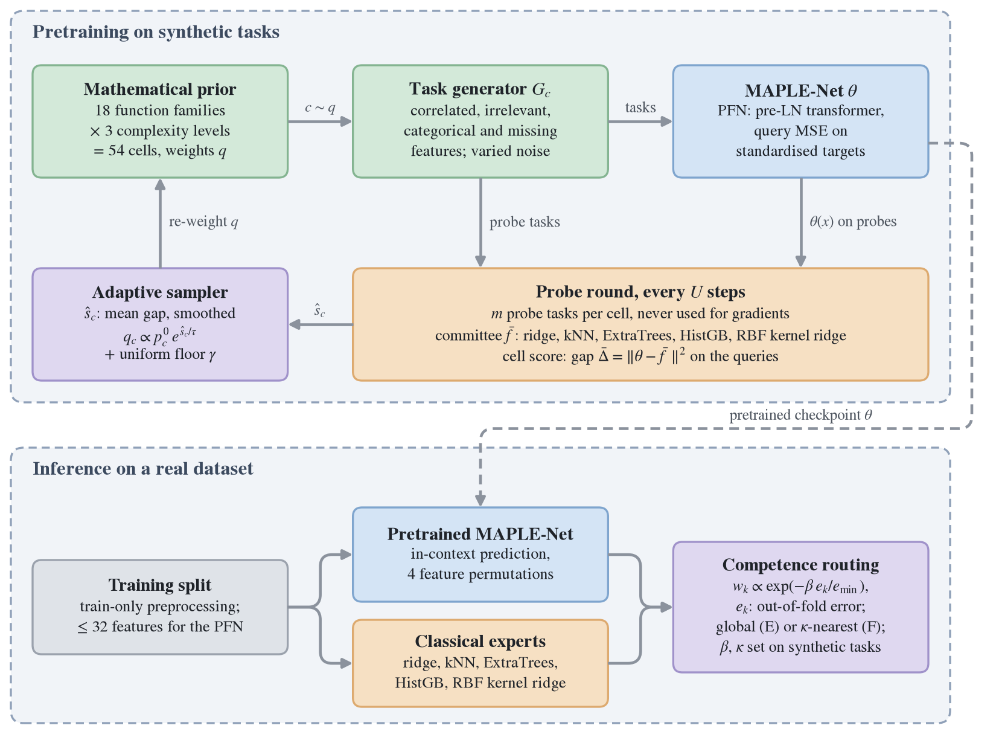
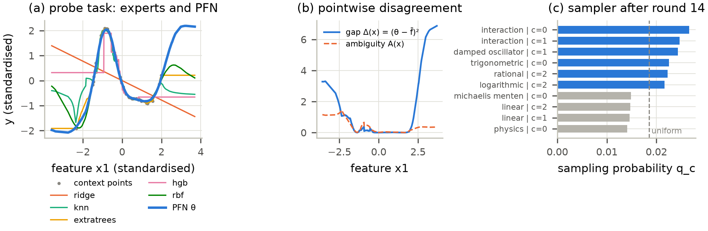
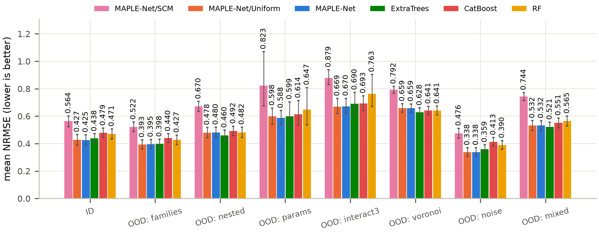
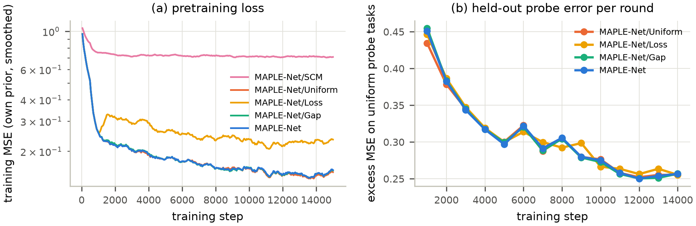
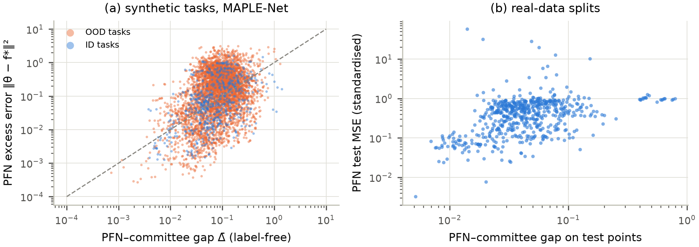
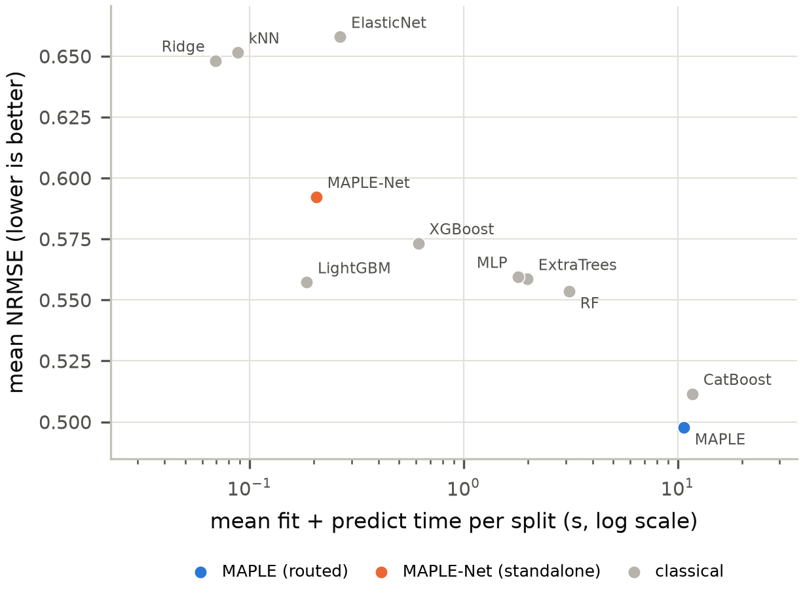
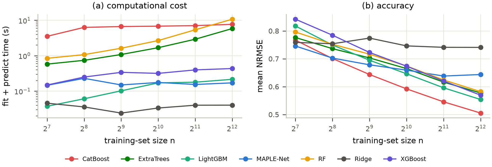

# MAPLE: Disagreement-Guided Prior Adaptation and Competence Routing for Tabular Regression

**Mohamed A. Mahdi**  
Information and Computer Science Department, College of Computer Science and Engineering, University of Ha’il, Ha’il, 55476, Saudi Arabia  
m.mahdi@uoh.edu.sa

**Mohammed Gamal Ragab**  
Department of Computing, Universiti Teknologi PETRONAS, Seri Iskandar, 32610, Perak, Malaysia  
mohammed.ragab@utp.edu.my

**Ayed Alwadain**  
Department of Software Engineering, College of Computer and Information Sciences, King Saud University, Riyadh, Saudi Arabia  
aalwadain@ksu.edu.sa

**Amgad Muneer**  
The University of Texas MD Anderson Cancer Center  
muneeramgad@gmail.com

**Abstract:** Prior-data fitted networks (PFNs) learn from synthetic tasks, making their generalization critically dependent on the underlying pretraining prior. However, whether dynamically adapting this prior improves predictive performance under fixed computational budgets remains unclear. We introduce MAPLE, a framework for adaptive mathematical prior sampling guided by label-free disagreement between a PFN and a committee of classical regressors. MAPLE organizes 18 mathematical function families into 54 task cells and employs a Kullback–Leibler-regularized sampler with theoretical guarantees of non-collapse, stability, finite-sample accuracy, and bounded prior distortion. A competence-based routing mechanism further combines PFN and expert predictions at inference. We evaluated MAPLE on 36 real-world regression datasets across three training-set sizes and eight synthetic benchmark suites under matched pretraining budgets. Contrary to the central hypothesis, adaptive sampling did not improve over a uniform mathematical prior (pooled out-of-distribution difference: 0.1%; Holm-adjusted p = 0.357), primarily because disagreement scores provided insufficient separation between task cells. Although mathematical priors reduced synthetic out-of-distribution error by 25% relative to a structural-causal-model prior, this improvement did not translate to real-world datasets. Competence routing consistently improved performance over the standalone PFN and outperformed tuned CatBoost with 128 training samples (Holm-adjusted p = 0.002). At larger sample sizes, classical expert stacking achieved comparable or better performance. These findings establish theoretical and empirical boundaries for disagreement-guided prior adaptation and demonstrate that pretraining scale, prior complexity, and expert integration are more consequential than adaptive reweighting within the investigated computational regime.

**Keywords:** prior-data fitted networks; tabular regression; synthetic pretraining; adaptive sampling; expert disagreement; distributionally robust optimisation; mathematical priors; out-of-distribution generalisation

## 1. Introduction

Tabular regression is one of the most common modelling problems in science and engineering. Most such datasets are
small to medium-sized, heterogeneous and noisy, and gradient-boosted trees remain the default
[@grinsztajn2022why; @mcelfresh2023when]. Prior-data fitted networks (PFNs) offer an alternative. A transformer is
pretrained once on millions of synthetic datasets drawn from a prior, then predicts on a new dataset in a single
forward pass, approximating Bayesian posterior prediction under that prior [@muller2022transformers;
@hollmann2023tabpfn]. Because a PFN can only be as good as its prior
[@nagler2023statistical], much recent progress has come from designing priors: structural causal models, forest
priors and curated mixtures of priors [@breejen2024fine; @zhang2025mitra].

In current practice the prior is fixed before training, or improved by an outer loop that retrains the whole model
for each candidate prior [@zhang2025mitra]. Each outer iteration
costs a full pretraining run, and within a run every region of the prior receives training effort in fixed
proportions, whether or not the model has already learned it. We ask whether the prior can instead be re-weighted
during pretraining, towards the parts the model has not yet learned, at little extra cost.

Two ingredients are needed: a prior whose parts are meaningful and can be re-weighted, and a signal that says which
parts are under-learned. For the first, we use mathematical priors. Interpretable families of functions, such as
polynomial, exponential, saturating, oscillatory, piecewise and ODE-generated relationships, are organised into
cells (family × complexity). For the second, the training loss is the obvious candidate, but its expectation
contains the irreducible noise variance additively (Proposition 4), so a loss-driven sampler can chase noise. We
use instead the disagreement between the PFN and a committee of cheap classical experts fitted on the same context.
This signal needs no labels at the query points, contains no additive noise term, and tracks the PFN's excess error
whenever the committee is the more accurate party.

Our hypothesis is that adaptive mathematical task generation guided by this disagreement yields a computationally
efficient tabular regressor that generalises better to unseen datasets than conventional synthetic pretraining,
ensembles and individual models. We test it at equal pretraining compute, with research questions and statistical
tests fixed before the main experiments, and we report the outcome in full: the adaptive sampler did not improve
accuracy, and the paper analyses why.

The paper makes five contributions.

1. A disagreement-steered adaptive sampler for PFN pretraining over a cell-structured mathematical prior. The
   sampler is the closed-form solution of a KL-regularised objective (equivalently, a KL-ball distributionally robust
   problem over the task prior) with a uniform floor. It is paired with competence routing between the PFN and
   classical experts at inference, whose two hyperparameters are chosen on synthetic tasks only.
2. An analysis of the sampler: it cannot collapse, is Lipschitz-stable in the cell scores, is estimated to accuracy
   $O(B\tau^{-1}\sqrt{\log(M/\delta)/m})$ from $m$ probe tasks per cell, and distorts the base prior by a bounded
   amount. We also characterise exactly when label-free disagreement tracks excess error (Propositions 1–5,
   Theorem 1).
3. A configurable generator of 18 mathematical and scientific function families with correlated, irrelevant,
   redundant, categorical and missing features and heteroscedastic noise, together with seven out-of-distribution
   test suites, each of which changes one structural aspect of the tasks relative to training (function families,
   composition, parameter range, interaction order, partition, noise law or regime mixing).
4. A controlled empirical study on 36 public regression datasets at three
   training-set sizes and eight synthetic suites, with classical and tuned baselines, three pretraining seeds for
   the main variants, and ablation and sensitivity analyses.
5. An open, restartable pipeline that regenerates every table, figure and number in this paper from append-only raw
   records.

Section 2 reviews related work. Section 3 presents the MAPLE framework and Section 4 its theoretical analysis.
Section 5 describes the experimental protocol, and Section 6 reports the results, including ablations. Section 7
discusses the findings and their limitations, and Section 8 concludes.

## 2. Related Work

**Prior-data fitted networks and tabular foundation models.** A prior-data fitted network (PFN) is trained on
datasets sampled from a prior over data-generating mechanisms. It learns to approximate the posterior predictive
distribution in a single forward pass [@muller2022transformers]. TabPFN applied this idea to small tabular
classification problems with structural-causal-model and Bayesian-neural-network priors [@hollmann2023tabpfn].
TabDPT pretrains on real tables [@ma2024tabdpt]. A
statistical analysis attributes PFN bias to the prior and PFN variance to the context size [@nagler2023statistical].
Several studies show that the choice of prior governs generalisation. Forest-generated tasks improve in-context
classifiers [@breejen2024fine], drift-aware priors handle temporal shift [@helli2024drift], and Mitra builds a
curated mixture of synthetic priors chosen for diversity, distinctiveness and real-data performance
[@zhang2025mitra]. PFNs trained on parametric mathematical priors also exist for Bayesian optimisation and
learning-curve extrapolation [@muller2023pfns4bo; @adriaensen2023efficient]. Across this literature the prior is
fixed, or chosen by an outer loop over complete training runs (calibration, configuration search, mixture
selection). Our review of 125 references found no method that re-weights a
PFN's prior *within* a single pretraining run; this is a bounded search, not proof of absence.

**In-context learning of function classes.** Transformers trained on linear, sparse, tree and network function
classes learn to regress in context [@garg2022what]. Above a threshold of pretraining task diversity, they
generalise beyond the pretraining tasks [@raventos2023pretraining]. Mechanistic analyses link in-context regression
to ridge regression and gradient descent [@akyurek2023what; @vonoswald2023transformers]. Amortised regressors such
as (conditional) neural processes share this set-based formulation [@garnelo2018neural; @garnelo2018conditional;
@zaheer2017deep; @lee2019set].

**Tabular learning.** Gradient-boosted decision trees remain strong defaults [@chen2016xgboost; @ke2017lightgbm;
@prokhorenkova2018catboost; @friedman2001greedy], as do bagged and randomised forests [@breiman2001random;
@geurts2006extremely]. Deep tabular models include FT-Transformer [@gorishniy2021revisiting], SAINT
[@somepalli2021saint], NODE [@popov2020neural], TabM [@gorishniy2025tabm] and strong default MLPs
[@holzmuller2024better]. Large benchmarks find that trees still win on typical medium-sized data
[@grinsztajn2022why; @shwartzziv2022tabular] and that the best model depends on the dataset [@mcelfresh2023when].

**Adaptive task selection, curricula and robust objectives.** Curriculum learning orders training data by
difficulty [@bengio2009curriculum]. Automated curricula pose task selection as a non-stationary bandit, with
learning-progress rewards [@graves2017automated; @matiisen2020teacher; @portelas2020automatic]. In reinforcement
learning, unsupervised environment design generates training environments from regret
[@dennis2020emergent; @parkerholder2022evolving] or replays them by temporal-difference error
[@jiang2021prioritized]; related work learns simulator randomisation [@tobin2017domain; @mehta2020active]. The
closest use of *disagreement* is value-disagreement sampling, which proposes goals where an ensemble of value
functions disagrees [@zhang2020automatic]. In meta-learning, episodes are sampled by difficulty
[@liu2020adaptive; @arnold2021uniform], by novelty [@kaddour2020probabilistic] or by a minimax objective over tasks
[@collins2020task]. In robust optimisation, distributionally robust learning over divergence balls
[@bental2013robust; @namkoong2016stochastic; @duchi2021learning] and Group DRO's exponentiated-gradient group weights
[@sagawa2020distributionally] are the closest analogues of MAPLE's sampler. These methods use labelled losses or
returns, and they do not target the prior of a tabular in-context learner.

**Disagreement, ensembles and routing.** Query-by-committee selects points on which a committee disagrees
[@seung1992query; @burbidge2007active]. The ambiguity decomposition relates ensemble error to member disagreement
[@krogh1995neural], and ensembles estimate epistemic uncertainty [@lakshminarayanan2017simple;
@hullermeier2021aleatoric]. Combining experts is done by learned gating [@jacobs1991adaptive; @jordan1994hierarchical],
by stacking [@wolpert1992stacked; @breiman1996stacked], or by dynamic selection based on local competence
[@woods1997combination; @ko2008from; @cruz2018dynamic].

**Equation priors.** Symbolic and physics-inspired regression [@schmidt2009distilling; @udrescu2020ai;
@lacava2021contemporary] and transformers pretrained on generated equations [@lample2020deep; @biggio2021neural;
@kamienny2022end] show both the value of mathematical priors and the sensitivity of pretrained models to the
generator's distribution. Physics-informed learning [@raissi2019physics; @karniadakis2021physics] instead imposes
known equations as constraints. MAPLE uses scientific relationships only as a distribution over regression tasks.

**Table 1.** Positioning of MAPLE relative to the closest prior work (literature assessment, not an experimental result).

| work | synthetic ICL pretraining | math/scientific families | online | label-free | committee | diversity floor | guarantees | tabular regression |
|---|---|---|---|---|---|---|---|---|
| TabPFN | ✓ | ✗ | ✗ | – | ✗ | – | – | ✗ |
| Mitra | ✓ | ~ | ✗ (offline mixture) | – | ✗ | ~ | ✗ | ✓ |
| Garg et al. 2022 | ✓ | ~ | ✗ (fixed schedule) | – | ✗ | – | ✗ | ✓ |
| Bandit ACL (Graves et al.) | ✗ | ✗ | ✓ | ✗ | ✗ | ~ | ✓ | ✗ |
| PLR / PAIRED | ✗ | ✗ | ✓ | ✗ | ✗ | ~ | ~ | ✗ |
| Value-disagreement sampling | ✗ | ✗ | ✓ | ✓ | ~ | ✗ | ✗ | ✗ |
| Adaptive task sampling / TR-MAML | ✗ | ✗ | ✓ | ✗ | ✗ | ✗ | ~ | ✗ |
| Group DRO | ✗ | ✗ | ✓ | ✗ | ✗ | ✗ | ✓ | ✗ |
| Query-by-committee | ✗ | ✗ | ✓ (points) | ✓ | ✓ | ✗ | ✓ | ✗ |
| MAPLE (this work) | ✓ | ✓ | ✓ | ✓ | ✓ | ✓ | ✓ | ✓ |

✓ = has the property; ~ = partially; ✗ = does not. Columns: online = task distribution adapted within one training run; label-free = adaptation signal needs no target values; committee = signal from heterogeneous classical learners; guarantees = stability/concentration results for the sampler.

Table 1 summarises the position of this work. MAPLE combines and transfers existing mechanisms
(online re-weighting, label-free committee disagreement and synthetic in-context pretraining) to the design of a
PFN prior, and analyses the resulting sampler. It does not introduce a new primitive.

## 3. The MAPLE Framework

MAPLE (mathematical adaptive prior learning) has three parts: a cell-structured generator of mathematical regression
tasks (Section 3.2), a PFN pretrained on those tasks while a sampler re-weights the cells by expert disagreement
(Sections 3.3 and 3.4), and a router that combines the PFN with classical experts at inference (Section 3.5).
Figure 1 shows the whole pipeline.

**Figure 1.** The MAPLE framework. Top: pretraining uses synthetic tasks only. Cells $c$ are drawn from the sampling distribution $q$ and turned into training tasks by the generator $G_c$. Every $U$ steps, fresh probe tasks from each cell are scored by the gap between the PFN and a committee of classical experts, and $q$ is re-weighted towards cells with larger gaps. Bottom: on a real dataset, the pretrained MAPLE-Net and the same five experts are fitted on the training split and combined by competence routing, whose two hyperparameters are chosen on synthetic tasks.

### 3.1 Problem setting and notation

A regression task consists of a context set $D_{\mathrm{ctx}}=\{(x_i,y_i)\}_{i=1}^{n}$ and query inputs
$X_{\mathrm{qry}}$, with $x\in\mathbb{R}^{d}$ and $y=f^{*}(x)+\varepsilon$, where $\mathbb{E}[\varepsilon\mid x]=0$ and
$\operatorname{Var}(\varepsilon\mid x)=\sigma^{2}(x)$. For a function $g$ of $x$ we write
$\|g\|^{2}=\mathbb{E}_{x\sim P_x}[g(x)^{2}]$ for the squared $L^{2}(P_x)$ norm over the query distribution. For a
vector $v$, $\operatorname{osc}(v)=\max_c v_c-\min_c v_c$. A prior over tasks is a distribution $G$ from which tasks
are drawn. A PFN $\theta$ is trained by minimising the expected query loss over $G$. With squared loss, the
minimiser is the posterior predictive mean $\mathbb{E}[y\mid x, D_{\mathrm{ctx}}]$ under $G$ [@muller2022transformers].
Because $\mathbb{E}[\varepsilon\mid x]=0$, the same minimiser is obtained by regressing on the noise-free target
$f^{*}$, which we use to reduce gradient variance.

*Cells and the task prior.* The mathematical prior is organised into $M$ cells $c=(\text{family},\text{complexity})$.
Each cell has a fixed task generator $G_c$. A distribution $q\in\Delta_M$ over cells induces the mixture prior
$G_q=\sum_c q_c G_c$, and $p^{0}=u$ is the uniform base distribution. The cell risk of $\theta$ is
$R_c(\theta)=\mathbb{E}_{T\sim G_c}\,\ell(\theta;T)$, where $\ell$ is the query mean squared error.

*Experts and disagreement.* A committee of $K$ classical regressors $f_1,\dots,f_K$ is fitted on each context, with
mean $\bar f$. We consider the committee variance (ambiguity) $A(x)=\frac1K\sum_k (f_k(x)-\bar f(x))^2$, the pairwise
disagreement $\frac{2}{K(K-1)}\sum_{i<j}|f_i(x)-f_j(x)|$ and, as MAPLE's default, the PFN–committee gap

$$
\Delta(x)=\bigl(\theta(x)-\bar f(x)\bigr)^{2},\qquad \bar\Delta=\|\theta-\bar f\|^{2}.
$$

All tasks are standardised by the context targets, so these quantities are already normalised by $\sigma_y$.

### 3.2 Mathematical task generator

Table 2 lists the 18 training families and the held-out structures. The training families
are: linear, sparse multivariate polynomials with interactions, exponential growth/decay, logarithmic, power laws,
rational functions and Lorentzian peaks, trigonometric sums, Gaussian radial-basis bumps, logistic and
Michaelis–Menten saturation, hinge (piecewise-linear) growth, physical laws (inverse-square, kinetic-plus-potential
energy, multiplicative), a damped oscillator, the closed-form logistic ODE solution, Lotka–Volterra dynamics
[@volterra1926fluctuations] integrated with fourth-order Runge–Kutta, hard two-regime switches, pairwise interactions and step
discontinuities. Each family has three complexity levels that control the number of active features, terms,
frequencies and interaction order, giving $M$ = 54 cells. A task combines a primary component from the
cell's family with up to two additive components from other families, each acting on random feature subsets.

**Table 2.** Mathematical task generator: function families, splits and sampling.

| family | split | description | cells | mean attempts | final q (MAPLE-Net) | uniform q |
|---|---|---|---|---|---|---|
| linear | train | w^T x + b | 3 | 1 | 0.0472 | 0.0556 |
| polynomial | train | sparse multivariate polynomial with interactions | 3 | 1.03 | 0.0583 | 0.0556 |
| exponential | train | sum a exp(b z): growth and decay | 3 | 1.03 | 0.0529 | 0.0556 |
| logarithmic | train | sum a log(u), u in (eps, hi) | 3 | 1.13 | 0.0548 | 0.0556 |
| power_law | train | a prod u_j^p_j | 3 | 1 | 0.0532 | 0.0556 |
| rational | train | (a z1 + b)/(1 + c z2^2) or Lorentzian peaks | 3 | 1 | 0.0584 | 0.0556 |
| trigonometric | train | sum a sin/cos(omega z + phi) | 3 | 1 | 0.0571 | 0.0556 |
| rbf | train | sum of Gaussian bumps | 3 | 1.03 | 0.0564 | 0.0556 |
| logistic | train | L/(1+exp(-k(z-z0))) | 3 | 1.07 | 0.0543 | 0.0556 |
| michaelis_menten | train | Vmax u/(Km+u) | 3 | 1 | 0.0509 | 0.0556 |
| piecewise | train | hinge (piecewise-linear growth) | 3 | 1.03 | 0.054 | 0.0556 |
| physics | train | inverse-square / energy / multiplicative laws | 3 | 1.07 | 0.0516 | 0.0556 |
| damped_oscillator | train | A exp(-zeta omega t) cos(omega_d t + phi) | 3 | 1.07 | 0.0661 | 0.0556 |
| logistic_ode | train | closed-form logistic ODE N(t) | 3 | 1.07 | 0.0529 | 0.0556 |
| lotka_volterra | train | RK4 predator-prey, prey at time T | 3 | 1.03 | 0.0609 | 0.0556 |
| conditional | train | hard two-regime switch on one feature | 3 | 1.07 | 0.0554 | 0.0556 |
| interaction | train | pairwise products of g(x_i) g(x_k) | 3 | 1.03 | 0.0631 | 0.0556 |
| discontinuous | train | linear trend plus step jumps | 3 | 1.03 | 0.0526 | 0.0556 |
| gompertz | ood | a exp(-b exp(-k z)) | 3 | 1 | – | – |
| sir | ood | RK4 SIR model, infected fraction at time T | 3 | 1.07 | – | – |
| hyperbolic | ood | a sinh(b z1)/cosh(c z2) (+ cosh term) | 3 | 1.1 | – | – |
| interaction3 | ood_structure | three-way products | 3 | 1.1 | – | – |
| voronoi | ood_structure | piecewise-linear on Voronoi regions | 3 | 1 | – | – |
| mixed_regime | ood_structure | softmax-gated mixture of regimes | 3 | 1.03 | – | – |

Split: train = available to pretraining; ood = held-out family; ood_structure = structure used only by OOD suites. Mean attempts = generator draws per valid task (validity checks). Final q = probability mass of the family in MAPLE-Net's final sampling distribution (mean over 3 seeds), versus 1/18 uniform.

Features are drawn through a Gaussian copula with a random low-rank correlation matrix, mixed marginals (normal,
uniform, log-normal, bimodal, heavy-tailed), irrelevant and redundant columns, ordinal or nominal categorical codes
and MCAR missingness. Noise is homoscedastic or heteroscedastic Gaussian, with a relative level between 0.01 and 1.
Every task passes validity checks (finite values, non-constant target, bounded range, context-standardised targets
within $\pm12$ standard deviations); otherwise it is resampled (Figure 2). Generation costs
about 5 ms per task (17 ms for the ODE families).

**Figure 2.** Mathematical task generator. Top left: the training families, grouped by type. Top right: function families and structures that are never used for pretraining and appear only in the out-of-distribution (OOD) suites; nested compositions and Student-$t$ or Laplace noise are likewise OOD-only. Bottom: assembly of one task for a cell; a task that fails either validity check is discarded and generated again.

### 3.3 Prior-data fitted network

The PFN embeds each context point as $W_x\tilde x+W_y y$ and each query point as $W_x\tilde x+e_{\mathrm{qry}}$, where
$\tilde x$ is $x$ zero-padded to $d_{\max}=32$ and rescaled by $\sqrt{d_{\max}/d}$. A stack of pre-LN transformer
blocks [@vaswani2017attention; @xiong2020layer] follows, in which every token attends only to context tokens. Query
predictions are therefore independent of one another and invariant to the order of the context points, and no
positional encodings are used. A two-layer head outputs the prediction. Section 5.4 lists the architecture and
training settings.

### 3.4 Disagreement-steered adaptive sampling

Every $U$ steps, MAPLE draws $m$ fresh probe tasks per cell and fits the committee to each probe context. The
committee's predictions do not depend on $\theta$, so CPU workers compute them asynchronously, and the round itself
needs only a PFN forward pass. MAPLE then evaluates a per-task score $Y\in[0,B]$ (the clipped mean of the chosen
disagreement, or the PFN loss for the loss-based variant), averages it into cell scores $\hat s_c$, smooths them with
an exponential moving average of factor $\lambda$, and sets

$$
q(\hat s)=(1-\gamma)\,\mathrm{Gibbs}(p^{0},\hat s/\tau)+\gamma\,u,\qquad \mathrm{Gibbs}(p^{0},s/\tau)_c=\frac{p^{0}_c e^{s_c/\tau}}{\sum_{c'}p^{0}_{c'}e^{s_{c'}/\tau}}.
$$

Training batches draw their cells from the current $q$. Probe tasks never enter gradient updates, and their random
streams are disjoint from the training and evaluation streams. Figure 3 illustrates
the mechanism on a real probe task.

**Figure 3.** Mechanism on a real probe task (trigonometric family, complexity 0) with the pretrained MAPLE-Net checkpoint (seed 0). (a) Context points, committee predictions and the PFN prediction along the active feature. (b) Pointwise PFN–committee gap and committee ambiguity. (c) The six most and four least probable cells in MAPLE-Net's final logged sampling distribution; dashed line: uniform.

### 3.5 Expert routing at inference

On a real dataset, the training split is preprocessed using training rows only. The PFN predicts in context,
averaging four feature permutations; for training sets larger than 1024 rows, it also averages over random
1024-row contexts. Datasets with more than 32 features are reduced to 32 by mutual information estimated on the
training rows [@kraskov2004estimating]. Five classical experts (ridge, $k$NN, ExtraTrees, histogram gradient
boosting, RBF kernel ridge) are fitted alongside. Out-of-fold squared errors $e_k$ from 5-fold cross-validation on
the training split measure each predictor's competence. Global routing (MAPLE-Global) uses weights
$w_k\propto\exp(-\beta\,e_k/\min_j e_j)$. Local routing (MAPLE, the full framework) uses the same formula with
$e_k$ replaced by the mean out-of-fold error over the $\kappa$ training points nearest to the query, a regression
analogue of dynamic ensemble selection [@woods1997combination; @ko2008from]. $\beta$ and $\kappa$ are chosen by grid
search on 150 synthetic tasks drawn from the checkpoint's final learned prior, never on real data.

### 3.6 Variants

The seven variants share the same transformer architecture, number of pretraining steps and token budget.
MAPLE-Net/SCM (P0) uses a TabPFN-v1-style random-MLP/SCM prior [@hollmann2023tabpfn], and MAPLE-Net/Uniform (A)
uses a uniform mathematical prior. MAPLE-Net/Loss (B) and MAPLE-Net/Gap (C) re-weight the mathematical prior by
the label-based loss and the label-free gap, respectively. Both use a sampling floor of zero. The default network,
MAPLE-Net (D), uses the gap score with a floor of $\gamma=0.1$.

The two routed variants combine MAPLE-Net with the same classical experts. MAPLE-Global (E) uses global routing,
while MAPLE (F) uses local routing.

## 4. Theoretical Analysis

This section states what can be proved about the sampler of Section 3.4 for a fixed PFN: what objective it solves,
how far it can move from the base prior, how stable and how accurately estimated it is, and when its label-free
score measures the PFN's excess error. Appendix A gives the proofs, and the test suite checks each statement
numerically. Section 4.4 lists open questions about the coupled dynamics of the sampler and network.

### 4.1 Variational characterisation and robustness

**Proposition 1 (Gibbs variational principle).** For $p^{0}$ with full support, $s\in\mathbb{R}^{M}$ and $\tau>0$, the
problem $\max_{q\in\Delta_M}\langle q,s\rangle-\tau\,\mathrm{KL}(q\|p^{0})$ has the unique solution
$q^{*}=\mathrm{Gibbs}(p^{0},s/\tau)$, with optimal value $\tau\log\sum_c p^{0}_c e^{s_c/\tau}$. Moreover, for $\rho>0$ and
non-constant $s$ with $\rho<\log(1/p^{0}(\arg\max s))$, every maximiser of $\langle q,s\rangle$ over the KL ball
$\{q:\mathrm{KL}(q\|p^{0})\le\rho\}$ is a Gibbs distribution for some finite $\tau(\rho)$ [@donsker1975asymptotic;
@bental2013robust].

With the loss score $s_c=R_c(\theta)$, alternating Proposition 1 with gradient steps is a KL-smoothed form of
distributionally robust optimisation over the task prior, related to Group DRO [@sagawa2020distributionally]. With
the gap score, the same update tilts the prior towards cells where the PFN and the committee disagree.

### 4.2 No collapse, stability and finite-sample accuracy

**Proposition 2 (no collapse, bounded tilt).** For $p^{0}=u$: $q_c\ge\gamma/M$;
$q^{*}_a/q^{*}_b\le e^{\operatorname{osc}(s)/\tau}$; and $\mathrm{KL}(q\|u)\le(1-\gamma)\operatorname{osc}(s)/\tau$.

**Proposition 3 (stability).** For all $s,s'$:
$\|q(s)-q(s')\|_1\le(1-\gamma)\operatorname{osc}(s-s')/(2\tau)\le(1-\gamma)\|s-s'\|_\infty/\tau$.

*Proof sketch.* Along $s(t)=s+t(s'-s)$, $\dot q_c=\tau^{-1}q_c(v_c-\langle q,v\rangle)$, so $\|\dot q\|_1$ is
$\tau^{-1}$ times the mean absolute deviation of $v$ under $q$. That deviation is at most $\operatorname{osc}(v)/2$, by
Cauchy–Schwarz and Popoviciu's inequality. Integrating over $t\in[0,1]$ gives the bound.

**Theorem 1 (finite-sample accuracy of the sampler).** With $m$ independent probe tasks per cell, scores clipped to
$[0,B]$ and $\theta$ fixed within the round, with probability at least $1-\delta$:

$$
\max_c|\hat s_c-s_c|\le B\sqrt{\frac{\log(2M/\delta)}{2m}},\qquad
\|q(\hat s)-q(s)\|_1\le\frac{(1-\gamma)B}{\tau}\sqrt{\frac{\log(2M/\delta)}{2m}}.
$$

*Proof.* Apply Hoeffding's inequality [@hoeffding1963probability] to each cell, take a union bound over the $M$
cells, and apply Proposition 3. With an exponential moving average of factor $\lambda$ and stationary scores, $m$ can
be replaced by $m(1+\lambda)/(1-\lambda)$.

**Proposition 5 (bounded distortion of the base prior).** If $0\le\ell\le L$, then
$|\mathbb{E}_{G_q}\ell-\mathbb{E}_{G_u}\ell|\le L\,\mathrm{TV}(q,u)\le L\sqrt{(1-\gamma)\operatorname{osc}(s)/(2\tau)}$.

Propositions 2, 3 and 5 together say that the sampler moves away from the uniform prior only in proportion to the
range of its scores divided by the temperature. A small score range therefore keeps it close to uniform, which is
what we observe in Section 6.3.

### 4.3 When disagreement tracks excess error

**Proposition 4 (disagreement and error).** If $\theta,f_1,\dots,f_K$ depend only on the context and the query noise is
independent of it, then (a) $\mathbb{E}(\theta-y)^2=\|\theta-f^{*}\|^2+\mathbb{E}\sigma^2(x)$; (b)
$|\sqrt{\bar\Delta}-\|\theta-f^{*}\||\le\|\bar f-f^{*}\|$, so if $\|\bar f-f^{*}\|\le\eta\|\theta-f^{*}\|$ with
$\eta<1$, then $(1-\eta)^2\|\theta-f^{*}\|^2\le\bar\Delta\le(1+\eta)^2\|\theta-f^{*}\|^2$; (c) the ambiguity
decomposition $(\bar f-y)^2=\frac1K\sum_k(f_k-y)^2-A$ holds pointwise [@krogh1995neural]; and (d) by (a), the
difference of test MSEs $\mathbb{E}(\theta-y)^2-\mathbb{E}(\bar f-y)^2=\|\theta-f^{*}\|^2-\|\bar f-f^{*}\|^2$ contains no
noise term.

Part (a) shows that a loss-based score contains the irreducible noise additively. Part (b) shows that the label-free
gap tracks the PFN's excess error whenever the committee is more accurate than the PFN. When the committee is worse
($\eta\ge1$), $\bar\Delta$ also measures the committee's own error, a failure mode known from query-by-committee
[@burbidge2007active] that Section 6.3 tests empirically. Part (d) gives a label-computable proxy for the difference
of excess errors, which we use on real data, where $f^{*}$ is unknown.

### 4.4 Cost and open questions

One adaptation round costs $M m(C_{\mathrm{PFN}}+\sum_k C_{\mathrm{fit},k})$. One PFN forward pass costs
$O(L[(n^2+n\,n_q)d_m+(n+n_q)d_m^2])$, with no $n_q^2$ term because queries do not attend to each other.

Three conjectures remain unproved. (C1) When the sampler adapts slowly relative to the PFN, $q_t$ tracks the
KL-regularised robust solution for the current $\theta_t$. (C2) Disagreement-based sampling is more robust than
loss-based sampling when noise varies across tasks. (C3) Gains on structural OOD suites transfer to real data only
to the extent that real data resemble the mathematical prior. Section 6 examines C2 and C3 empirically.

## 5. Experimental Setup

### 5.1 Datasets and splits

We use the 35 regression datasets of the curated OpenML-CTR23 suite [@fischer2023openml; @vanschoren2014openml;
@feurer2021openml] and scikit-learn's Diabetes data [@efron2004least] (Table 3). Boston Housing
is excluded because of its ethically problematic feature, and California Housing [@pace1997sparse] is used instead.
Yacht Hydrodynamics is not in the suite and is too small for our protocol. No dataset was removed for being
difficult. For each dataset we subsample training sets of $n_{\mathrm{train}}\in\{128,512,2048\}$ rows, repeated
10, 5 and 3 times respectively. Test sets contain up to 2000
of the remaining rows. A training-set size is used for a dataset only if at least 200 test rows remain, and skipped
combinations are logged. All methods share identical, persisted split indices. Preprocessing, feature selection,
hyperparameter search, routing weights and stacking weights are all fitted on the training split only.

**Table 3.** Benchmark dataset characteristics (OpenML-CTR23 suite and Diabetes).

| dataset | n | numerical | categorical | missing (%) | target mean | target SD | target skew | size class | licence | regimes (n_train) |
|---|---|---|---|---|---|---|---|---|---|---|
| abalone | 4.18e+03 | 7 | 1 | 0 | 9.93 | 3.22 | 1.11 | medium | CC BY 4.0 | 128, 512, 2048 |
| airfoil_self_noise | 1.5e+03 | 5 | 0 | 0 | 125 | 6.9 | -0.419 | small | CC BY 4.0 | 128, 512 |
| auction_verification | 2.04e+03 | 5 | 2 | 0 | 7.34e+03 | 1.04e+04 | 1.5 | medium | CC BY 4.0 | 128, 512 |
| brazilian_houses | 1.07e+04 | 5 | 4 | 0 | 5.49e+03 | 1.65e+04 | 59 | medium | CC 0: Public Domain | 128, 512, 2048 |
| california_housing | 2.06e+04 | 8 | 0 | 0 | 2.07e+05 | 1.15e+05 | 0.978 | large | Public | 128, 512, 2048 |
| cars | 804 | 17 | 0 | 0 | 2.13e+04 | 9.88e+03 | 1.57 | small | Public | 128, 512 |
| concrete_compressive_strength | 1.03e+03 | 8 | 0 | 0 | 35.8 | 16.7 | 0.416 | small | CC BY 4.0 | 128, 512 |
| cps88wages | 2.82e+04 | 2 | 4 | 0 | 604 | 454 | 6.5 | large | Public | 128, 512, 2048 |
| cpu_activity | 8.19e+03 | 21 | 0 | 0 | 84 | 18.4 | -3.42 | medium | Public | 128, 512, 2048 |
| diamonds | 5.39e+04 | 6 | 3 | 0 | 3.93e+03 | 3.99e+03 | 1.62 | large | Public | 128, 512, 2048 |
| energy_efficiency | 768 | 8 | 0 | 0 | 22.3 | 10.1 | 0.36 | small | CC BY 4.0 | 128, 512 |
| fifa | 1.92e+04 | 27 | 1 | 0 | 9.02e+03 | 1.95e+04 | 6.47 | medium | CC0: Public Domain | 128, 512, 2048 |
| forest_fires | 517 | 10 | 2 | 0 | 12.8 | 63.6 | 12.8 | small | CC BY 4.0 | 128 |
| fps_benchmark | 2.46e+04 | 29 | 14 | 6.58 | 124 | 54.6 | 1.05 | large | CC BY | 128, 512, 2048 |
| geographical_origin_of_music | 1.06e+03 | 116 | 0 | 0 | 26.7 | 18.5 | -0.99 | small | CC BY 4.0 | 128, 512 |
| grid_stability | 1e+04 | 12 | 0 | 0 | 0.0157 | 0.0369 | 0.0187 | medium | CC BY 4.0 | 128, 512, 2048 |
| health_insurance | 2.23e+04 | 4 | 7 | 0 | 25.6 | 18.7 | -0.342 | large | GPL (>= 2) | 128, 512, 2048 |
| kin8nm | 8.19e+03 | 8 | 0 | 0 | 0.714 | 0.264 | 0.0903 | medium | Public | 128, 512, 2048 |
| kings_county | 2.16e+04 | 17 | 4 | 0 | 5.4e+05 | 3.67e+05 | 4.02 | large | CC 0: Public Domain | 128, 512, 2048 |
| miami_housing | 1.39e+04 | 15 | 0 | 0 | 4e+05 | 3.17e+05 | 3.22 | medium | CC0: Public Domain | 128, 512, 2048 |
| moneyball | 1.23e+03 | 8 | 6 | 20.9 | 715 | 91.5 | 0.174 | small | Public | 128, 512 |
| naval_propulsion_plant | 1.19e+04 | 14 | 0 | 0 | 0.975 | 0.0147 | -9.12e-17 | medium | CC BY 4.0 | 128, 512, 2048 |
| physiochemical_protein | 4.57e+04 | 9 | 0 | 0 | 7.75 | 6.12 | 0.567 | large | CC BY 4.0 | 128, 512, 2048 |
| pumadyn32nh | 8.19e+03 | 32 | 0 | 0 | -0.000416 | 0.036 | -0.0505 | medium | Public | 128, 512, 2048 |
| qsar_fish_toxicity | 908 | 6 | 0 | 0 | 4.06 | 1.45 | 0.252 | small | CC BY 4.0 | 128, 512 |
| red_wine | 1.6e+03 | 11 | 0 | 0 | 5.64 | 0.807 | 0.218 | small | CC BY 4.0 | 128, 512 |
| sarcos | 4.89e+04 | 21 | 0 | 0 | 13.7 | 20.5 | 0.152 | large | Public | 128, 512, 2048 |
| socmob | 1.16e+03 | 1 | 4 | 0 | 18.2 | 41 | 4.43 | small | Non-commercial scholarly and teaching purposes. | 128, 512 |
| solar_flare | 1.07e+03 | 2 | 8 | 0 | 0.3 | 0.835 | 3.95 | small | CC BY 4.0 | 128, 512 |
| space_ga | 3.11e+03 | 6 | 0 | 0 | -0.576 | 0.198 | -1.02 | medium | Public | 128, 512, 2048 |
| student_performance_por | 649 | 13 | 17 | 0 | 11.9 | 3.23 | -0.911 | small | CC BY 4.0 | 128 |
| superconductivity | 2.13e+04 | 81 | 0 | 0 | 34.4 | 34.3 | 0.86 | large | CC BY 4.0 | 128, 512, 2048 |
| video_transcoding | 6.88e+04 | 16 | 2 | 0 | 10 | 16.1 | 4.25 | large | CC BY 4.0 | 128, 512, 2048 |
| wave_energy | 7.2e+04 | 36 | 0 | 0 | 3.76e+06 | 1.12e+05 | 0.144 | large | CC BY 4.0 | 128, 512, 2048 |
| white_wine | 4.9e+03 | 11 | 0 | 0 | 5.88 | 0.886 | 0.156 | medium | CC BY 4.0 | 128, 512, 2048 |
| diabetes | 442 | 10 | 0 | 0 | 152 | 77 | 0.439 | small | distributed with scikit-learn (BSD-3-Clause) | 128 |

Regimes list the training-set sizes evaluated (a regime is used only if at least 200 test rows remain). Excluded: Boston Housing (ethical concerns), Yacht Hydrodynamics (not in suite; too small).

### 5.2 Baselines

The classical baselines are the mean predictor, ridge, ElasticNet, $k$NN, random forest, ExtraTrees, histogram
gradient boosting, RBF kernel ridge, MLP, XGBoost, LightGBM and CatBoost with library defaults [@hoerl1970ridge;
@zou2005regularization; @breiman2001random; @geurts2006extremely; @chen2016xgboost; @ke2017lightgbm;
@prokhorenkova2018catboost; @pedregosa2011scikit]. XGBoost, LightGBM and CatBoost are also tuned (suffix -T) with a
fixed budget of 10 random configurations evaluated by 3-fold cross-validation on the training split.
CatBoost (default and tuned) one-hot encodes categorical features with at most 255 levels (`one_hot_max_size` = 255)
instead of using its target statistics. This was needed to fit the CPU budget and may weaken CatBoost slightly on
datasets with categorical features. We also report a simple average and a non-negative stacked regression
[@breiman1996stacked] of the five classical experts, and stacking of MAPLE-Net with the experts.

FT-Transformer, SAINT and NODE require per-dataset GPU training and tuning and fall outside the CPU benchmark.

### 5.3 Synthetic evaluation suites

We evaluate on 200 tasks for each of eight suites. The in-distribution (ID) suite draws fresh tasks
from the training cells. The seven structurally out-of-distribution (OOD) suites are: held-out families (Gompertz growth
[@gompertz1825nature], SIR epidemics [@kermack1927contribution] and hyperbolic functions); nested compositions $g(h(x))$, whereas training uses additive compositions only; parameter ranges
stretched $\times2.5$; three-way interactions, whereas training has at most pairwise; piecewise-linear functions on
Voronoi regions; Student-$t$ and Laplace noise; and softmax-gated mixtures of 2–4 regimes. Context sizes, dimensions,
noise and missingness have comparable distributions across suites, so OOD differences reflect structure.

### 5.4 Pretraining

The five standalone networks are each pretrained with three seeds for 15,000 steps on two shared GPUs, using
PyTorch [@paszke2019pytorch] and the AdamW optimiser [@loshchilov2019decoupled]. Ablation and
sensitivity runs use seed 0. Table 4 gives the full configuration.

**Table 4.** Main experimental configuration.

| setting | value |
|---|---|
| PFN architecture | 6 pre-LN layers, width 256, 8 heads, FF 768, d_max 32 |
| PFN parameters | 4,026,369 |
| Pretraining steps | 15,000 (AdamW, lr 0.0003, wd 0.01, warm-up 500, cosine) |
| Batch | token budget 32,768; context n ~ log-U[16, 1024]; d ~ log-U[1, 32]; 128 queries |
| Prior cells | 18 training families × 3 complexity levels = 54 |
| Sampler | τ = 0.2, γ = 0.1 (MAPLE-Net), EMA λ = 0.5, clip B = 4.0 |
| Adaptation | every U = 1000 steps, m = 4 probe tasks/cell, probe n = 128 |
| Committee | ridge, knn, extratrees, hgb, rbf |
| Pretraining seeds | 0, 1, 2 (ablations: seed 0) |
| Real-data regimes | n_train ∈ [128, 512, 2048]; repeats {128: 10, 512: 5, 2048: 3}; test ≤ 2000 rows |
| Routing | 5-fold OOF on training split; β, κ selected on 150 synthetic tasks from the learned prior |
| HPO budget (-T) | 10 random configurations, 3-fold CV on the training split |
| CatBoost categoricals | one-hot for <= 255 levels (one_hot_max_size = 255), default and -T |
| Synthetic evaluation | 200 tasks per suite × 8 suites |
| Statistics | unit = dataset (real) / task (synthetic); Friedman + Nemenyi; Wilcoxon signed-rank with Holm; rank-biserial r; bootstrap 95% CI |

### 5.5 Metrics and statistical protocol

We report RMSE, MAE, $R^2$ and NRMSE = RMSE/SD($y_{\mathrm{test}}$), together with training time, inference time,
peak memory and parameter counts. For real data, the unit of analysis is the dataset: metrics are averaged over
repeats and pretraining seeds before testing, and folds are never treated as independent datasets
[@dietterich1998approximate]. For synthetic suites, the unit is the task. We use the Friedman test with Nemenyi
critical differences [@friedman1937use; @demsar2006statistical]. Following [@benavoli2016should], the primary
pairwise tests are two-sided Wilcoxon signed-rank tests [@wilcoxon1945individual] with Holm correction
[@holm1979simple; @garcia2008extension]. Effect sizes are matched-pairs rank-biserial correlations $r_{rb}$
[@kerby2014simple], and confidence intervals use the bootstrap [@efron1979bootstrap].

Unless stated otherwise, an NRMSE difference in Section 6 is the median relative difference over datasets (real data)
or tasks (synthetic data); "$p_{\mathrm{Holm}}$" is the Holm-adjusted p-value within the test's pre-registered
family. W/L/T counts the wins, losses and ties of the first-named method. We treat median relative differences
below 1% as practically negligible, even when they are statistically significant. We report raw p-values for
exploratory comparisons.

## 6. Results

We first compare all methods on real data (Section 6.1), then test the adaptive prior on the synthetic suites
(Section 6.2), examine why the sampler behaved as it did (Section 6.3), and close with ablations (Section 6.4) and
computational cost (Section 6.5).

### 6.1 Real-data benchmark

Table 5 reports mean NRMSE, mean rank and win counts at the three training-set sizes. It shows
the better MAPLE route at each size, selected by mean NRMSE on the datasets in the table. 36, 33 and 22 datasets
are large enough for $n_{\mathrm{train}}$ = 128, 512 and 2048 respectively (each split keeps at least 200 test
rows).

**Table 5.** Summary of performance across datasets for each training-set size.

| method | mean NRMSE (n=128) | mean NRMSE (n=512) | mean NRMSE (n=2048) | mean rank (n=128) | mean rank (n=512) | mean rank (n=2048) | wins (n=128) | wins (n=512) | wins (n=2048) |
|---|---|---|---|---|---|---|---|---|---|
| Mean | 1.004 | 1.002 | 1.001 | 10.431 | 10.727 | 10.727 | 0 | 0 | 0 |
| Ridge | 0.711 | 0.648 | 0.621 | 5.056 | 7.636 | 8.000 | 3 | 1 | 0 |
| ElasticNet | 0.719 | 0.658 | 0.630 | 5.458 | 7.576 | 8.182 | 4 | 0 | 0 |
| kNN | 0.750 | 0.651 | 0.617 | 8.083 | 8.061 | 8.409 | 0 | 0 | 0 |
| RF | 0.668 | 0.554 | 0.500 | 5.056 | 5.303 | 5.818 | 0 | 0 | 0 |
| ExtraTrees | 0.660 | 0.559 | 0.503 | 4.167 | 4.545 | 4.591 | 5 | 3 | 4 |
| MLP | 0.806 | 0.559 | 0.471 | 7.056 | 5.152 | 3.909 | 0 | 2 | 7 |
| XGBoost | 0.730 | 0.573 | 0.501 | 8.111 | 6.667 | 6.136 | 0 | 1 | 0 |
| LightGBM | 0.717 | 0.557 | 0.493 | 6.917 | 5.545 | 5.045 | 0 | 0 | 0 |
| CatBoost | _0.647_ | _0.511_ | _0.448_ | _3.778_ | _3.030_ | _2.818_ | 6 | 9 | 7 |
| MAPLE (best route) | **0.613** | **0.496** | **0.443** | **1.889** | **1.758** | **2.364** | 18 | 17 | 4 |

Lower is better for NRMSE and rank. Wins count datasets on which the method has the lowest NRMSE. The dataset counts are N = {128: 36, 512: 33, 2048: 22}. The MAPLE row uses the route with the lowest mean NRMSE at each size (128: MAPLE-Global, 512: MAPLE-Global, 2048: MAPLE). Ranks and wins use the displayed methods. Tied methods each receive a win. RF = random forest.

**Overall ranking.** The Friedman test rejects equal performance of the 15 main methods at every size
($\chi^2$ = 243.5, 223.8 and
162.9; all p < 0.001). Figure 4
shows the ranks and Nemenyi critical differences recalculated for the displayed subset. In the full pre-registered
comparison at $n_{\mathrm{train}}$ = 128, global routing (MAPLE-Global) has
the best mean rank (3.11), followed by MAPLE
(3.83) and the stacked classical experts
(4.33). At 512 and 2048 the stacked experts rank first
(2.83 and 3.32),
with MAPLE-Global, MAPLE and tuned CatBoost within one critical difference. The three standalone PFNs rank level with
tuned CatBoost at $n_{\mathrm{train}}$ = 128 (MAPLE-Net: 6.42; CatBoost-T:
6.14) but fall to ranks
9.30 and 11.27 at the
larger sizes.

**Figure 4.** Mean ranks and Nemenyi critical differences for the displayed methods at each training-set size. The ranks and critical differences are calculated within this subset. Rank 1 is the lowest NRMSE. Lines span one critical difference ($\alpha$ = 0.05), and the shaded band covers ranks within one critical difference of the best method.

**Routing versus the PFN alone (RQ5).** Routing the PFN together with the classical experts reduces MAPLE-Net's error
at every size, by a median of 2.3% at $n_{\mathrm{train}}$ = 128
(W/L/T = 27/9/0, $p_{\mathrm{Holm}}$ < 0.001, $r_{rb}$ = 0.70), 8.9% at 512
(W/L/T = 28/5/0, $p_{\mathrm{Holm}}$ < 0.001, $r_{rb}$ = 0.93) and 25.3% at 2048
(W/L/T = 20/2/0, $p_{\mathrm{Holm}}$ < 0.001, $r_{rb}$ = 0.97). The margin grows because the standalone PFN gets worse relative to
the other methods as $n_{\mathrm{train}}$ grows (Section 6.5), not because the router improves. The second half of
H5, that MAPLE is no worse than stacking, does not hold at every size. Against the stacked experts, the median
difference is 0.1% in MAPLE's favour at 128
(W/L/T = 19/17/0, $p_{\mathrm{Holm}}$ = 0.509, $r_{rb}$ = 0.13; not significant), whereas
MAPLE has higher median error at 512 (0.6%;
W/L/T = 12/21/0, $p_{\mathrm{Holm}}$ = 0.053, $r_{rb}$ = -0.44; not significant) and at 2048
(0.7%;
W/L/T = 5/17/0, $p_{\mathrm{Holm}}$ = 0.007, $r_{rb}$ = -0.72; significant). Against
stacking that includes MAPLE-Net, MAPLE has higher median error at 512
(0.8%; W/L/T = 7/26/0, $p_{\mathrm{Holm}}$ = 0.001, $r_{rb}$ = -0.68;
significant). All of these deficits are below the 1% threshold we set for
practical relevance. Local routing did not improve on global routing: at $n_{\mathrm{train}}$ = 128, MAPLE-Global had
0.3% lower median error than MAPLE
(W/L/T = 27/9/0, $p_{\mathrm{Holm}}$ = 0.050, $r_{rb}$ = 0.45; not significant), and the
difference was not significant at the larger sizes either.

**Does the PFN add information to the experts?** In an exploratory comparison, stacking with MAPLE-Net had lower error
than stacking the experts alone at $n_{\mathrm{train}}$ = 128
(W/L/T = 23/13/0, raw p = 0.003, $r_{rb}$ = 0.55), but not at 512
(W/L/T = 15/12/6, raw p = 0.216, $r_{rb}$ = 0.27) or 2048
(W/L/T = 7/9/6, raw p = 0.756, $r_{rb}$ = -0.09). At the larger sizes the two stackers produced
identical errors on 6 and
6 datasets respectively, which is what happens when the
non-negative stacker gives MAPLE-Net zero weight.

**Comparison with tuned gradient boosting (RQ6, exploratory).** At $n_{\mathrm{train}}$ = 128, MAPLE reduced the
median error of tuned CatBoost by 2.3%
(W/L/T = 29/7/0, $p_{\mathrm{Holm}}$ = 0.002, $r_{rb}$ = 0.58), of tuned XGBoost by 5.6%
(W/L/T = 33/3/0, $p_{\mathrm{Holm}}$ < 0.001, $r_{rb}$ = 0.83) and of tuned LightGBM by
8.9% (W/L/T = 34/2/0, $p_{\mathrm{Holm}}$ < 0.001, $r_{rb}$ = 0.95). At 512 the
difference to tuned CatBoost is not significant
(1.5% in MAPLE's favour; W/L/T = 22/11/0, $p_{\mathrm{Holm}}$ = 0.171, $r_{rb}$ = 0.28),
and at 2048 tuned CatBoost has the lower median error
(1.0%;
W/L/T = 12/10/0, $p_{\mathrm{Holm}}$ = 1.000, $r_{rb}$ = 0.14; not significant).

**Per-dataset results.** Figure 5 shows NRMSE per dataset at $n_{\mathrm{train}}$ = 512.
MAPLE was more accurate than all classical baselines included in the benchmark summary on 19 of
36 datasets at 128, 17 of
33 at 512 and 4 of 22
at 2048. The standalone PFN failed on a few datasets: on naval propulsion plant its NRMSE was
0.99 at $n_{\mathrm{train}}$ = 512, no better
than predicting the training mean, whereas tuned CatBoost reached
0.23 and MAPLE
0.20. This is consistent with the router
down-weighting the PFN where its out-of-fold error is large. We did not diagnose the PFN failures further.

**Figure 5.** Per-dataset NRMSE for MAPLE, CatBoost and ExtraTrees at n_train = 512. Values are averaged over split repeats and, for MAPLE, over three pretraining seeds. Grey segments span the range across the three methods. Lower is better.

### 6.2 Synthetic generalisation and the adaptive prior

Table 6 and Figure 6 report mean NRMSE on the ID suite and the
seven OOD suites. The mathematical-prior PFNs have the lowest mean NRMSE on the ID suite (MAPLE-Net: 0.425; ExtraTrees: 0.438; CatBoost:
0.479). Averaged over the OOD suites they are level with ExtraTrees (MAPLE-Net:
0.523; ExtraTrees: 0.522). ExtraTrees is better on
nested compositions, Voronoi regions and regime mixtures, whereas the PFNs are better on held-out families,
stretched parameters, three-way interactions and heavy-tailed noise.

**Table 6.** In-distribution versus out-of-distribution generalisation on synthetic task suites (mean NRMSE).

| suite | Ridge | kNN | RF | ExtraTrees | CatBoost | XGBoost | MAPLE-Net/SCM | MAPLE-Net/Uniform | MAPLE-Net/Loss | MAPLE-Net/Gap | MAPLE-Net |
|---|---|---|---|---|---|---|---|---|---|---|---|
| id | 0.649 | 0.695 | 0.471 | 0.438 | 0.479 | 0.508 | 0.564 | 0.427 | 0.426 | **0.425** | _0.425_ |
| ood_families | 0.595 | 0.669 | 0.427 | 0.398 | 0.440 | 0.448 | 0.522 | _0.393_ | 0.399 | **0.392** | 0.395 |
| ood_nested | 0.776 | 0.744 | 0.482 | **0.460** | 0.492 | 0.519 | 0.670 | 0.478 | _0.478_ | 0.479 | 0.480 |
| ood_params | 0.816 | 0.792 | 0.647 | 0.599 | 0.614 | 0.640 | 0.823 | 0.598 | **0.579** | 0.589 | _0.588_ |
| ood_interact3 | 0.957 | 0.857 | 0.763 | 0.690 | 0.693 | 0.943 | 0.879 | 0.669 | **0.659** | _0.667_ | 0.670 |
| ood_voronoi | 0.856 | 0.793 | _0.641_ | **0.628** | 0.641 | 0.695 | 0.792 | 0.659 | 0.656 | 0.658 | 0.659 |
| ood_noise | 0.596 | 0.629 | 0.390 | 0.359 | 0.413 | 0.416 | 0.476 | _0.338_ | 0.338 | **0.336** | 0.338 |
| ood_mixed | 0.831 | 0.746 | 0.565 | **0.521** | 0.551 | 0.608 | 0.744 | 0.532 | _0.531_ | 0.531 | 0.532 |
| OOD mean | 0.775 | 0.747 | 0.559 | 0.522 | 0.549 | 0.610 | 0.701 | 0.524 | **0.520** | _0.522_ | 0.523 |
| gap (OOD − ID) | 0.127 | **0.052** | 0.088 | 0.084 | _0.070_ | 0.101 | 0.137 | 0.097 | 0.094 | 0.097 | 0.098 |

Lower is better; 200 tasks per suite; PFN rows averaged over pretraining seeds. Suites: ID = training families, fresh draws; held-out families (Gompertz, SIR, hyperbolic); nested compositions; parameter ranges ×2.5; 3-way interactions; Voronoi regions; Student-t/Laplace noise; soft regime mixtures. All suites apply the same validity filter as training (context-standardised targets within ±12 SD), which removes the most extreme extrapolation and heavy-tail tasks.

**Figure 6.** Mean NRMSE per synthetic suite (200 tasks each; PFN bars averaged over three pretraining seeds). Error bars: 95% bootstrap confidence intervals over tasks. ID = fresh tasks from the training cells; the seven OOD suites differ from training in structure.

**Adaptive versus uniform prior (RQ1).** The adaptive sampler did not improve on the uniform mathematical prior.
On the ID suite, MAPLE-Net had 0.4% lower median NRMSE than MAPLE-Net/Uniform
(W/L/T = 111/89/0, $p_{\mathrm{Holm}}$ = 0.357, $r_{rb}$ = 0.11); on the pooled OOD suites it had 0.1%
higher median NRMSE (W/L/T = 666/734/0, $p_{\mathrm{Holm}}$ = 0.357, $r_{rb}$ = -0.04). None of the seven OOD suites shows a significant
difference after Holm correction, so H1 is not supported. On real data the two priors were also indistinguishable;
the median NRMSE difference of MAPLE-Net relative to MAPLE-Net/Uniform was -0.02% at 128 ($p_{\mathrm{Holm}}$ = 0.786), +0.04% at 512 ($p_{\mathrm{Holm}}$ = 0.458) and +0.12% at 2048 ($p_{\mathrm{Holm}}$ = 0.610)
(negative = MAPLE-Net lower error).

**Mathematical versus SCM prior (RQ4).** The PFN pretrained on the SCM prior is far less accurate on every synthetic
suite (ID 0.564, OOD mean 0.701; MAPLE-Net/Uniform had
25% lower median NRMSE on the pooled OOD suites,
$p_{\mathrm{Holm}}$ < 0.001). This comparison favours the mathematical prior by construction, because all synthetic
suites come from the same generator. On real data, the stricter test, the two priors are indistinguishable: the
median NRMSE difference of MAPLE-Net relative to MAPLE-Net/SCM was +0.2% at 128 ($p_{\mathrm{Holm}}$ = 1.000), -0.2% at 512 ($p_{\mathrm{Holm}}$ = 0.469) and -0.4% at 2048 ($p_{\mathrm{Holm}}$ = 0.707),
and MAPLE-Net/Uniform gave the same picture. H4 is not supported.

### 6.3 Behaviour of the sampler and of the disagreement signal

Figure 7 shows how far each adaptive sampler moved away from the uniform prior. The
loss-driven sampler (B) moved far: its final KL divergence from uniform averaged
0.52 over seeds, and its final family probabilities ranged from
0.016 to 0.234 (uniform:
0.056). The disagreement-driven samplers (C and D) barely moved: final KL
0.014 and 0.012, with family probabilities between
0.045 and 0.070 for D. The reason is the scale of
the scores. Across cells, the gap scores had a standard deviation of 0.034, against
0.169 for the loss scores, and at $\tau$ = 0.2 such small differences
produce Gibbs weights close to uniform (Propositions 2 and 5). The sharper temperature $\tau$ = 0.05 moved the
sampler further (final KL 0.17) without changing accuracy (Section 6.4).
Figure 8 shows the final family distributions: B concentrated on oscillatory
families (trigonometric and damped oscillator), whereas C and D stayed near uniform.

**Figure 7.** (a) Family probabilities of MAPLE-Net (seed 0) over the 14 adaptation rounds (cells summed by family). (b) KL divergence of the sampling distribution from uniform for MAPLE-Net/Loss, MAPLE-Net/Gap and MAPLE-Net (mean over three seeds; band: range over seeds).

**Figure 8.** Final sampling probability of each function family (summed over complexity levels; mean over three seeds) for the loss-driven sampler (MAPLE-Net/Loss) and the disagreement-driven samplers (MAPLE-Net/Gap, MAPLE-Net). Dashed line: uniform.

Re-weighting changed what the model was trained on but not what it learned (Figure 9).
B's training loss is higher because it over-samples hard cells, yet on held-out probe tasks drawn uniformly from all
cells the error curves of A, B, C and D coincide throughout pretraining.

**Figure 9.** (a) Training loss on each variant's own (adaptive) prior (mean over three seeds, smoothed). (b) Excess error on held-out probe tasks drawn uniformly over cells after each adaptation round (mean over seeds).

**Disagreement versus loss as the adaptation signal (RQ2).** On synthetic tasks, MAPLE-Net/Gap had lower error than MAPLE-Net/Loss
overall (0.7%; W/L/T = 892/708/0, $p_{\mathrm{Holm}}$ = 0.021, $r_{rb}$ = 0.08) and on the noisier half of the tasks
(0.6%; W/L/T = 450/350/0, $p_{\mathrm{Holm}}$ = 0.021, $r_{rb}$ = 0.10). These effects are statistically
significant but
practically negligible (below 1%).
On real data the direction reversed: MAPLE-Net/Loss had lower median error than MAPLE-Net/Gap at $n_{\mathrm{train}}$ = 512
(0.7%; W/L/T = 25/8/0, $p_{\mathrm{Holm}}$ < 0.001, $r_{rb}$ = 0.69) and
2048 (1.1%;
W/L/T = 16/6/0, $p_{\mathrm{Holm}}$ = 0.025, $r_{rb}$ = 0.60). The first of these is
below our 1% threshold for practical
relevance; the second is just above it,
so on real data the loss-driven sampler was, if anything, slightly better.

**Does the gap track the PFN's error (RQ3)?** Figure 10 plots the label-free gap
against the PFN's excess error. On synthetic tasks the task-level Spearman correlation for MAPLE-Net is
0.37 (95% CI [0.33,
0.41], n = 1600), far below the
0.91 of the label-based loss. The committee was more accurate than
the PFN on only 20% of tasks. Proposition 4(b) guarantees that the
gap tracks excess error only in that regime; elsewhere the gap also measures the committee's own error. The
correlation was weakest on three-way interactions (0.14) and regime
mixtures (0.14). On real data the noise-free target is unknown, so
excess error cannot be measured directly; instead we use the noise-free proxy of Proposition 4(d), the PFN's test
MSE minus the committee's. With the dataset as unit, the gap's correlation with this proxy is
0.18 (95% CI [-0.21,
0.52], n = 36), and the median within-dataset correlation
across splits is -0.03. Its correlation with the PFN's raw
test MSE is higher (0.47, 95% CI [0.17,
0.69]), but raw MSE is confounded by each dataset's noise level, which raises both
quantities. H3 is therefore supported on synthetic data only (weak to moderate): the gap tracks the PFN's excess
error on synthetic tasks,
but we find no reliable relation on real data once noise is removed.

**Figure 10.** Label-free PFN–committee gap versus the PFN's error. (a) Synthetic tasks, MAPLE-Net: excess error relative to the noise-free target (log–log; dashed line: identity). (b) Real-data splits: PFN test MSE on standardised targets against the gap on the test points.

### 6.4 Ablations and sensitivity (RQ7)

Table 7 and Figure 11 report one-factor changes to MAPLE-Net, each pretrained
with seed 0 and compared with MAPLE-Net seed 0 on all synthetic tasks and on real data at $n_{\mathrm{train}}$ = 512.
These comparisons must be read against the variation between pretraining seeds. Across its three seeds, MAPLE-Net's
mean ID NRMSE ranged over 0.0144 and its mean OOD NRMSE over
0.0072.
Seed 0 happened to be the least accurate of the three on the ID suite (0.4326),
so most one-factor variants appear slightly better than the reference.

**Table 7.** Ablation study (pretraining seed 0; each row changes one component of MAPLE-Net).

| model | ID NRMSE | OOD NRMSE | real NRMSE (n=512) | Δ synthetic vs MAPLE-Net (%) | p (synthetic) | Δ real vs MAPLE-Net (%) | p (real) |
|---|---|---|---|---|---|---|---|
| MAPLE-Net | 0.4326 | 0.5255 | 0.5895 | 0 | – | 0 | – |
| MAPLE-Net/SCM | 0.5625 | 0.6991 | 0.6074 | 24.91 | **1.741e-220** | 1.042 | 1 |
| MAPLE-Net/Uniform | 0.429 | 0.5258 | 0.5905 | -0.2236 | 0.1627 | -0.1358 | 1 |
| MAPLE-Net/Loss | 0.4298 | 0.5224 | **0.5828** | 0.4444 | 1 | **-0.6022** | 0.166 |
| MAPLE-Net/Gap | 0.4274 | 0.5251 | 0.5939 | -0.1145 | 0.3578 | 0.1862 | 0.3712 |
| budget_0.25_A | 0.497 | 0.5977 | 0.6067 | 10.13 | 6.371e-181 | 0.837 | 0.0324 |
| budget_0.25_D | 0.4985 | 0.5986 | 0.6038 | 10.5 | _9.878e-186_ | 0.8459 | 0.305 |
| budget_0.5_A | 0.4649 | 0.5578 | 0.5985 | 4.529 | 1.084e-100 | 1.384 | 0.1299 |
| budget_0.5_D | 0.4628 | 0.5621 | 0.5983 | 5.004 | 1.369e-116 | 0.4594 | 0.3207 |
| committee_2 | 0.4279 | 0.5238 | 0.5927 | -0.4402 | 0.0007888 | 0.05165 | 1 |
| committee_3 | 0.429 | 0.5242 | 0.5933 | -0.2343 | 0.1578 | 0.3106 | 0.6199 |
| complexity_0 | 0.4387 | 0.5396 | 0.622 | 0.9652 | 1.341e-06 | 3.507 | **9.444e-07** |
| complexity_1 | 0.4294 | 0.5265 | 0.6025 | -0.09723 | 1 | 1.575 | _1.272e-05_ |
| ema_0.0 | 0.4278 | 0.5249 | 0.5907 | -0.09058 | 0.571 | 0.09182 | 1 |
| ema_0.9 | 0.4272 | 0.526 | 0.5901 | -0.2622 | 0.1351 | -0.0369 | 1 |
| gamma_0.3 | 0.4275 | 0.5257 | 0.5922 | -0.177 | 0.3616 | 0.1531 | 1 |
| probes_2 | 0.4296 | 0.5221 | _0.5884_ | _-0.5733_ | 0.001251 | _-0.297_ | 1 |
| probes_8 | 0.4278 | 0.5231 | 0.5919 | -0.4797 | 0.02792 | 0.313 | 1 |
| score_ambiguity | 0.4279 | 0.5237 | 0.5905 | -0.3277 | 0.1351 | -0.006024 | 1 |
| score_combined | 0.4323 | _0.5219_ | 0.5928 | -0.2244 | 0.2975 | 0.09919 | 1 |
| score_pairwise | _0.4253_ | **0.5218** | 0.5921 | **-0.688** | 8.091e-05 | 0.3428 | 0.6651 |
| tau_0.05 | **0.425** | 0.5239 | 0.5918 | -0.01514 | 0.4379 | 0.2126 | 1 |
| tau_1.0 | 0.4283 | 0.5235 | 0.5906 | -0.2649 | 0.1318 | -0.2645 | 1 |
| update_250 | 0.429 | 0.523 | 0.5929 | -0.2223 | 0.1351 | 0.2254 | 1 |
| update_4000 | 0.4297 | 0.527 | 0.5904 | 0.05735 | 1 | -0.1763 | 1 |

NRMSE: lower is better. Δ = median over units of (row − MAPLE-Net)/MAPLE-Net NRMSE, over synthetic tasks (all 8 suites) or real datasets (n_train = 512); negative = better than MAPLE-Net. p: two-sided Wilcoxon signed-rank, Holm-corrected across rows. Rows: MAPLE-Net/SCM (no mathematical prior), MAPLE-Net/Uniform (no adaptive sampling), MAPLE-Net/Loss (loss instead of disagreement), MAPLE-Net/Gap (no diversity floor), committee_k (k experts), score_* (disagreement definition), update_U (adaptation period), complexity_c (max complexity), budget_x (fraction of training steps).

**Figure 11.** One-factor ablations relative to MAPLE-Net (seed 0): median relative NRMSE change on synthetic tasks (left) and on real datasets at n_train = 512 (right). Positive = worse than MAPLE-Net. Error bars: 95% bootstrap confidence intervals.
Three factors produce effects well beyond the seed variation (p-values in this subsection are Holm-corrected across
the rows of Table 7). The prior family matters most on synthetic tasks: the SCM prior (MAPLE-Net/SCM)
increases NRMSE by 24.9%, but its effect on real data
(+1.0%; $p_{\mathrm{Holm}}$ = 1.000) is not significant. Pretraining compute also
matters on synthetic tasks: a quarter of the steps costs +10.5%
and half the steps +5.0%, and the uniform-prior runs with
the same budget cuts, also compared with MAPLE-Net seed 0, show the same pattern
(+10.1% and
+4.5%). On real data the budget effects are small
(between +0.5%
and +1.4%)
and significant for 1
of the four runs. Function complexity matters for transfer: pretraining on complexity level 0 only raised
real-data NRMSE by +3.5% ($p_{\mathrm{Holm}}$ < 0.001), and
stopping at level 1 by +1.6% ($p_{\mathrm{Holm}}$ < 0.001).
Every change to the sampler itself (score definition, committee size, temperature, floor, EMA, number of probes and
update period) changes NRMSE by less than 1% on synthetic tasks and on real data, within the range spanned by
pretraining seeds.

Table 8 and Figure 12 show the same runs as one-parameter sweeps.
The curves are flat for all sampler hyperparameters and slope clearly only for the training budget and the maximum
complexity.

**Table 8.** Sensitivity of MAPLE-Net to sampler and training hyperparameters (pretraining seed 0; synthetic suites).

| setting | run | ID NRMSE | OOD NRMSE |
|---|---|---|---|
| τ (temperature) = 0.05 | tau_0.05 | **0.4250** | 0.5239 |
| τ (temperature) = 0.2 | D | 0.4326 | 0.5255 |
| τ (temperature) = 1.0 | tau_1.0 | 0.4283 | 0.5235 |
| γ (floor) = 0 | C | 0.4274 | 0.5251 |
| γ (floor) = 0.1 | D | 0.4326 | 0.5255 |
| γ (floor) = 0.3 | gamma_0.3 | 0.4275 | 0.5257 |
| m (probes/cell) = 2 | probes_2 | 0.4296 | **0.5221** |
| m (probes/cell) = 4 | D | 0.4326 | 0.5255 |
| m (probes/cell) = 8 | probes_8 | 0.4278 | 0.5231 |
| λ (EMA) = 0 | ema_0.0 | 0.4278 | 0.5249 |
| λ (EMA) = 0.5 | D | 0.4326 | 0.5255 |
| λ (EMA) = 0.9 | ema_0.9 | _0.4272_ | 0.5260 |
| U (update period) = 250 | update_250 | 0.4290 | _0.5230_ |
| U (update period) = 1000 | D | 0.4326 | 0.5255 |
| U (update period) = 4000 | update_4000 | 0.4297 | 0.5270 |
| committee size = 2 | committee_2 | 0.4279 | 0.5238 |
| committee size = 3 | committee_3 | 0.4290 | 0.5242 |
| committee size = 5 | D | 0.4326 | 0.5255 |
| training budget = 0.25 | budget_0.25_D | 0.4985 | 0.5986 |
| training budget = 0.5 | budget_0.5_D | 0.4628 | 0.5621 |
| training budget = 1.0 | D | 0.4326 | 0.5255 |
| max complexity = 0 | complexity_0 | 0.4387 | 0.5396 |
| max complexity = 1 | complexity_1 | 0.4294 | 0.5265 |
| max complexity = 2 | D | 0.4326 | 0.5255 |

Lower is better. Default values: τ = 0.2, γ = 0.1, m = 4, λ = 0.5, U = 1000, 5 experts, full budget, max complexity 2 (row 'D'). OOD = mean over 7 OOD suites.

**Figure 12.** Sensitivity of mean ID and OOD NRMSE to one hyperparameter at a time (pretraining seed 0; the middle or default value is MAPLE-Net seed 0).

### 6.5 Computational cost and scaling

Table 9 lists fit time, prediction time and memory at $n_{\mathrm{train}}$ = 512, and
Figure 13 shows the time and accuracy of selected methods. In the tuning experiment, CatBoost
averaged 276 s to fit per split on one CPU thread
(10 random configurations with 3-fold cross-validation). MAPLE's fit time,
10.4 s, is dominated by the out-of-fold fits of the five experts; the PFN
itself needs 0.08 s to preprocess the training split and
0.12 s to predict. The PFN runs on a GPU while the other
methods run on one CPU thread, so these timings are not a like-for-like hardware comparison. Pretraining costs about
0.8 GPU-hours per checkpoint, paid once.

**Table 9.** Computational cost per split (n_train = 512; mean over datasets and repeats).

| method | fit time (s) | predict time (s) | peak RAM increase (MB) | GPU peak (MB) | pretraining (GPU-h, one-off) | parameters |
|---|---|---|---|---|---|---|
| Mean | **0.0245** | **0.00946** | **0.153** | – | – | – |
| Ridge | 0.0482 | 0.0212 | _0.227_ | – | – | – |
| ElasticNet | 0.244 | 0.0214 | 0.285 | – | – | – |
| kNN | _0.0379_ | 0.0501 | 0.377 | – | – | – |
| RF | 2.94 | 0.178 | 2.59 | – | – | – |
| ExtraTrees | 1.8 | 0.187 | 4.27 | – | – | – |
| MLP | 1.76 | 0.0426 | 7.43 | – | – | – |
| XGBoost | 0.596 | _0.0187_ | 4.9 | – | – | – |
| LightGBM | 0.152 | 0.0326 | 1.28 | – | – | – |
| CatBoost | 11.7 | 0.0191 | 3.84 | – | – | – |
| MAPLE | 10.4 | 0.298 | 17.7 | 260 | 0.813 | 4.03e+06 |

Lower is better. MAPLE's fit time includes out-of-fold expert fits. PFN inference ran on a shared GPU. Peak RAM increase is sampled every 5 ms during fit + predict. Pretraining time is wall-clock on a shared GPU with 3 data workers and is a one-off cost. RF = random forest. MAPLE uses local competence routing.

**Figure 13.** Cost–accuracy trade-off at n_train = 512: mean fit-plus-predict time per split (log scale) against mean NRMSE over datasets. Points closer than a few pixels share one label. PFN inference ran on a GPU. The classical methods used one CPU thread.
Figure 14 follows three datasets from $n_{\mathrm{train}}$ = 128 to 4096 (the sizes
available for all three). With the smallest training sets the PFN is the most accurate method (mean NRMSE
0.746, against 0.767 for CatBoost), and its
inference time stays almost flat. Its accuracy, however, stops improving after 2048 training rows
(0.638 at 2048, 0.644 at 4096),
while every tree ensemble keeps improving (CatBoost: 0.505 at 4096).
Above 1024 training rows the PFN sees random 1024-row contexts averaged over bags, so it cannot use all the data,
and its pretraining contexts were no larger than this. The standalone PFN's scaling is therefore limited by design,
which explains why its rank falls with $n_{\mathrm{train}}$ in Figure 4.

**Figure 14.** Scaling with training-set size on three datasets (California housing, kin8nm, physicochemical protein; three repeats each), for the sizes available for all three. (a) Fit-plus-predict time; (b) mean NRMSE. MAPLE-Net uses GPU inference with 1024-row context bagging above 1024 training rows; the other methods use one CPU thread and default hyperparameters.

## 7. Discussion

### 7.1 What the evidence supports

Table 10 collects the verdict on each pre-registered hypothesis, derived by fixed rules from
the tests of Section 6. Table 11 (Appendix B) lists pairwise real-data results for the displayed
methods. H1 (adaptive better than uniform) is
not supported: the adaptive sampler was statistically and practically indistinguishable from the uniform
mathematical prior on the ID and OOD synthetic suites and on real data, and none of its design choices (score,
temperature, floor, committee, probes, update period) changed accuracy by more than the variation between
pretraining seeds. H2 (disagreement at least as good as loss) is supported on synthetic tasks (negligible effect); reversed on real data (n = 512, 2048), and H3 (the gap tracks excess
error) is supported on synthetic data only (weak to moderate). H4 (mathematical prior better than the SCM prior on real data) is
not supported on real data. H5 (routing better than the PFN and no worse than stacking) is partially supported: its first
half holds at every size, its second does not.

**Table 10.** Pre-registered research questions: hypotheses, evidence and verdicts.

| RQ | hypothesis (pre-registered) | key evidence | verdict |
|---|---|---|---|
| RQ1 | MAPLE-Net < MAPLE-Net/Uniform on ID and pooled-OOD synthetic suites | ID D vs A: -0.4% (p_Holm = 0.357); OOD D vs A: +0.1% (p_Holm = 0.357) | Not supported |
| RQ2 | MAPLE-Net/Gap ≤ MAPLE-Net/Loss overall; MAPLE-Net/Gap < MAPLE-Net/Loss on high-noise tasks | all C vs B: -0.7% (p_Holm = 0.021); high noise C vs B: -0.6% (p_Holm = 0.021) | Supported on synthetic tasks (negligible effect); reversed on real data (n = 512, 2048) |
| RQ3 | Spearman ρ(gap, excess error) > 0 on synthetic and real data | synthetic ρ = 0.37 [0.33, 0.41] (loss: 0.91); real, regret proxy ρ = 0.18 [-0.21, 0.52]; real, raw MSE ρ = 0.47 [0.17, 0.69] | Supported on synthetic data only (weak to moderate) |
| RQ4 | MAPLE-Net/Uniform or MAPLE-Net < MAPLE-Net/SCM on real data | n = 128: D vs SCM: +0.2% (p_Holm = 1.000); n = 512: D vs SCM: -0.2% (p_Holm = 0.469); n = 2048: D vs SCM: -0.4% (p_Holm = 0.707); synthetic OOD A vs SCM: -25.0% (p_Holm < 0.001) | Not supported on real data |
| RQ5 | MAPLE < MAPLE-Net and MAPLE ≤ stacking | routing and stacking comparisons (Section 6.1) | Partially supported |
| RQ6 | Exploratory: MAPLE vs tuned GBDTs | gradient-boosting comparisons (Section 6.1) | Exploratory |
| RQ7 | Exploratory: which components matter | one-factor ablations and sensitivity runs (Section 6.4) | Exploratory |

Percentages are median relative NRMSE differences (negative = first method has lower error). p_Holm: two-sided Wilcoxon signed-rank, Holm-corrected within the pre-registered family. Unit: task (synthetic) or dataset (real). Significant = p_Holm < 0.05; |difference| < 1% is practically negligible. Verdicts follow fixed rules applied to these statistics.

The components that did change accuracy are not the hypothesised mechanism. The mathematical prior made the PFN much
more accurate than an SCM prior on synthetic regression tasks, including structurally out-of-distribution ones, but
the advantage did not carry over to the 36 real datasets. The synthetic suites come from
the same generator family, so the first result partly measures how close the training and test generators are.
Real data, where the two priors tie, are the more informative test.

Pretraining compute and function complexity also mattered. Cutting the number of steps to a quarter or a half raised
synthetic-task error by 10.5% and
5.0%, and restricting the prior to the lowest
complexity level produced the largest real-data loss of any ablation
(+3.5%). At our scale, how long the model is
trained and how rich its prior is matter more than how the prior is weighted.

Combining the PFN with classical experts helped most. Competence routing reduced the PFN's median error by
2.3% to 25.3% and, at
$n_{\mathrm{train}}$ = 128, was more accurate than tuned CatBoost, XGBoost and LightGBM. Most of this gain is
available without a PFN: stacking the five classical experts was not distinguishable from MAPLE at 128, not significantly different at 512, slightly more accurate at 2048
(all differences below 1%). The PFN adds measurable information only in the smallest regime, where PFNs have been
reported to be most competitive [@hollmann2023tabpfn; @mcelfresh2023when].

### 7.2 Why disagreement-steered sampling had no effect

Three observations explain the null result, and together they make an implementation fault, the most obvious
alternative explanation, unlikely.

First, the scores were too flat to move the sampler. Across cells the gap scores varied with a standard deviation of
only 0.034, about a fifth of the spread of the loss scores. At $\tau$ = 0.2
this kept every family's probability between 0.045 and
0.070 around the uniform 0.056, as Propositions 2 and 5
imply for a small score oscillation. The loss-driven sampler, run through the same code path with a larger score
spread, did move far from uniform (Section 6.3).

Second, moving the sampler did not help either. MAPLE-Net/Loss re-weighted the prior strongly, and the sharper temperature
$\tau$ = 0.05 moved the disagreement sampler to a final KL of 0.17; neither
changed accuracy on held-out tasks drawn uniformly over the cells (Sections 6.3 and 6.4). Even MAPLE-Net/Loss still gave every
family at least 0.016 of the samples at the end of pretraining, so no part of the
prior was starved. Together with the budget ablation, this suggests that the binding constraint at our scale is
model capacity and compute, not the allocation of tasks across cells.

Third, the gap is a weak proxy for excess error in this setting. Proposition 4(b) guarantees that the gap tracks the
PFN's excess error when the committee is the more accurate party, but the committee was more accurate on only
20% of synthetic tasks. Outside that regime the gap mostly measures the
committee's own error, the known failure mode of query-by-committee [@burbidge2007active], and the observed
correlation (0.37) is accordingly well below that of the label-based loss. On real
data, the gap's correlation with the noise-free excess-error proxy was 0.18
(95% CI [-0.21, 0.52]), so the signal that steers
the sampler is weakest where transfer is decided.

The theory holds but says little at the operating point we chose. With the clip $B$ = 4.0, $\tau$ = 0.2,
$\gamma$ = 0.1, $M$ = 54 cells, $m$ = 4 probe tasks per cell and $\delta$ = 0.05, the $\ell_1$
bound of Theorem 1 evaluates to 17.6, far above the trivial bound of 2.
It would fall below 1 only with about 1244 probe tasks per cell. The
observed scores were also far below the clip $B$, so a data-dependent clip or score standardisation would tighten the
bound and sharpen the sampler at the same time. Whether a sharper sampler would then help is not settled by our
results, because the strongly adaptive variants we did run showed no benefit.

### 7.3 Relation to prior work

Prior choice affects PFN predictions [@nagler2023statistical], and mixtures of synthetic priors have improved
tabular prediction in earlier work [@zhang2025mitra]. Adaptive task distributions have improved learning in
automated curricula and in reinforcement learning [@graves2017automated; @jiang2021prioritized;
@parkerholder2022evolving]; our results show that this benefit does not carry over automatically to PFN pretraining
on a 54-cell mathematical prior at our scale. The routing results are consistent with the long record of
stacking and dynamic selection in classical ensembles [@wolpert1992stacked; @breiman1996stacked; @cruz2018dynamic],
and with benchmark evidence that well-tuned gradient-boosted trees remain hard to beat on medium-sized tabular data
[@grinsztajn2022why; @mcelfresh2023when].

### 7.4 Limitations

The largest limitation is scale. The PFN has about
4.0 million parameters and was
pretrained for 15,000 steps on shared GPUs. The budget ablation shows that the PFN was still improving
with more training. An adaptive prior might matter once a larger PFN can learn the easier cells early.

The main variants used three pretraining seeds, but ablations and sensitivity runs used one, so their effects must be
read against the seed spread reported in Section 6.4. Pretraining also ran on two GPU types with different
mixed-precision formats, so the seed variation includes a precision component.

The benchmark protocol was shaped by a CPU budget. Split repeats were reduced at larger sizes (10,
5 and 3 repeats for $n_{\mathrm{train}}$ = 128, 512 and 2048), tuning used
10 random configurations, and CatBoost one-hot encoded categorical features instead of using its target
statistics. Only 22 datasets are large enough for $n_{\mathrm{train}}$ = 2048, so the largest
regime has the least statistical power. PFN inference ran on a GPU and all other methods on one CPU thread, so the
cost comparison is indicative rather than a controlled hardware comparison.

All synthetic suites come from our generator and pass the same validity filter as pretraining (targets within twelve
context standard deviations), which removes the most extreme tasks and favours models trained on that generator.
Finally, datasets with more than 32 features are reduced by mutual information for the PFN only, and training sets
larger than 1024 rows are handled by context bagging, which limits the PFN at large $n_{\mathrm{train}}$
(Section 6.5).

## 8. Conclusions

We built and analysed MAPLE, a framework that pretrains a prior-data fitted network on an interpretable,
cell-structured mathematical prior, re-weights the cells during pretraining by the disagreement between the PFN and
a committee of classical experts, and routes between the PFN and the experts at inference. We proved that the
sampler cannot collapse, is stable and has bounded distortion, and characterised when label-free disagreement tracks
excess error. In a pre-registered, equal-compute evaluation, the adaptive sampler did not improve on a uniform
mathematical prior, and the mathematical prior did not improve on an SCM prior on real data. The measurable gains
came from routing the PFN together with classical experts. At $n_{\mathrm{train}}$ = 128 this was more accurate than
tuned gradient boosting, but at larger training sizes plain stacking of the experts was as good or better. For prior design at this scale, pretraining compute and prior richness are better investments
than adaptive re-weighting. The next step is to test whether disagreement-steered sampling becomes useful for
substantially larger models and budgets, with standardised scores so that the sampler and its finite-sample
guarantee both operate in a non-trivial regime.

## A. Proofs

**Proof of Proposition 1.** For $q\in\Delta_M$ (with $0\log 0=0$),
$\mathrm{KL}(q\|q^{*})=\sum_c q_c\log(q_c/p^{0}_c)-\langle q,s\rangle/\tau+\log Z=\mathrm{KL}(q\|p^{0})-\langle q,s\rangle/\tau+\log Z$,
where $Z=\sum_c p^{0}_c e^{s_c/\tau}$. Hence $\langle q,s\rangle-\tau\mathrm{KL}(q\|p^{0})=\tau\log Z-\tau\mathrm{KL}(q\|q^{*})$.
By Gibbs' inequality, $\mathrm{KL}(q\|q^{*})\ge 0$, with equality if and only if $q=q^{*}$ (since $q^{*}$ has full
support). This proves uniqueness and the optimal value.

For the constrained problem, the feasible set $\{q\in\Delta_M:\mathrm{KL}(q\|p^{0})\le\rho\}$ is compact and convex, and
the objective is linear, so a maximiser exists. Slater's condition holds at $q=p^{0}$, so there is a multiplier
$\tau^{*}\ge 0$ such that every maximiser maximises $\langle q,s\rangle-\tau^{*}(\mathrm{KL}(q\|p^{0})-\rho)$. If
$\tau^{*}=0$, the maximiser would be supported on $S_{\max}=\arg\max_c s_c$. The minimum of $\mathrm{KL}(q\|p^{0})$
over such distributions is $\log(1/p^{0}(S_{\max}))>\rho$, which is infeasible. Hence $\tau^{*}>0$, and by the first
part the maximiser is the Gibbs distribution with temperature $\tau^{*}$. $\square$

**Proof of Proposition 2.** The floor $q_c\ge\gamma/M$ holds because $q^{*}_c\ge 0$. The ratio bound follows from the
closed form. For the KL bound, $\mathrm{KL}(q^{*}\|u)=\sum_c q^{*}_c(s_c/\tau-\log Z_u)$ with
$\log Z_u=\log(\frac1M\sum_c e^{s_c/\tau})\ge\min_c s_c/\tau$, so
$\mathrm{KL}(q^{*}\|u)\le(\langle q^{*},s\rangle-\min s)/\tau\le\operatorname{osc}(s)/\tau$. Convexity of KL in its
first argument gives $\mathrm{KL}(q\|u)\le(1-\gamma)\mathrm{KL}(q^{*}\|u)$. $\square$

**Proof of Proposition 3.** Let $v=s'-s$, $s(t)=s+tv$ and $q(t)=q^{*}(s(t))$. Then
$\frac{d}{dt}q_c=\tau^{-1}q_c(v_c-\langle q,v\rangle)$, so
$\|\frac{d}{dt}q\|_1=\tau^{-1}\mathbb{E}_{c\sim q(t)}|v_c-\mathbb{E}_{q(t)}v|$. For a random variable $V\in[a,b]$,
Cauchy–Schwarz gives $\mathbb{E}|V-\mathbb{E}V|\le\sqrt{\operatorname{Var}V}$, and Popoviciu's inequality gives
$\operatorname{Var}V\le(b-a)^2/4$. Therefore $\|\frac{d}{dt}q\|_1\le\operatorname{osc}(v)/(2\tau)$, and integrating
over $[0,1]$ gives $\|q^{*}(s')-q^{*}(s)\|_1\le\operatorname{osc}(v)/(2\tau)\le\|v\|_\infty/\tau$. The mixture with the
uniform distribution is affine with coefficient $1-\gamma$. $\square$

**Proof of Proposition 4.** (a) $\mathbb{E}(\theta-f^{*}-\varepsilon)^2=\|\theta-f^{*}\|^2-2\mathbb{E}[(\theta-f^{*})\varepsilon]+\mathbb{E}\varepsilon^2$.
The middle term vanishes because $\mathbb{E}[\varepsilon\mid x]=0$ and $\theta$ does not depend on the query noise.
(b) The triangle inequality in $L^{2}(P_x)$ gives $\|\theta-\bar f\|\le\|\theta-f^{*}\|+\|\bar f-f^{*}\|$ and
$\|\theta-f^{*}\|\le\|\theta-\bar f\|+\|\bar f-f^{*}\|$. Under $\|\bar f-f^{*}\|\le\eta\|\theta-f^{*}\|$, this yields
$(1-\eta)\|\theta-f^{*}\|\le\|\theta-\bar f\|\le(1+\eta)\|\theta-f^{*}\|$; squaring gives the claim. (c) For reals
$a_1,\dots,a_K$ with mean $\bar a$ and any $y$,
$\frac1K\sum_k(a_k-y)^2=(\bar a-y)^2+\frac1K\sum_k(a_k-\bar a)^2$, because the cross term
$\frac{2}{K}(\bar a-y)\sum_k(a_k-\bar a)$ is zero. (d) Apply (a) to $\theta$ and to $\bar f$, both of which
depend only on the context, and subtract. $\square$

**Proof of Theorem 1.** For a fixed cell $c$, the per-task scores $Y_{c,1},\dots,Y_{c,m}$ are independent and lie in
$[0,B]$. Hoeffding's inequality gives $P(|\hat s_c-s_c|\ge\epsilon)\le 2e^{-2m\epsilon^2/B^2}$. A union bound over the $M$
cells, with the right-hand side set to $\delta$, gives $\epsilon_m=B\sqrt{\log(2M/\delta)/(2m)}$. On this event,
$\operatorname{osc}(\hat s-s)\le 2\epsilon_m$, and Proposition 3 gives $\|q(\hat s)-q(s)\|_1\le(1-\gamma)\epsilon_m/\tau$.

For the exponential moving average $\tilde s=\sum_{r\ge0}(1-\lambda)\lambda^{r}\hat s^{(r)}$ under stationarity, each probe
in round $r$ has weight $w=(1-\lambda)\lambda^{r}/m$. Hoeffding's inequality for weighted sums gives
$P(|\tilde s_c-s_c|\ge\epsilon)\le 2\exp(-2\epsilon^2/(B^2\sum w^2))$ with $\sum w^2=(1-\lambda)/(m(1+\lambda))$, so $m$ is
replaced by $m(1+\lambda)/(1-\lambda)$. $\square$

**Proof of Proposition 5.** $\mathbb{E}_{G_q}\ell-\mathbb{E}_{G_u}\ell=\sum_c(q_c-u_c)R_c$ with $R_c\in[0,L]$. Since
$\sum_c(q_c-u_c)=0$, we may subtract $L/2$ from every $R_c$, so the absolute value is at most
$\frac{L}{2}\|q-u\|_1=L\,\mathrm{TV}(q,u)$. Pinsker's inequality and Proposition 2 complete the proof. $\square$

## B. Additional Results

Table 11 lists selected pairwise real-data comparisons against MAPLE. Holm correction uses
the full main comparison set at each training-set size. Table 12 gives per-dataset $R^2$ at
$n_{\mathrm{train}}$ = 512 with standard deviations over split repeats. The per-dataset RMSE and MAE tables (in the
original target units) for all three training-set sizes, the $R^2$ tables for $n_{\mathrm{train}}$ = 128 and 2048, the
per-dataset MAE figure and the seed-stability and residual figures are provided as supplementary material.

**Table 11.** Pairwise statistical comparisons against MAPLE on real data (dataset = unit; NRMSE averaged over repeats and seeds).

| comparison | N | W | p | p (Holm, all comparisons in regime) | r_rb | median rel. diff (%) | 95% CI (%) | W/L/T |
|---|---|---|---|---|---|---|---|---|
| n=128 MAPLE vs Ridge | 36 | 58 | 2.3e-06 | 1.61e-05 | 0.826 | 8.17 | [3.4, 17.1] | 30/6/0 |
| n=128 MAPLE vs kNN | 36 | 0 | 2.91e-11 | 4.07e-10 | 1 | 15.1 | [10.2, 30.3] | 36/0/0 |
| n=128 MAPLE vs RF | 36 | 11 | 1.6e-09 | 1.76e-08 | 0.967 | 6.6 | [4.9, 12.4] | 34/2/0 |
| n=128 MAPLE vs ExtraTrees | 36 | 45 | 4.88e-07 | 4.39e-06 | 0.865 | 4.95 | [2.1, 9.2] | 31/5/0 |
| n=128 MAPLE vs MLP | 36 | 2 | 8.73e-11 | 1.14e-09 | 0.994 | 14 | [8.6, 24.2] | 35/1/0 |
| n=128 MAPLE vs MAPLE-Net/SCM | 36 | 161 | 0.006 | 0.018 | 0.517 | 1.89 | [-0.2, 8.7] | 22/14/0 |
| n=128 MAPLE vs MAPLE-Net/Uniform | 36 | 103 | 0.000148 | 0.000738 | 0.691 | 1.97 | [0.5, 6.7] | 28/8/0 |
| n=128 MAPLE vs MAPLE-Net | 36 | 99 | 0.000108 | 0.000647 | 0.703 | 2.35 | [0.5, 6.6] | 27/9/0 |
| n=128 MAPLE vs MAPLE-Global | 36 | 182 | 0.0168 | 0.0335 | -0.453 | -0.313 | [-0.6, -0.1] | 9/27/0 |
| n=512 MAPLE vs Ridge | 33 | 15 | 3.19e-08 | 3.51e-07 | 0.947 | 22 | [9.8, 42.2] | 31/2/0 |
| n=512 MAPLE vs kNN | 33 | 2 | 6.98e-10 | 9.78e-09 | 0.993 | 23.8 | [16.4, 55.0] | 32/1/0 |
| n=512 MAPLE vs RF | 33 | 5 | 2.33e-09 | 3.03e-08 | 0.982 | 8.45 | [4.0, 14.6] | 32/1/0 |
| n=512 MAPLE vs ExtraTrees | 33 | 19 | 7.15e-08 | 7.15e-07 | 0.932 | 6.16 | [4.7, 11.0] | 31/2/0 |
| n=512 MAPLE vs MLP | 33 | 42 | 2.63e-06 | 1.58e-05 | 0.85 | 7.79 | [6.6, 14.3] | 28/5/0 |
| n=512 MAPLE vs MAPLE-Net/SCM | 33 | 21 | 1.04e-07 | 8.33e-07 | 0.925 | 8.42 | [3.2, 19.7] | 29/4/0 |
| n=512 MAPLE vs MAPLE-Net/Uniform | 33 | 19 | 7.15e-08 | 7.15e-07 | 0.932 | 9.02 | [5.1, 16.5] | 30/3/0 |
| n=512 MAPLE vs MAPLE-Net | 33 | 21 | 1.04e-07 | 8.33e-07 | 0.925 | 9.77 | [4.5, 16.9] | 28/5/0 |
| n=512 MAPLE vs MAPLE-Global | 33 | 176 | 0.0626 | 0.125 | -0.373 | -0.572 | [-0.8, -0.0] | 11/22/0 |
| n=2048 MAPLE vs Ridge | 22 | 13 | 4.2e-05 | 0.000336 | 0.897 | 45.1 | [21.9, 58.2] | 20/2/0 |
| n=2048 MAPLE vs kNN | 22 | 0 | 4.77e-07 | 6.68e-06 | 1 | 26 | [17.4, 61.3] | 22/0/0 |
| n=2048 MAPLE vs RF | 22 | 6 | 6.68e-06 | 6.01e-05 | 0.953 | 11.6 | [3.7, 27.3] | 21/1/0 |
| n=2048 MAPLE vs ExtraTrees | 22 | 43 | 0.00528 | 0.0264 | 0.66 | 7.93 | [0.7, 19.3] | 16/6/0 |
| n=2048 MAPLE vs MLP | 22 | 75 | 0.0984 | 0.295 | 0.407 | 4.29 | [-1.5, 7.8] | 14/8/0 |
| n=2048 MAPLE vs MAPLE-Net/SCM | 22 | 4 | 3.34e-06 | 4.34e-05 | 0.968 | 37.4 | [13.1, 53.3] | 20/2/0 |
| n=2048 MAPLE vs MAPLE-Net/Uniform | 22 | 4 | 3.34e-06 | 4.34e-05 | 0.968 | 32.3 | [14.3, 47.1] | 20/2/0 |
| n=2048 MAPLE vs MAPLE-Net | 22 | 4 | 3.34e-06 | 4.34e-05 | 0.968 | 33.8 | [15.6, 47.3] | 20/2/0 |
| n=2048 MAPLE vs MAPLE-Global | 22 | 107 | 0.545 | 1 | -0.154 | -0.195 | [-0.5, 0.3] | 9/13/0 |

Two-sided Wilcoxon signed-rank tests, Holm-corrected over the full main comparison set for a regime (a different family from the pre-registered families used in the text, so the adjusted p-values differ). r_rb: matched-pairs rank-biserial correlation (positive = MAPLE better). Median relative difference = median over datasets of (other − MAPLE)/MAPLE with a 95% bootstrap CI; positive = MAPLE better. W/L/T = datasets where MAPLE wins/loses/ties. n=128: Friedman χ²(14) = 243.48, p = 6.4e-44, N = 36, Nemenyi CD = 3.57; n=512: Friedman χ²(14) = 223.78, p = 7.3e-40, N = 33, Nemenyi CD = 3.73; n=2048: Friedman χ²(14) = 162.89, p = 1.9e-27, N = 22, Nemenyi CD = 4.57.

**Table 12.** R² on the real-data benchmark (n_train = 512); mean ± SD over 5 split repeats (MAPLE also averaged over 3 pretraining seeds).

| dataset | Ridge | RF | ExtraTrees | CatBoost | MAPLE |
|---|---|---|---|---|---|
| abalone | 0.487 ± 0.016 | _0.505_ ± 0.020 | 0.494 ± 0.019 | 0.498 ± 0.021 | **0.541** ± 0.019 |
| airfoil_self_noise | 0.516 ± 0.012 | 0.877 ± 0.009 | 0.900 ± 0.007 | **0.917** ± 0.008 | _0.912_ ± 0.005 |
| auction_verification | 0.635 ± 0.008 | 0.942 ± 0.005 | 0.910 ± 0.015 | **0.973** ± 0.007 | _0.946_ ± 0.012 |
| brazilian_houses | -0.090 ± 1.222 | 0.505 ± 0.289 | _0.507_ ± 0.290 | 0.488 ± 0.282 | **0.521** ± 0.304 |
| california_housing | 0.609 ± 0.029 | 0.643 ± 0.011 | 0.643 ± 0.010 | **0.723** ± 0.014 | _0.720_ ± 0.008 |
| cars | 0.909 ± 0.007 | 0.948 ± 0.008 | 0.940 ± 0.008 | _0.952_ ± 0.004 | **0.956** ± 0.005 |
| concrete_compressive_strength | 0.587 ± 0.008 | 0.883 ± 0.012 | 0.891 ± 0.012 | **0.915** ± 0.006 | _0.911_ ± 0.007 |
| cps88wages | **0.275** ± 0.022 | 0.070 ± 0.193 | -0.159 ± 0.423 | 0.076 ± 0.238 | _0.275_ ± 0.048 |
| cpu_activity | 0.670 ± 0.042 | 0.973 ± 0.004 | _0.977_ ± 0.003 | 0.939 ± 0.013 | **0.980** ± 0.003 |
| diamonds | 0.902 ± 0.022 | 0.908 ± 0.009 | 0.916 ± 0.003 | **0.947** ± 0.008 | _0.917_ ± 0.007 |
| energy_efficiency | 0.916 ± 0.003 | 0.997 ± 0.000 | 0.997 ± 0.000 | **0.999** ± 0.000 | _0.998_ ± 0.000 |
| fifa | 0.367 ± 0.018 | 0.677 ± 0.013 | **0.689** ± 0.023 | 0.623 ± 0.057 | _0.678_ ± 0.025 |
| fps_benchmark | 0.832 ± 0.083 | 0.616 ± 0.062 | 0.257 ± 0.115 | **0.971** ± 0.004 | _0.888_ ± 0.007 |
| geographical_origin_of_music | 0.168 ± 0.014 | 0.225 ± 0.032 | 0.263 ± 0.030 | _0.268_ ± 0.040 | **0.271** ± 0.028 |
| grid_stability | 0.636 ± 0.007 | 0.756 ± 0.016 | 0.781 ± 0.014 | _0.886_ ± 0.005 | **0.892** ± 0.004 |
| health_insurance | _0.350_ ± 0.022 | 0.316 ± 0.026 | 0.253 ± 0.035 | 0.287 ± 0.030 | **0.357** ± 0.025 |
| kin8nm | 0.401 ± 0.020 | 0.494 ± 0.025 | 0.521 ± 0.026 | _0.665_ ± 0.022 | **0.722** ± 0.017 |
| kings_county | 0.677 ± 0.024 | 0.722 ± 0.036 | 0.743 ± 0.040 | _0.755_ ± 0.049 | **0.757** ± 0.032 |
| miami_housing | 0.675 ± 0.007 | 0.787 ± 0.028 | 0.817 ± 0.013 | _0.821_ ± 0.023 | **0.838** ± 0.015 |
| moneyball | **0.945** ± 0.003 | 0.921 ± 0.004 | 0.923 ± 0.004 | 0.934 ± 0.003 | _0.944_ ± 0.002 |
| naval_propulsion_plant | 0.835 ± 0.006 | 0.927 ± 0.006 | _0.956_ ± 0.002 | 0.945 ± 0.006 | **0.960** ± 0.004 |
| physiochemical_protein | 0.207 ± 0.151 | 0.330 ± 0.027 | _0.365_ ± 0.026 | 0.344 ± 0.030 | **0.365** ± 0.021 |
| pumadyn32nh | 0.121 ± 0.010 | _0.576_ ± 0.015 | **0.577** ± 0.016 | 0.519 ± 0.016 | 0.565 ± 0.018 |
| qsar_fish_toxicity | 0.563 ± 0.036 | 0.587 ± 0.036 | 0.592 ± 0.031 | _0.593_ ± 0.032 | **0.623** ± 0.037 |
| red_wine | 0.333 ± 0.022 | 0.398 ± 0.007 | _0.404_ ± 0.015 | 0.376 ± 0.012 | **0.412** ± 0.015 |
| sarcos | _0.923_ ± 0.001 | 0.850 ± 0.009 | 0.881 ± 0.009 | 0.881 ± 0.011 | **0.931** ± 0.004 |
| socmob | 0.457 ± 0.130 | 0.744 ± 0.047 | 0.720 ± 0.061 | **0.836** ± 0.060 | _0.749_ ± 0.048 |
| solar_flare | **0.125** ± 0.048 | -0.315 ± 0.179 | -0.565 ± 0.199 | -0.334 ± 0.104 | _-0.007_ ± 0.053 |
| space_ga | 0.576 ± 0.020 | 0.553 ± 0.036 | 0.577 ± 0.030 | _0.611_ ± 0.021 | **0.648** ± 0.030 |
| superconductivity | 0.693 ± 0.017 | 0.799 ± 0.021 | _0.803_ ± 0.030 | 0.800 ± 0.027 | **0.803** ± 0.023 |
| video_transcoding | 0.518 ± 0.018 | 0.826 ± 0.048 | 0.832 ± 0.032 | **0.878** ± 0.038 | _0.850_ ± 0.031 |
| wave_energy | 0.423 ± 0.020 | 0.463 ± 0.009 | 0.522 ± 0.014 | _0.583_ ± 0.005 | **0.613** ± 0.006 |
| white_wine | 0.249 ± 0.018 | 0.330 ± 0.014 | _0.349_ ± 0.012 | 0.322 ± 0.018 | **0.355** ± 0.012 |

Higher is better; best in bold, second best underlined. RF = random forest. MAPLE uses local competence routing.

## Back Matter

**Author Contributions:** [To be completed by the authors using the CRediT taxonomy.]

**Funding:** This research is supported by the Ongoing Research Funding program (ORF-2026-309), King Saud University, Riyadh, Saudi Arabia.

**Institutional Review Board Statement:** Not applicable.

**Informed Consent Statement:** Not applicable.

**Data Availability Statement:** The real-data benchmark uses the public [OpenML-CTR23 suite (study 353)](https://www.openml.org/search?id=353&study_type=task&type=study) and the [Diabetes dataset distributed with scikit-learn](https://scikit-learn.org/stable/modules/generated/sklearn.datasets.load_diabetes.html).

**Acknowledgments (including generative-AI disclosure):** During the preparation of this study, the authors used Claude (Anthropic, model Claude Opus 5.5) to implement the research software, run the experiments, and draft the text of this manuscript. [Authors: review and revise this statement; the authors must review and edit all content and take full responsibility for the publication.]

**Conflicts of Interest:** The authors declare no conflicts of interest.

### Abbreviations

- **PFN**: prior-data fitted network
- **MAPLE**: mathematical adaptive prior learning
- **OOD**: out-of-distribution
- **ID**: in-distribution
- **NRMSE**: normalised root mean squared error
- **RMSE**: root mean squared error
- **MAE**: mean absolute error
- **OOF**: out-of-fold
- **SCM**: structural causal model
- **DRO**: distributionally robust optimisation
- **GBDT**: gradient-boosted decision trees
- **KL**: Kullback–Leibler divergence
- **TV**: total variation distance
- **CD**: critical difference
- **HPO**: hyperparameter optimisation

## References

See `references.bib` (rendered in the LaTeX/PDF version).
