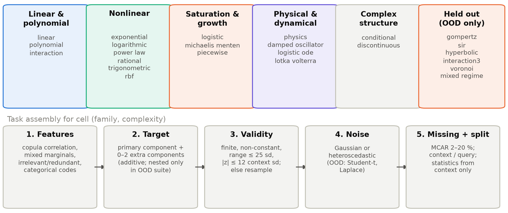
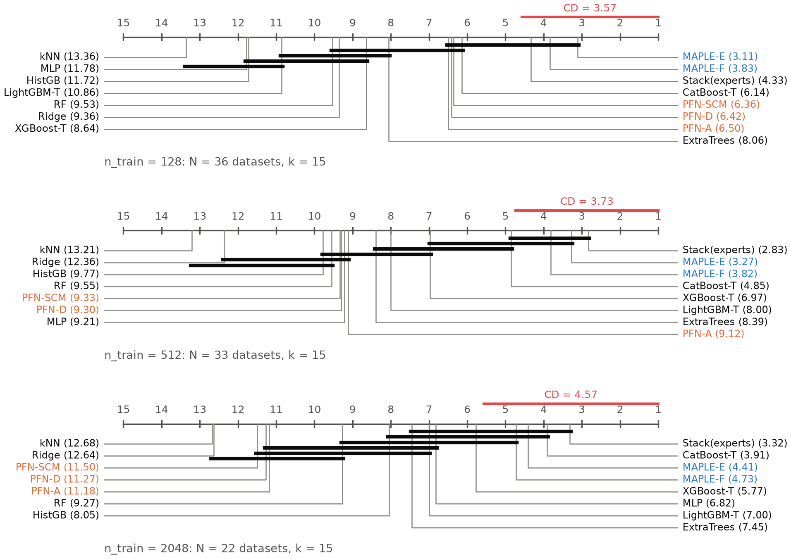
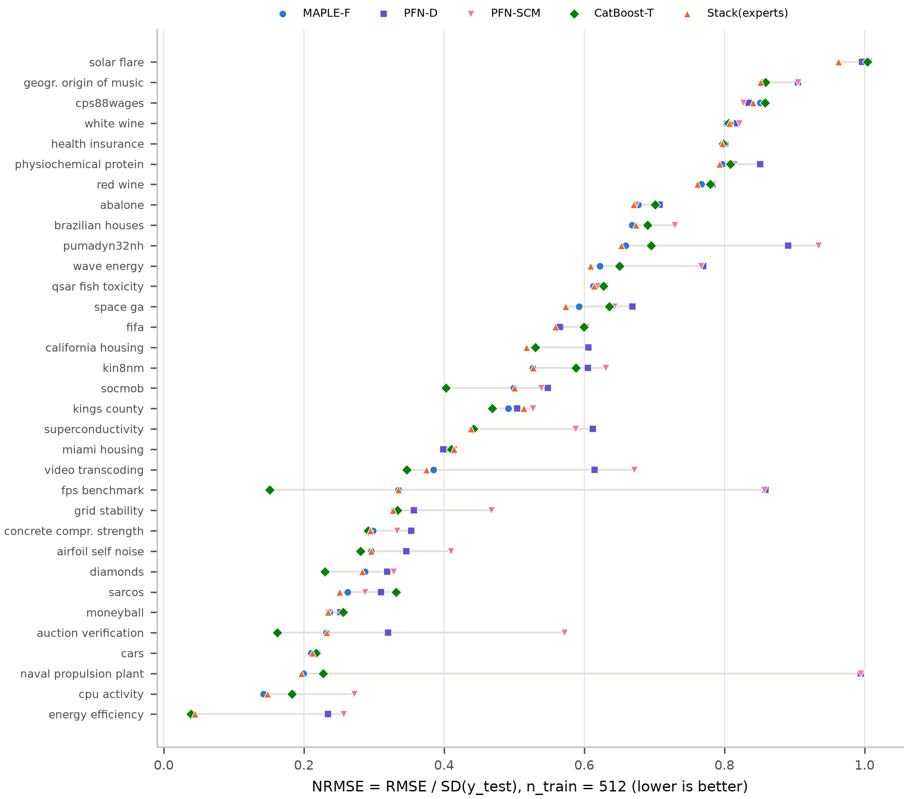
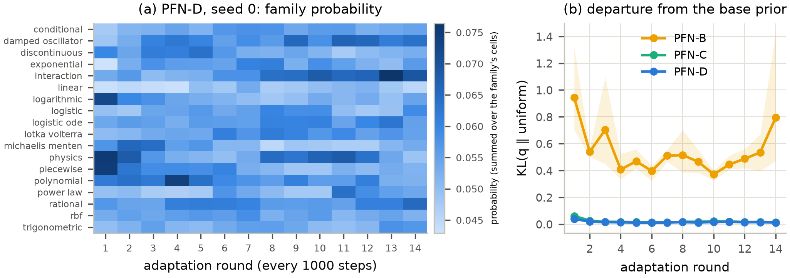
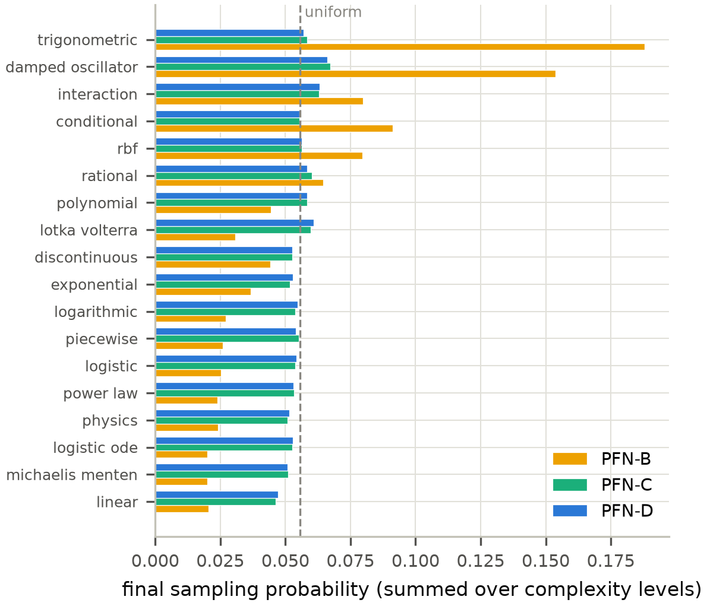
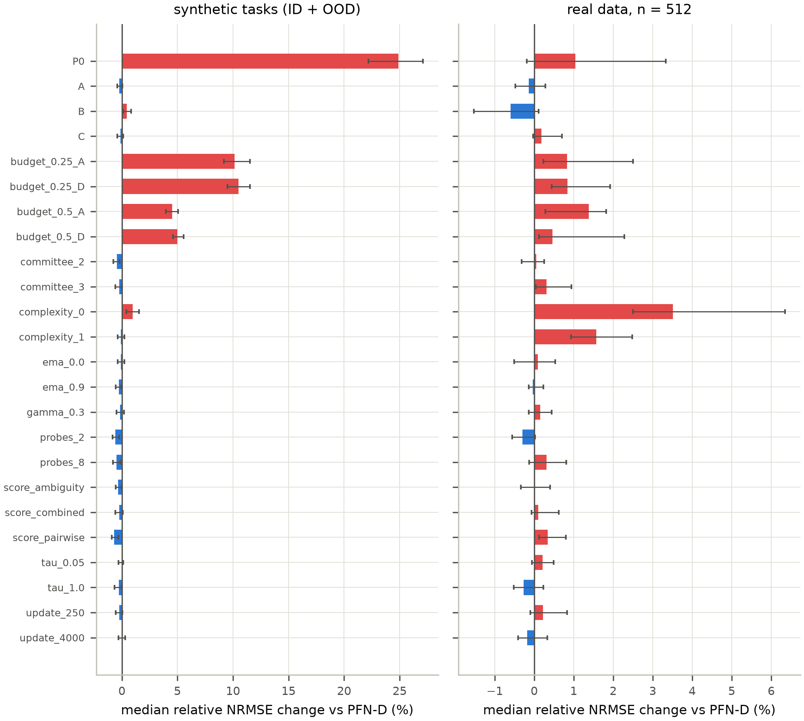
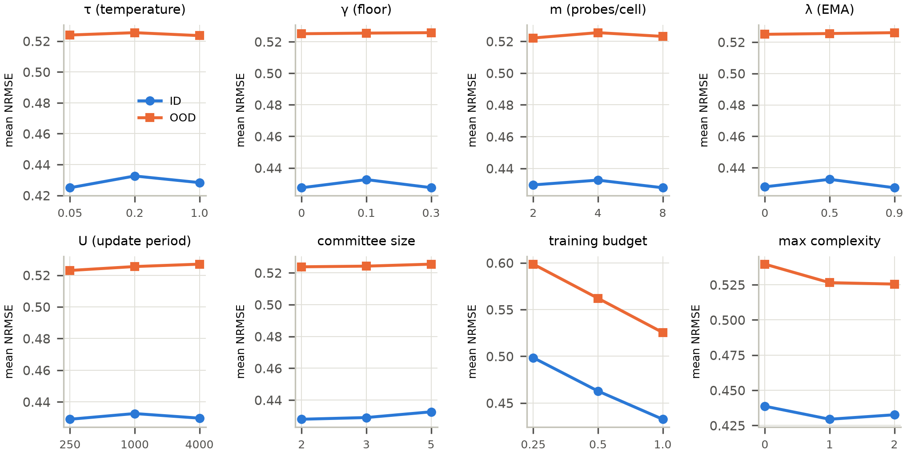

# Adaptive Mathematical Priors Steered by Expert Disagreement for Tabular Prior-Data Fitted Networks: Theory and a Pre-Registered Evaluation

*[Authors and affiliations to be added by the authors]*

**Abstract:** Prior-data fitted networks (PFNs) learn tabular prediction from synthetic tasks, so their accuracy depends on the prior. We ask whether re-weighting a mathematical prior during pretraining, towards cells where the PFN disagrees with a committee of classical experts, yields a better regressor at equal compute. MAPLE combines a 54-cell mathematical task generator, a KL-regularised adaptive sampler with proofs of non-collapse, stability, finite-sample accuracy and bounded prior distortion, and competence routing between the PFN and the experts. In a pre-registered evaluation on 36 regression datasets at three training-set sizes and eight synthetic suites, the adaptive sampler was indistinguishable from a uniform prior (pooled out-of-distribution difference 0.1%, Holm-adjusted p = 0.36): disagreement scores varied too little across cells to move it. The mathematical prior beat a structural-causal-model prior by 25% on synthetic suites but not on real data. Routing reduced the PFN's median error by 2.3% to 25.3% and, with 128 training rows, outperformed tuned CatBoost (Holm-adjusted p = 0.002); with more rows, stacking the experts alone was as accurate. Large pretrained foundation models (TabPFN v2, TabICL), run as external references, had the lowest mean error at every size. At this scale, pretraining compute and prior complexity matter more than adaptive weighting.

**Keywords:** prior-data fitted networks; tabular regression; synthetic pretraining; adaptive sampling; expert disagreement; distributionally robust optimisation; mathematical priors; out-of-distribution generalisation

## 1. Introduction

Tabular regression is one of the most common modelling problems in science and engineering. Most such datasets are
small to medium-sized, heterogeneous and noisy, and gradient-boosted trees remain the default
[@grinsztajn2022why; @mcelfresh2023when]. Prior-data fitted networks (PFNs) offer an alternative. A transformer is
pretrained once on millions of synthetic datasets drawn from a prior, then predicts on a new dataset in a single
forward pass, approximating Bayesian posterior prediction under that prior [@muller2022transformers;
@hollmann2023tabpfn; @hollmann2025accurate]. Because a PFN can only be as good as its prior
[@nagler2023statistical], much recent progress has come from *designing priors*: structural causal models, forest
priors and curated mixtures of priors [@breejen2024fine; @zhang2025mitra].

In current practice the prior is fixed before training, or improved by an outer loop that retrains the whole model
for each candidate prior [@hollmann2025accurate; @grinsztajn2025tabpfn25; @zhang2025mitra]. Each outer iteration
costs a full pretraining run. Within a run, every region of the prior receives training effort in fixed
proportions, whether or not the model has already learned it. This raises a natural question: can the prior be
re-weighted *during* pretraining, towards the parts the model has not yet learned, at little extra cost?

Answering this question requires two things: a prior whose parts are meaningful and can be re-weighted, and a
signal that says which parts are under-learned. For the first, we use *mathematical* priors. Interpretable families
of functions, such as polynomial, exponential, saturating, oscillatory, piecewise and ODE-generated relationships,
are organised into cells (family × complexity). For the second, a label-based loss is an obvious choice, but by
Proposition 4 the expected squared loss contains the irreducible noise variance additively, so a loss-driven
sampler can chase noise. We instead use the **disagreement between the PFN and a committee of cheap classical
experts** fitted on the same context. This signal needs no labels at the query points and contains no additive noise
term, and it tracks the PFN's excess error when the committee is the more accurate party.

The research hypothesis is that adaptive mathematical task generation, guided by such disagreement, yields a
computationally efficient tabular regressor that generalises better to unseen datasets than conventional synthetic
pretraining, ensembles, and individual models. We treat this as a hypothesis to test rather than a claim. All
comparisons are made at equal pretraining compute, and the research questions and statistical tests were fixed
before the main experiments.

**Contributions.**

1. **Mechanism.** A disagreement-steered adaptive sampler for PFN pretraining over a cell-structured mathematical
   prior. The sampler is the closed-form solution of a KL-regularised objective (equivalently, a KL-ball
   distributionally robust problem over the task prior) with a uniform floor. We pair it with competence routing
   between the PFN and classical experts at inference, whose two hyperparameters are chosen on synthetic tasks only.
2. **Analysis.** Proofs that the sampler cannot collapse, is Lipschitz-stable in the cell scores, is estimated to
   accuracy $O(B\tau^{-1}\sqrt{\log(M/\delta)/m})$ from $m$ probe tasks per cell, and distorts the base prior by a
   bounded amount. We also characterise exactly when label-free disagreement tracks excess error (Propositions 1–5,
   Theorem 1).
3. **Generator.** A configurable generator of 18 mathematical and scientific function families with correlated,
   irrelevant, redundant, categorical and missing features and heteroscedastic noise. It comes with seven
   structurally out-of-distribution test suites that differ from training in structure, not merely in random seed.
4. **Evidence.** A controlled empirical study: 36 public regression datasets
   at three training-set sizes, eight synthetic suites, 13 classical and tuned baselines, seven PFN variants with three
   pretraining seeds, ablations and sensitivity analyses, plus two large pretrained tabular foundation models
   (TabPFN v2 and TabICL) as external reference points. Pre-registered tests are reported in full, including where
   the hypothesis is not supported.
5. **Artifacts.** An open, restartable pipeline that regenerates every table, figure and number in this paper from
   append-only raw records.

Section 2 reviews related work. Sections 3–5 present the formulation, method and theory. Section 6 describes the
experimental protocol. Sections 7–9 report results, ablations and statistics. Section 10 discusses the findings and
their limitations, and Section 11 concludes.

## 2. Related Work

**Prior-data fitted networks and tabular foundation models.** A prior-data fitted network (PFN) is trained on
datasets sampled from a prior over data-generating mechanisms. It learns to approximate the posterior predictive
distribution in a single forward pass [@muller2022transformers]. TabPFN applied this idea to small tabular
classification problems with structural-causal-model and Bayesian-neural-network priors [@hollmann2023tabpfn].
TabPFN v2 extended it to regression and larger tables [@hollmann2025accurate], and TabPFN-2.5 scaled it further
[@grinsztajn2025tabpfn25]. Related models use different architectures or data: TabICL scales in-context learning to
large tables [@qu2025tabicl], and TabDPT pretrains on real rather than synthetic tables [@ma2024tabdpt]. A
statistical analysis attributes PFN bias to the prior and PFN variance to the context size [@nagler2023statistical].
Several studies show that the choice of prior governs generalisation. Forest-generated tasks improve in-context
classifiers [@breejen2024fine], drift-aware priors handle temporal shift [@helli2024drift], and Mitra builds a
curated mixture of synthetic priors chosen for diversity, distinctiveness and real-data performance
[@zhang2025mitra]. PFNs trained on parametric mathematical priors also exist for Bayesian optimisation and
learning-curve extrapolation [@muller2023pfns4bo; @adriaensen2023efficient]. Across this literature the prior is
fixed, or chosen by an outer loop over complete training runs (calibration, configuration search, mixture
selection). We are not aware of work that re-weights a PFN's prior *within* a single pretraining run.

**In-context learning of function classes.** Transformers trained on linear, sparse, tree and network function
classes learn to regress in context [@garg2022what]. Above a threshold of pretraining task diversity, they
generalise beyond the pretraining tasks [@raventos2023pretraining]. Mechanistic analyses link in-context regression
to ridge regression and gradient descent [@akyurek2023what; @vonoswald2023transformers]. Amortised regressors such
as (conditional) neural processes share this set-based formulation [@garnelo2018neural; @garnelo2018conditional;
@zaheer2017deep; @lee2019set].

**Tabular learning.** Gradient-boosted decision trees remain strong defaults [@chen2016xgboost; @ke2017lightgbm;
@prokhorenkova2018catboost; @friedman2001greedy], as do bagged and randomised forests [@breiman2001random;
@geurts2006extremely]. Deep tabular models include FT-Transformer [@gorishniy2021revisiting], SAINT
[@somepalli2021saint], NODE [@popov2020neural], TabM [@gorishniy2025tabm] and strong default MLPs
[@holzmuller2024better]. Large benchmarks find that trees still win on typical medium-sized data
[@grinsztajn2022why; @shwartzziv2022tabular] and that the best model depends on the dataset [@mcelfresh2023when].

**Adaptive task selection, curricula and robust objectives.** Curriculum learning orders training data by
difficulty [@bengio2009curriculum]. Automated curricula pose task selection as a non-stationary bandit, with
learning-progress rewards [@graves2017automated; @matiisen2020teacher; @portelas2020automatic]. In reinforcement
learning, unsupervised environment design generates training environments from regret
[@dennis2020emergent; @parkerholder2022evolving] or replays them by temporal-difference error
[@jiang2021prioritized]; related work learns simulator randomisation [@tobin2017domain; @mehta2020active]. The
closest use of *disagreement* is value-disagreement sampling, which proposes goals where an ensemble of value
functions disagrees [@zhang2020automatic]. In meta-learning, episodes are sampled by difficulty
[@liu2020adaptive; @arnold2021uniform], by novelty [@kaddour2020probabilistic] or by a minimax objective over tasks
[@collins2020task]. In robust optimisation, distributionally robust learning over divergence balls
[@bental2013robust; @namkoong2016stochastic; @duchi2021learning] and Group DRO's exponentiated-gradient group weights
[@sagawa2020distributionally] are the closest analogues of MAPLE's sampler. These methods use labelled losses or
returns, and they do not target the prior of a tabular in-context learner.

**Disagreement, ensembles and routing.** Query-by-committee selects points on which a committee disagrees
[@seung1992query; @burbidge2007active]. The ambiguity decomposition relates ensemble error to member disagreement
[@krogh1995neural], and ensembles estimate epistemic uncertainty [@lakshminarayanan2017simple;
@hullermeier2021aleatoric]. Combining experts is done by learned gating [@jacobs1991adaptive; @jordan1994hierarchical],
by stacking [@wolpert1992stacked; @breiman1996stacked], or by dynamic selection based on local competence
[@woods1997combination; @ko2008from; @cruz2018dynamic].

**Equation priors.** Symbolic and physics-inspired regression [@schmidt2009distilling; @udrescu2020ai;
@lacava2021contemporary] and transformers pretrained on generated equations [@lample2020deep; @biggio2021neural;
@kamienny2022end] show both the value of mathematical priors and the sensitivity of pretrained models to the
generator's distribution. Physics-informed learning [@raissi2019physics; @karniadakis2021physics] instead imposes
known equations as constraints. MAPLE uses scientific relationships only as a distribution over regression tasks.

**Table 1.** Positioning of MAPLE relative to the closest prior work (literature assessment, not an experimental result).

| work | synthetic ICL pretraining | math/scientific families | online | label-free | committee | diversity floor | guarantees | tabular regression |
|---|---|---|---|---|---|---|---|---|
| TabPFN | ✓ | ✗ | ✗ | – | ✗ | – | – | ✗ |
| TabPFN v2 / 2.5 | ✓ | ✗ | ✗ (offline) | – | ✗ | – | – | ✓ |
| Mitra | ✓ | ~ | ✗ (offline mixture) | – | ✗ | ~ | ✗ | ✓ |
| Garg et al. 2022 | ✓ | ~ | ✗ (fixed schedule) | – | ✗ | – | ✗ | ✓ |
| Bandit ACL (Graves et al.) | ✗ | ✗ | ✓ | ✗ | ✗ | ~ | ✓ | ✗ |
| PLR / PAIRED | ✗ | ✗ | ✓ | ✗ | ✗ | ~ | ~ | ✗ |
| Value-disagreement sampling | ✗ | ✗ | ✓ | ✓ | ~ | ✗ | ✗ | ✗ |
| Adaptive task sampling / TR-MAML | ✗ | ✗ | ✓ | ✗ | ✗ | ✗ | ~ | ✗ |
| Group DRO | ✗ | ✗ | ✓ | ✗ | ✗ | ✗ | ✓ | ✗ |
| Query-by-committee | ✗ | ✗ | ✓ (points) | ✓ | ✓ | ✗ | ✓ | ✗ |
| MAPLE (this work) | ✓ | ✓ | ✓ | ✓ | ✓ | ✓ | ✓ | ✓ |

✓ = has the property; ~ = partially; ✗ = does not. Columns: online = task distribution adapted within one training run; label-free = adaptation signal needs no target values; committee = signal from heterogeneous classical learners; guarantees = stability/concentration results for the sampler.

Table 1 summarises the position of this work. MAPLE combines and transfers existing mechanisms
(online re-weighting, label-free committee disagreement and synthetic in-context pretraining) to the design of a
PFN prior, and analyses the resulting sampler. It does not introduce a new primitive.

## 3. Mathematical Preliminaries

A regression task consists of a context set $D_{\mathrm{ctx}}=\{(x_i,y_i)\}_{i=1}^{n}$ and query inputs
$X_{\mathrm{qry}}$, with $x\in\mathbb{R}^{d}$ and $y=f^{*}(x)+\varepsilon$, where $\mathbb{E}[\varepsilon\mid x]=0$ and
$\operatorname{Var}(\varepsilon\mid x)=\sigma^{2}(x)$. For a function $g$ of $x$ we write
$\|g\|^{2}=\mathbb{E}_{x\sim P_x}[g(x)^{2}]$ for the squared $L^{2}(P_x)$ norm over the query distribution. For a
vector $v$, $\operatorname{osc}(v)=\max_c v_c-\min_c v_c$. A prior over tasks is a distribution $G$ from which tasks
are drawn. A PFN $\theta$ is trained by minimising the expected query loss over $G$. With squared loss, the
minimiser is the posterior predictive mean $\mathbb{E}[y\mid x, D_{\mathrm{ctx}}]$ under $G$ [@muller2022transformers].
Because $\mathbb{E}[\varepsilon\mid x]=0$, the same minimiser is obtained by regressing on the noise-free target
$f^{*}$, which we use to reduce gradient variance.

**Cells and the task prior.** The mathematical prior is organised into $M$ *cells* $c=(\text{family},\text{complexity})$.
Each cell has a fixed task generator $G_c$. A distribution $q\in\Delta_M$ over cells induces the mixture prior
$G_q=\sum_c q_c G_c$; $p^{0}=u$ is the uniform base distribution. The cell risk of $\theta$ is
$R_c(\theta)=\mathbb{E}_{T\sim G_c}\,\ell(\theta;T)$, where $\ell$ is the query mean squared error.

**Experts and disagreement.** A committee of $K$ classical regressors $f_1,\dots,f_K$ is fitted on each context, with
mean $\bar f$. We consider the committee variance (ambiguity) $A(x)=\frac1K\sum_k (f_k(x)-\bar f(x))^2$, the pairwise
disagreement $\frac{2}{K(K-1)}\sum_{i<j}|f_i(x)-f_j(x)|$ and, as MAPLE's default, the **PFN–committee gap**

$$
\Delta(x)=\bigl(\theta(x)-\bar f(x)\bigr)^{2},\qquad \bar\Delta=\|\theta-\bar f\|^{2}.
$$

All tasks are standardised by the context targets, so these quantities are already normalised by $\sigma_y$.

## 4. Proposed Methodology

### 4.1 Mathematical task generator

Table 2 lists the 18 training families and the held-out structures. The training families
are: linear, sparse multivariate polynomials with interactions, exponential growth/decay, logarithmic, power laws,
rational functions and Lorentzian peaks, trigonometric sums, Gaussian radial-basis bumps, logistic and
Michaelis–Menten saturation, hinge (piecewise-linear) growth, physical laws (inverse-square, kinetic-plus-potential
energy, multiplicative), a damped oscillator, the closed-form logistic ODE solution, Lotka–Volterra dynamics
integrated with fourth-order Runge–Kutta, hard two-regime switches, pairwise interactions and step
discontinuities. Each family has three complexity levels that control the number of active features, terms,
frequencies and interaction order. A task combines a primary component from the cell's family with up to two
additive components from other families, each acting on random feature subsets.

**Table 2.** Mathematical task generator: function families, splits and sampling.

| family | split | description | cells | mean attempts | final q (PFN-D) | uniform q |
|---|---|---|---|---|---|---|
| linear | train | w^T x + b | 3 | 1 | 0.0472 | 0.0556 |
| polynomial | train | sparse multivariate polynomial with interactions | 3 | 1.03 | 0.0583 | 0.0556 |
| exponential | train | sum a exp(b z): growth and decay | 3 | 1.03 | 0.0529 | 0.0556 |
| logarithmic | train | sum a log(u), u in (eps, hi) | 3 | 1.13 | 0.0548 | 0.0556 |
| power_law | train | a prod u_j^p_j | 3 | 1 | 0.0532 | 0.0556 |
| rational | train | (a z1 + b)/(1 + c z2^2) or Lorentzian peaks | 3 | 1 | 0.0584 | 0.0556 |
| trigonometric | train | sum a sin/cos(omega z + phi) | 3 | 1 | 0.0571 | 0.0556 |
| rbf | train | sum of Gaussian bumps | 3 | 1.03 | 0.0564 | 0.0556 |
| logistic | train | L/(1+exp(-k(z-z0))) | 3 | 1.07 | 0.0543 | 0.0556 |
| michaelis_menten | train | Vmax u/(Km+u) | 3 | 1 | 0.0509 | 0.0556 |
| piecewise | train | hinge (piecewise-linear growth) | 3 | 1.03 | 0.054 | 0.0556 |
| physics | train | inverse-square / energy / multiplicative laws | 3 | 1.07 | 0.0516 | 0.0556 |
| damped_oscillator | train | A exp(-zeta omega t) cos(omega_d t + phi) | 3 | 1.07 | 0.0661 | 0.0556 |
| logistic_ode | train | closed-form logistic ODE N(t) | 3 | 1.07 | 0.0529 | 0.0556 |
| lotka_volterra | train | RK4 predator-prey, prey at time T | 3 | 1.03 | 0.0609 | 0.0556 |
| conditional | train | hard two-regime switch on one feature | 3 | 1.07 | 0.0554 | 0.0556 |
| interaction | train | pairwise products of g(x_i) g(x_k) | 3 | 1.03 | 0.0631 | 0.0556 |
| discontinuous | train | linear trend plus step jumps | 3 | 1.03 | 0.0526 | 0.0556 |
| gompertz | ood | a exp(-b exp(-k z)) | 3 | 1 | – | – |
| sir | ood | RK4 SIR model, infected fraction at time T | 3 | 1.07 | – | – |
| hyperbolic | ood | a sinh(b z1)/cosh(c z2) (+ cosh term) | 3 | 1.1 | – | – |
| interaction3 | ood_structure | three-way products | 3 | 1.1 | – | – |
| voronoi | ood_structure | piecewise-linear on Voronoi regions | 3 | 1 | – | – |
| mixed_regime | ood_structure | softmax-gated mixture of regimes | 3 | 1.03 | – | – |

Split: train = available to pretraining; ood = held-out family; ood_structure = structure used only by OOD suites. Mean attempts = generator draws per valid task (validity checks). Final q = probability mass of the family in PFN-D's final sampling distribution (mean over 3 seeds), versus 1/18 uniform.

Features are drawn through a Gaussian copula with a random low-rank correlation matrix, mixed marginals (normal,
uniform, log-normal, bimodal, heavy-tailed), irrelevant and redundant columns, ordinal or nominal categorical codes
and MCAR missingness. Noise is homoscedastic or heteroscedastic Gaussian, with a relative level between 0.01 and 1.
Every task passes validity checks (finite values, non-constant target, bounded range, context-standardised targets
within $\pm12$ standard deviations); otherwise it is resampled (Figure 1). Generation costs
about 5 ms per task (17 ms for the ODE families).

**Figure 1.** Mathematical task generator. Top: function families grouped by type; the right-most group is never used for pretraining and appears only in out-of-distribution (OOD) suites. Bottom: assembly of a task for a cell (family, complexity).

### 4.2 Prior-data fitted network

The PFN embeds each context point as $W_x\tilde x+W_y y$ and each query point as $W_x\tilde x+e_{\mathrm{qry}}$. Here
$\tilde x$ is $x$ zero-padded to $d_{\max}=32$ and rescaled by $\sqrt{d_{\max}/d}$. A stack of pre-LN transformer
blocks [@vaswani2017attention; @xiong2020layer] follows, in which every token attends only to context tokens. Query
predictions are therefore independent of one another and invariant to the order of the context points; there are
no positional encodings. A two-layer head outputs the prediction. Section 6 lists the architecture and training
settings.

### 4.3 Disagreement-steered adaptive sampling

Every $U$ steps, MAPLE draws $m$ fresh probe tasks per cell and fits the committee to each probe context. The
committee's predictions do not depend on $\theta$, so they are computed asynchronously in CPU workers; only a PFN
forward pass is needed at the round itself. MAPLE then evaluates a per-task score $Y\in[0,B]$ (the clipped mean of
the chosen disagreement, or the PFN loss for the loss-based variant), averages it into cell scores $\hat s_c$,
smooths them with an exponential moving average of factor $\lambda$, and sets

$$
q(\hat s)=(1-\gamma)\,\mathrm{Gibbs}(p^{0},\hat s/\tau)+\gamma\,u,\qquad \mathrm{Gibbs}(p^{0},s/\tau)_c=\frac{p^{0}_c e^{s_c/\tau}}{\sum_{c'}p^{0}_{c'}e^{s_{c'}/\tau}}.
$$

Training batches draw their cells from the current $q$. Probe tasks never enter gradient updates, and their random
streams are disjoint from training and evaluation streams. Figure 2 shows the complete
framework, and Figure 3 illustrates the mechanism on a real probe task.

**Figure 2.** The MAPLE framework. Pretraining (top) uses synthetic tasks only. Every U steps, probe tasks from each cell are scored by the gap between the PFN and a committee of classical experts, and the cell sampling distribution is re-weighted. At inference (bottom), the pretrained PFN and the experts are combined by competence routing, whose two hyperparameters are chosen on synthetic tasks.

**Figure 3.** Mechanism on a real probe task (trigonometric family, complexity 0) with the pretrained PFN-D checkpoint (seed 0). (a) Context points, committee predictions and the PFN prediction along the active feature. (b) Pointwise PFN–committee gap and committee ambiguity. (c) The six most and four least probable cells in PFN-D's final logged sampling distribution; dashed line: uniform.

### 4.4 Expert routing at inference

On a real dataset, the training split is preprocessed using training rows only. The PFN predicts in context,
averaging four feature permutations; for training sets larger than 1024 rows, it also averages over random
1024-row contexts. Datasets with more than 32 features are reduced to 32 by mutual information estimated on the
training rows [@kraskov2004estimating]. Five classical experts (ridge, $k$NN, ExtraTrees, histogram gradient
boosting, RBF kernel ridge) are fitted alongside. Out-of-fold squared errors $e_k$ from 5-fold cross-validation on
the training split measure each predictor's competence. **Global routing** (MAPLE-E) uses weights
$w_k\propto\exp(-\beta\,e_k/\min_j e_j)$. **Local routing** (MAPLE-F, the full framework) uses the same formula with
$e_k$ replaced by the mean out-of-fold error over the $\kappa$ training points nearest to the query, a regression
analogue of dynamic ensemble selection [@woods1997combination; @ko2008from]. $\beta$ and $\kappa$ are chosen by grid
search on 150 synthetic tasks drawn from the checkpoint's final learned prior, never on real data.

### 4.5 Variants

We compare seven pretrained or routed variants: **P0**, the same PFN pretrained on a conventional TabPFN-v1-style
random-MLP/SCM prior [@hollmann2023tabpfn]; **A**, the uniform mathematical prior; **B**, adaptive with the label-based
loss score and no floor; **C**, adaptive with the gap score and no floor; **D**, adaptive with the gap score and floor
$\gamma=0.1$; **E**, D with global routing; and **F** (MAPLE), D with local routing. All pretraining runs use the same
architecture, number of steps and token budget.

## 5. Theoretical Analysis

Full proofs are in Appendix A and in the repository (`research/theory/theory.md`), and each statement is checked
numerically by the test suite. We distinguish proved statements from conjectures; no convergence result is claimed
for the coupled training dynamics.

**Proposition 1 (Gibbs variational principle).** For $p^{0}$ with full support, $s\in\mathbb{R}^{M}$ and $\tau>0$, the
problem $\max_{q\in\Delta_M}\langle q,s\rangle-\tau\,\mathrm{KL}(q\|p^{0})$ has the unique solution
$q^{*}=\mathrm{Gibbs}(p^{0},s/\tau)$, with optimal value $\tau\log\sum_c p^{0}_c e^{s_c/\tau}$. Moreover, for $\rho>0$ and
non-constant $s$ with $\rho<\log(1/p^{0}(\arg\max s))$, every maximiser of $\langle q,s\rangle$ over the KL ball
$\{q:\mathrm{KL}(q\|p^{0})\le\rho\}$ is a Gibbs distribution for some finite $\tau(\rho)$ [@donsker1975asymptotic;
@bental2013robust].

With the loss score $s_c=R_c(\theta)$, alternating Proposition 1 with gradient steps is a KL-smoothed form of
distributionally robust optimisation over the task prior, related to Group DRO [@sagawa2020distributionally].

**Proposition 2 (no collapse, bounded tilt).** For $p^{0}=u$: $q_c\ge\gamma/M$;
$q^{*}_a/q^{*}_b\le e^{\operatorname{osc}(s)/\tau}$; and $\mathrm{KL}(q\|u)\le(1-\gamma)\operatorname{osc}(s)/\tau$.

**Proposition 3 (stability).** For all $s,s'$:
$\|q(s)-q(s')\|_1\le(1-\gamma)\operatorname{osc}(s-s')/(2\tau)\le(1-\gamma)\|s-s'\|_\infty/\tau$.

*Proof sketch.* Along $s(t)=s+t(s'-s)$, $\dot q_c=\tau^{-1}q_c(v_c-\langle q,v\rangle)$, so $\|\dot q\|_1$ is
$\tau^{-1}$ times the mean absolute deviation of $v$ under $q$. That deviation is at most $\operatorname{osc}(v)/2$, by
Cauchy–Schwarz and Popoviciu's inequality. Integrating over $t\in[0,1]$ gives the bound.

**Proposition 4 (disagreement and error).** If $\theta,f_1,\dots,f_K$ depend only on the context and the query noise is
independent of it, then (a) $\mathbb{E}(\theta-y)^2=\|\theta-f^{*}\|^2+\mathbb{E}\sigma^2(x)$; (b)
$|\sqrt{\bar\Delta}-\|\theta-f^{*}\||\le\|\bar f-f^{*}\|$, so if $\|\bar f-f^{*}\|\le\eta\|\theta-f^{*}\|$ with
$\eta<1$, then $(1-\eta)^2\|\theta-f^{*}\|^2\le\bar\Delta\le(1+\eta)^2\|\theta-f^{*}\|^2$; (c) the ambiguity
decomposition $(\bar f-y)^2=\frac1K\sum_k(f_k-y)^2-A$ holds pointwise [@krogh1995neural].

Part (a) says that a loss-based score contains the irreducible noise additively; part (b) says that the label-free
gap tracks the PFN's *excess* error whenever the committee is more accurate than the PFN. When the committee is worse
($\eta\ge1$), $\bar\Delta$ also measures the committee's own error. This failure mode is known for query-by-committee
[@burbidge2007active], and Section 7.4 tests it empirically.

**Theorem 1 (finite-sample accuracy of the sampler).** With $m$ independent probe tasks per cell, scores clipped to
$[0,B]$ and $\theta$ fixed within the round, with probability at least $1-\delta$:

$$
\max_c|\hat s_c-s_c|\le B\sqrt{\frac{\log(2M/\delta)}{2m}},\qquad
\|q(\hat s)-q(s)\|_1\le\frac{(1-\gamma)B}{\tau}\sqrt{\frac{\log(2M/\delta)}{2m}}.
$$

*Proof.* Apply Hoeffding's inequality [@hoeffding1963probability] to each cell, take a union bound over the $M$
cells, and apply Proposition 3. With an exponential moving average of factor $\lambda$ and stationary scores, $m$ can
be replaced by $m(1+\lambda)/(1-\lambda)$.

**Proposition 5 (bounded distortion of the base prior).** If $0\le\ell\le L$, then
$|\mathbb{E}_{G_q}\ell-\mathbb{E}_{G_u}\ell|\le L\,\mathrm{TV}(q,u)\le L\sqrt{(1-\gamma)\operatorname{osc}(s)/(2\tau)}$.
The adaptive prior therefore cannot move far from the uniform prior without a correspondingly large score range.

**Complexity.** One adaptation round costs $M m(C_{\mathrm{PFN}}+\sum_k C_{\mathrm{fit},k})$. One PFN forward pass costs
$O(L[(n^2+n\,n_q)d_m+(n+n_q)d_m^2])$, with no $n_q^2$ term because queries do not attend to each other.

**Conjectures (not proved).** (C1) When the sampler adapts slowly relative to the PFN, $q_t$ tracks the
KL-regularised robust solution for the current $\theta_t$. (C2) Disagreement-based sampling is more robust than
loss-based sampling when noise varies across tasks. (C3) Gains on structural OOD suites transfer to real data only
to the extent that real data resemble the mathematical prior. Sections 7–9 examine C2 and C3 empirically.

## 6. Experimental Setup

**Datasets.** We use the 35 regression datasets of the curated OpenML-CTR23 suite [@fischer2023openml;
@vanschoren2014openml; @feurer2021openml] and scikit-learn's Diabetes data [@efron2004least]
(Table 3). Boston Housing is excluded because of its ethically problematic feature, and
California Housing [@pace1997sparse] is used instead. Yacht Hydrodynamics is not in the suite and is too small for
our protocol. No dataset was removed for being difficult. For each dataset we subsample training sets of
$n_{\mathrm{train}}\in\{128,512,2048\}$ rows, repeated 10, 5 and
3 times respectively. Test sets contain up to 2000 of the remaining rows. A regime is used only
if at least 200 test rows remain, and skipped regimes are logged. All methods share identical, persisted split
indices. Preprocessing, feature selection, hyperparameter search, routing weights and stacking weights are all
fitted on the training split only.

**Table 3.** Benchmark dataset characteristics (OpenML-CTR23 suite and Diabetes).

| dataset | n | numerical | categorical | missing (%) | target mean | target SD | target skew | size class | licence | regimes (n_train) |
|---|---|---|---|---|---|---|---|---|---|---|
| abalone | 4.18e+03 | 7 | 1 | 0 | 9.93 | 3.22 | 1.11 | medium | CC BY 4.0 | 128, 512, 2048 |
| airfoil_self_noise | 1.5e+03 | 5 | 0 | 0 | 125 | 6.9 | -0.419 | small | CC BY 4.0 | 128, 512 |
| auction_verification | 2.04e+03 | 5 | 2 | 0 | 7.34e+03 | 1.04e+04 | 1.5 | medium | CC BY 4.0 | 128, 512 |
| brazilian_houses | 1.07e+04 | 5 | 4 | 0 | 5.49e+03 | 1.65e+04 | 59 | medium | CC 0: Public Domain | 128, 512, 2048 |
| california_housing | 2.06e+04 | 8 | 0 | 0 | 2.07e+05 | 1.15e+05 | 0.978 | large | Public | 128, 512, 2048 |
| cars | 804 | 17 | 0 | 0 | 2.13e+04 | 9.88e+03 | 1.57 | small | Public | 128, 512 |
| concrete_compressive_strength | 1.03e+03 | 8 | 0 | 0 | 35.8 | 16.7 | 0.416 | small | CC BY 4.0 | 128, 512 |
| cps88wages | 2.82e+04 | 2 | 4 | 0 | 604 | 454 | 6.5 | large | Public | 128, 512, 2048 |
| cpu_activity | 8.19e+03 | 21 | 0 | 0 | 84 | 18.4 | -3.42 | medium | Public | 128, 512, 2048 |
| diamonds | 5.39e+04 | 6 | 3 | 0 | 3.93e+03 | 3.99e+03 | 1.62 | large | Public | 128, 512, 2048 |
| energy_efficiency | 768 | 8 | 0 | 0 | 22.3 | 10.1 | 0.36 | small | CC BY 4.0 | 128, 512 |
| fifa | 1.92e+04 | 27 | 1 | 0 | 9.02e+03 | 1.95e+04 | 6.47 | medium | CC0: Public Domain | 128, 512, 2048 |
| forest_fires | 517 | 10 | 2 | 0 | 12.8 | 63.6 | 12.8 | small | CC BY 4.0 | 128 |
| fps_benchmark | 2.46e+04 | 29 | 14 | 6.58 | 124 | 54.6 | 1.05 | large | CC BY | 128, 512, 2048 |
| geographical_origin_of_music | 1.06e+03 | 116 | 0 | 0 | 26.7 | 18.5 | -0.99 | small | CC BY 4.0 | 128, 512 |
| grid_stability | 1e+04 | 12 | 0 | 0 | 0.0157 | 0.0369 | 0.0187 | medium | CC BY 4.0 | 128, 512, 2048 |
| health_insurance | 2.23e+04 | 4 | 7 | 0 | 25.6 | 18.7 | -0.342 | large | GPL (>= 2) | 128, 512, 2048 |
| kin8nm | 8.19e+03 | 8 | 0 | 0 | 0.714 | 0.264 | 0.0903 | medium | Public | 128, 512, 2048 |
| kings_county | 2.16e+04 | 17 | 4 | 0 | 5.4e+05 | 3.67e+05 | 4.02 | large | CC 0: Public Domain | 128, 512, 2048 |
| miami_housing | 1.39e+04 | 15 | 0 | 0 | 4e+05 | 3.17e+05 | 3.22 | medium | CC0: Public Domain | 128, 512, 2048 |
| moneyball | 1.23e+03 | 8 | 6 | 20.9 | 715 | 91.5 | 0.174 | small | Public | 128, 512 |
| naval_propulsion_plant | 1.19e+04 | 14 | 0 | 0 | 0.975 | 0.0147 | -9.12e-17 | medium | CC BY 4.0 | 128, 512, 2048 |
| physiochemical_protein | 4.57e+04 | 9 | 0 | 0 | 7.75 | 6.12 | 0.567 | large | CC BY 4.0 | 128, 512, 2048 |
| pumadyn32nh | 8.19e+03 | 32 | 0 | 0 | -0.000416 | 0.036 | -0.0505 | medium | Public | 128, 512, 2048 |
| qsar_fish_toxicity | 908 | 6 | 0 | 0 | 4.06 | 1.45 | 0.252 | small | CC BY 4.0 | 128, 512 |
| red_wine | 1.6e+03 | 11 | 0 | 0 | 5.64 | 0.807 | 0.218 | small | CC BY 4.0 | 128, 512 |
| sarcos | 4.89e+04 | 21 | 0 | 0 | 13.7 | 20.5 | 0.152 | large | Public | 128, 512, 2048 |
| socmob | 1.16e+03 | 1 | 4 | 0 | 18.2 | 41 | 4.43 | small | Non-commercial scholarly and teaching purposes. | 128, 512 |
| solar_flare | 1.07e+03 | 2 | 8 | 0 | 0.3 | 0.835 | 3.95 | small | CC BY 4.0 | 128, 512 |
| space_ga | 3.11e+03 | 6 | 0 | 0 | -0.576 | 0.198 | -1.02 | medium | Public | 128, 512, 2048 |
| student_performance_por | 649 | 13 | 17 | 0 | 11.9 | 3.23 | -0.911 | small | CC BY 4.0 | 128 |
| superconductivity | 2.13e+04 | 81 | 0 | 0 | 34.4 | 34.3 | 0.86 | large | CC BY 4.0 | 128, 512, 2048 |
| video_transcoding | 6.88e+04 | 16 | 2 | 0 | 10 | 16.1 | 4.25 | large | CC BY 4.0 | 128, 512, 2048 |
| wave_energy | 7.2e+04 | 36 | 0 | 0 | 3.76e+06 | 1.12e+05 | 0.144 | large | CC BY 4.0 | 128, 512, 2048 |
| white_wine | 4.9e+03 | 11 | 0 | 0 | 5.88 | 0.886 | 0.156 | medium | CC BY 4.0 | 128, 512, 2048 |
| diabetes | 442 | 10 | 0 | 0 | 152 | 77 | 0.439 | small | distributed with scikit-learn (BSD-3-Clause) | 128 |

Source: OpenML (dataset ids in dataset_metadata.csv) and scikit-learn. Regimes list the training-set sizes evaluated (a regime is used only if at least 200 test rows remain). Excluded: Boston Housing (ethical concerns), Yacht Hydrodynamics (not in suite; too small).

**Baselines.** We use the mean predictor, ridge, ElasticNet, $k$NN, random forest, ExtraTrees, histogram gradient
boosting, RBF kernel ridge, MLP, XGBoost, LightGBM and CatBoost with library defaults
[@hoerl1970ridge; @zou2005regularization; @breiman2001random; @geurts2006extremely; @chen2016xgboost; @ke2017lightgbm;
@prokhorenkova2018catboost; @pedregosa2011scikit]. XGBoost, LightGBM and CatBoost are also tuned (suffix -T) with a
fixed budget of 10 random configurations evaluated by 3-fold cross-validation on the training split. CatBoost (default and tuned) one-hot encodes categorical features with at most 255 levels
(`one_hot_max_size` = 255) instead of using its target statistics; this was needed to fit the CPU budget and may
weaken CatBoost slightly on datasets with categorical features.
We also report a simple average and a non-negative stacked regression [@breiman1996stacked] of the five classical
experts, and stacking of PFN-D with the experts. As external reference points we also run two large pretrained
tabular foundation models with their library defaults on a GPU: TabPFN v2 [@hollmann2025accurate] (regression
weights of the `tabpfn` package, version 9.2.0, model version 2) and TabICL [@qu2025tabicl] (the version-2 regression
checkpoint of the `tabicl` package, version 2.2.0). Their pretraining compute is orders of magnitude larger than
ours, so they are not equal-budget comparisons; they are reported alongside, compared with MAPLE in exploratory
tests, and kept out of the pre-registered comparison set. Newer TabPFN releases (2.5 and later) are distributed
under non-commercial licences behind an access agreement and were not used. FT-Transformer, SAINT and NODE require per-dataset GPU training and tuning, a different
compute class from our CPU experts; they are discussed in Section 2 but not run.

**Synthetic generalisation.** We evaluate on 200 tasks for each of eight suites. The ID suite draws
fresh tasks from the training cells. The seven structurally OOD suites are: held-out families (Gompertz, SIR,
hyperbolic); nested compositions $g(h(x))$, whereas training uses additive compositions only; parameter ranges
stretched $\times2.5$; three-way interactions, whereas training has at most pairwise; piecewise-linear functions on
Voronoi regions; Student-$t$ and Laplace noise; and softmax-gated mixtures of 2–4 regimes. Context sizes, dimensions,
noise and missingness have comparable distributions across suites, so OOD differences reflect structure.

**Pretraining protocol.** Variants P0 and A–D are each pretrained with three seeds for
15,000 steps on two shared GPUs. Ablation and sensitivity runs use seed 0. The full configuration is in
Table 4.

**Table 4.** Main experimental configuration.

| setting | value |
|---|---|
| PFN architecture | 6 pre-LN layers, width 256, 8 heads, FF 768, d_max 32 |
| PFN parameters | 4,026,369 |
| Pretraining steps | 15,000 (AdamW, lr 0.0003, wd 0.01, warm-up 500, cosine) |
| Batch | token budget 32,768; context n ~ log-U[16, 1024]; d ~ log-U[1, 32]; 128 queries |
| Prior cells | 18 training families × 3 complexity levels = 54 |
| Sampler | τ = 0.2, γ = 0.1 (D), EMA λ = 0.5, clip B = 4.0 |
| Adaptation | every U = 1000 steps, m = 4 probe tasks/cell, probe n = 128 |
| Committee | ridge, knn, extratrees, hgb, rbf |
| Pretraining seeds | 0, 1, 2 (ablations: seed 0) |
| Real-data regimes | n_train ∈ [128, 512, 2048]; repeats {128: 10, 512: 5, 2048: 3}; test ≤ 2000 rows |
| Routing | 5-fold OOF on training split; β, κ selected on 150 synthetic tasks from the learned prior |
| HPO budget (-T) | 10 random configurations, 3-fold CV on the training split |
| CatBoost categoricals | one-hot for <= 255 levels (one_hot_max_size = 255), default and -T |
| External references | TabPFN v2 weights (tabpfn 9.2.0); TabICL v2 regressor (tabicl 2.2.0); library defaults, GPU; not in the pre-registered comparison set |
| Synthetic evaluation | 200 tasks per suite × 8 suites |
| Statistics | unit = dataset (real) / task (synthetic); Friedman + Nemenyi; Wilcoxon signed-rank with Holm; rank-biserial r; bootstrap 95% CI |

All values are read from configs/*.yaml and the trained checkpoint.

**Metrics and statistics.** We report RMSE, MAE, $R^2$ and NRMSE = RMSE/SD($y_{\mathrm{test}}$), together with
training time, inference time, peak memory and parameter counts. For real data, the unit of analysis is the dataset:
metrics are averaged over repeats and pretraining seeds before testing, and folds are never treated as independent
datasets [@dietterich1998approximate]. For synthetic suites, the unit is the task. We use the Friedman test with
Nemenyi critical differences [@friedman1937use; @demsar2006statistical]. Following [@benavoli2016should], the primary
pairwise tests are two-sided Wilcoxon signed-rank tests [@wilcoxon1945individual] with Holm correction
[@holm1979simple; @garcia2008extension]. Effect sizes are matched-pairs rank-biserial correlations [@kerby2014simple],
and confidence intervals use the bootstrap [@efron1979bootstrap]. A median relative difference below 1% is reported
as practically negligible even when it is significant. The research questions and tests were fixed before any main
experiment was run (repository file `research/novelty_assessment/research_questions.md`).

## 7. Results

All numbers in this section are regenerated from the raw records by the scripts in the repository. Unless stated
otherwise, NRMSE differences are median relative differences over datasets (real data) or tasks (synthetic data),
and "$p_{\mathrm{Holm}}$" is the Holm-adjusted p-value of a two-sided Wilcoxon signed-rank test within its
pre-registered family. W/L/T counts are wins, losses and ties of the first-named method.

### 7.1 Real-data benchmark

Table 5 reports mean NRMSE, mean rank and win counts for every method at the three
training-set sizes. 36, 33 and 22 datasets
are large enough for $n_{\mathrm{train}}$ = 128, 512 and 2048 respectively (each split keeps at least 200 test
rows).

**Table 5.** Summary of performance across datasets for each training-set size.

| method | mean NRMSE (n=128) | mean NRMSE (n=512) | mean NRMSE (n=2048) | mean rank (n=128) | mean rank (n=512) | mean rank (n=2048) | wins (n=128) | wins (n=512) | wins (n=2048) |
|---|---|---|---|---|---|---|---|---|---|
| Mean | 1.004 | 1.002 | 1.001 | 25.681 | 26.424 | 26.682 | **0.000** | **0.000** | **0.000** |
| Ridge | 0.711 | 0.648 | 0.621 | 16.222 | 20.970 | 21.227 | _1.000_ | _1.000_ | **0.000** |
| ElasticNet | 0.719 | 0.658 | 0.630 | 16.153 | 20.970 | 21.364 | **0.000** | **0.000** | **0.000** |
| kNN | 0.750 | 0.651 | 0.617 | 22.944 | 22.788 | 21.909 | **0.000** | **0.000** | **0.000** |
| RF | 0.668 | 0.554 | 0.500 | 16.500 | 16.091 | 15.682 | **0.000** | **0.000** | **0.000** |
| ExtraTrees | 0.660 | 0.559 | 0.503 | 14.417 | 14.576 | 12.909 | **0.000** | **0.000** | **0.000** |
| HistGB | 0.690 | 0.556 | 0.485 | 20.056 | 16.667 | 13.523 | **0.000** | **0.000** | **0.000** |
| RBF-KRR | 0.695 | 0.591 | 0.536 | 17.806 | 17.061 | 15.591 | **0.000** | **0.000** | **0.000** |
| MLP | 0.806 | 0.559 | 0.471 | 20.556 | 16.061 | 12.045 | **0.000** | **0.000** | _1.000_ |
| XGBoost | 0.730 | 0.573 | 0.501 | 22.250 | 19.303 | 16.864 | **0.000** | **0.000** | **0.000** |
| LightGBM | 0.717 | 0.557 | 0.493 | 20.667 | 17.394 | 15.500 | **0.000** | **0.000** | **0.000** |
| CatBoost | 0.647 | 0.511 | 0.448 | 13.556 | 11.303 | 8.318 | **0.000** | _1.000_ | **0.000** |
| XGBoost-T | 0.654 | 0.550 | 0.477 | 15.111 | 12.030 | 10.000 | _1.000_ | **0.000** | **0.000** |
| LightGBM-T | 0.683 | 0.528 | 0.490 | 18.611 | 13.515 | 11.818 | **0.000** | **0.000** | **0.000** |
| CatBoost-T | 0.627 | 0.497 | 0.440 | 11.389 | 8.939 | 7.273 | **0.000** | _1.000_ | **0.000** |
| Avg(experts) | 0.648 | 0.552 | 0.513 | 11.417 | 13.879 | 14.591 | **0.000** | **0.000** | **0.000** |
| Stack(experts) | 0.616 | 0.494 | 0.435 | 8.111 | 5.955 | 6.091 | **0.000** | **0.000** | _1.000_ |
| PFN-SCM | 0.671 | 0.608 | 0.632 | 11.500 | 16.394 | 20.045 | 2.000 | **0.000** | **0.000** |
| PFN-A | 0.661 | 0.592 | 0.623 | 11.500 | 15.909 | 19.727 | **0.000** | **0.000** | **0.000** |
| PFN-B | 0.658 | 0.586 | 0.617 | 11.444 | 14.364 | 18.636 | **0.000** | **0.000** | **0.000** |
| PFN-C | 0.662 | 0.594 | 0.625 | 12.250 | 16.242 | 19.955 | **0.000** | **0.000** | **0.000** |
| PFN-D | 0.661 | 0.592 | 0.624 | 11.500 | 16.242 | 20.000 | **0.000** | **0.000** | **0.000** |
| Stack(PFN-D) | 0.612 | 0.493 | 0.446 | 7.139 | 5.379 | 6.045 | **0.000** | **0.000** | **0.000** |
| MAPLE-E | 0.613 | 0.496 | 0.444 | 6.222 | 6.667 | 7.795 | **0.000** | **0.000** | **0.000** |
| MAPLE-F | 0.614 | 0.498 | 0.443 | 7.306 | 7.364 | 8.182 | _1.000_ | **0.000** | **0.000** |
| TabPFN-v2 | _0.576_ | _0.455_ | _0.411_ | _5.028_ | _4.030_ | _4.273_ | 8.000 | 6.000 | 4.000 |
| TabICL | **0.561** | **0.436** | **0.400** | **2.667** | **1.485** | **1.955** | 23.000 | 24.000 | 16.000 |

Lower is better for NRMSE and rank; wins = number of datasets on which the method is best. Only datasets with all methods present are used (N = {128: 36, 512: 33, 2048: 22}). Abbreviations: RF, random forest; -T, tuned with a 10-trial random search (3-fold CV on the training split); Stack(experts), non-negative stacking of Ridge, kNN, ExtraTrees, HistGB, RBF kernel ridge; PFN-SCM, PFN pretrained on the conventional SCM/MLP prior (P0); PFN-A, uniform mathematical prior; PFN-D, disagreement-adaptive prior with floor; MAPLE-F, PFN-D with local competence routing.

**Overall ranking.** The Friedman test rejects equal performance of the 15 main methods at every size
($\chi^2$ = 243.5, 223.8 and
162.9; all p < 0.001). Figure 4
shows the mean ranks with Nemenyi critical differences. At $n_{\mathrm{train}}$ = 128, global routing (MAPLE-E) has
the best mean rank (3.11), followed by MAPLE-F
(3.83) and the stacked classical experts
(4.33). At 512 and 2048 the stacked experts rank first
(2.83 and 3.32),
with MAPLE-E, MAPLE-F and tuned CatBoost within one critical difference. The three standalone PFNs rank level with
tuned CatBoost at $n_{\mathrm{train}}$ = 128 (PFN-D: 6.42; CatBoost-T:
6.14) but fall to ranks
9.30 and 11.27 at the
larger sizes.

**Figure 4.** Critical-difference diagrams over the 15 main methods for the three training-set sizes (mean rank over datasets; NRMSE averaged over split repeats and pretraining seeds). Thick bars join methods whose mean ranks differ by less than the Nemenyi critical difference (CD, $\alpha$ = 0.05).
**Routing versus the PFN alone (RQ5).** Routing the PFN together with the classical experts reduces PFN-D's error
at every size, by a median of 2.3% at $n_{\mathrm{train}}$ = 128
(W/L/T = 27/9/0, $p_{\mathrm{Holm}}$ < 0.001, $r_{rb}$ = 0.70), 8.9% at 512
(W/L/T = 28/5/0, $p_{\mathrm{Holm}}$ < 0.001, $r_{rb}$ = 0.93) and 25.3% at 2048
(W/L/T = 20/2/0, $p_{\mathrm{Holm}}$ < 0.001, $r_{rb}$ = 0.97). The growing margin reflects the PFN's decline with
$n_{\mathrm{train}}$ rather than an improvement of the router. The second half of H5, that MAPLE-F is no worse than
stacking, does not hold at every size. Against the stacked experts, the median difference is
0.1% in MAPLE-F's favour at 128
(W/L/T = 19/17/0, $p_{\mathrm{Holm}}$ = 0.509, $r_{rb}$ = 0.13; not significant), whereas
MAPLE-F has higher median error at 512 (0.6%;
W/L/T = 12/21/0, $p_{\mathrm{Holm}}$ = 0.053, $r_{rb}$ = -0.44; not significant) and at 2048
(0.7%;
W/L/T = 5/17/0, $p_{\mathrm{Holm}}$ = 0.007, $r_{rb}$ = -0.72; significant). Against
stacking that includes PFN-D, MAPLE-F has higher median error at 512
(0.8%; W/L/T = 7/26/0, $p_{\mathrm{Holm}}$ = 0.001, $r_{rb}$ = -0.68;
significant). All of these deficits are below the 1% threshold we set for
practical relevance. Local routing did not improve on global routing: at $n_{\mathrm{train}}$ = 128, MAPLE-E had
0.3% lower median error than MAPLE-F
(W/L/T = 27/9/0, $p_{\mathrm{Holm}}$ = 0.050, $r_{rb}$ = 0.45; not significant), and the
difference was not significant at the larger sizes either.

**Does the PFN add information to the experts?** In an exploratory comparison (raw p-values), stacking with PFN-D
had lower error than stacking the experts alone at $n_{\mathrm{train}}$ = 128
(W/L/T = 23/13/0, raw p = 0.003, $r_{rb}$ = 0.55), but not at 512
(W/L/T = 15/12/6, raw p = 0.216, $r_{rb}$ = 0.27) or 2048
(W/L/T = 7/9/6, raw p = 0.756, $r_{rb}$ = -0.09). At the larger sizes the two stackers produced
identical errors on 6 and
6 datasets respectively.

**Comparison with tuned gradient boosting (RQ6, exploratory).** At $n_{\mathrm{train}}$ = 128, MAPLE-F reduced the
median error of tuned CatBoost by 2.3%
(W/L/T = 29/7/0, $p_{\mathrm{Holm}}$ = 0.002, $r_{rb}$ = 0.58), of tuned XGBoost by 5.6%
(W/L/T = 33/3/0, $p_{\mathrm{Holm}}$ < 0.001, $r_{rb}$ = 0.83) and of tuned LightGBM by
8.9% (W/L/T = 34/2/0, $p_{\mathrm{Holm}}$ < 0.001, $r_{rb}$ = 0.95). At 512 the
difference to tuned CatBoost is not significant
(1.5% in MAPLE-F's favour; W/L/T = 22/11/0, $p_{\mathrm{Holm}}$ = 0.171, $r_{rb}$ = 0.28),
and at 2048 tuned CatBoost has the lower median error
(1.0%;
W/L/T = 12/10/0, $p_{\mathrm{Holm}}$ = 1.000, $r_{rb}$ = 0.14; not significant).
**External reference: large pretrained foundation models (exploratory).** TabPFN v2 and TabICL, run with their
library defaults, are not equal-compute comparisons: both were pretrained with far more compute and data than our
PFN.
At $n_{\mathrm{train}}$ = 128 the lowest mean NRMSE was TabICL's (0.561; MAPLE-F
0.614, tuned CatBoost 0.627).
At $n_{\mathrm{train}}$ = 512 the lowest mean NRMSE was TabICL's (0.436; MAPLE-F
0.498, tuned CatBoost 0.497).
At $n_{\mathrm{train}}$ = 2048 the lowest mean NRMSE was TabICL's (0.400; MAPLE-F
0.443, tuned CatBoost 0.440).
The median of (model − MAPLE-F)/MAPLE-F NRMSE was -2.3%, -4.5%, -7.3%
for TabPFN v2 and -5.3%, -7.9%, -10.5%
for TabICL at the three sizes (negative = more accurate than MAPLE-F; at $n_{\mathrm{train}}$ = 512, TabPFN v2:
W/L/T = 27/6/0, raw p < 0.001, $r_{rb}$ = 0.76; TabICL: W/L/T = 31/2/0, raw p < 0.001, $r_{rb}$ = 0.97). Their cost per split was also low: 0.78 s to fit and
0.91 s to predict for TabPFN v2, and 1.23 s
and 0.69 s for TabICL, on a GPU. The gap between these models and every
method trained at our budget, including the routed MAPLE variants, is far larger than any effect of the adaptive
prior, and it bounds the practical relevance of our findings (Section 10).

**Per-dataset results.** Figure 5 shows NRMSE per dataset at $n_{\mathrm{train}}$ = 512.
MAPLE-F was more accurate than the best classical method on 7 of
36 datasets at 128, 4 of
33 at 512 and 1 of 22
at 2048. The standalone PFN failed on a few datasets: on naval propulsion plant its NRMSE was
0.99 at $n_{\mathrm{train}}$ = 512, no better
than predicting the training mean, whereas tuned CatBoost reached
0.23 and MAPLE-F
0.20. This is consistent with the router
down-weighting the PFN where its out-of-fold error is large. We did not diagnose the PFN failures further.

**Figure 5.** Per-dataset NRMSE at n_train = 512 (mean over split repeats; PFN rows also over three pretraining seeds) for MAPLE-F, PFN-D, PFN-SCM, tuned CatBoost and the stacked experts. Grey segments span the range across the five methods. Lower is better.

### 7.2 Cost and scaling

Table 6 lists fit time, prediction time and memory at $n_{\mathrm{train}}$ = 512, and
Figure 6 places each method on the cost–accuracy plane. Tuned CatBoost is the most
expensive method, at 276 s mean fit time per split on one CPU thread
(10 random configurations with 3-fold cross-validation). MAPLE-F's fit time,
10.4 s, is dominated by the out-of-fold fits of the five experts; the PFN
itself needs 0.08 s to preprocess the training split and
0.12 s to predict. The PFN, TabPFN v2 and TabICL run on a GPU while the other methods
run on one CPU thread, so these timings are not a like-for-like hardware comparison. Pretraining costs about
0.8 GPU-hours per checkpoint, paid once.

**Table 6.** Computational cost per split (n_train = 512; mean over datasets and repeats).

| method | fit time (s) | predict time (s) | peak RAM increase (MB) | GPU peak (MB) | pretraining (GPU-h, one-off) | parameters |
|---|---|---|---|---|---|---|
| Mean | **0.0245** | **0.00946** | 0.153 | – | – | – |
| Ridge | 0.0482 | 0.0212 | 0.227 | – | – | – |
| ElasticNet | 0.244 | 0.0214 | 0.285 | – | – | – |
| kNN | _0.0379_ | 0.0501 | 0.377 | – | – | – |
| RF | 2.94 | 0.178 | 2.59 | – | – | – |
| ExtraTrees | 1.8 | 0.187 | 4.27 | – | – | – |
| HistGB | 1.13 | 0.0583 | 0.616 | – | – | – |
| RBF-KRR | 0.0461 | 0.0291 | 16.6 | – | – | – |
| MLP | 1.76 | 0.0426 | 7.43 | – | – | – |
| XGBoost | 0.596 | _0.0187_ | 4.9 | – | – | – |
| LightGBM | 0.152 | 0.0326 | 1.28 | – | – | – |
| CatBoost | 11.7 | 0.0191 | 3.84 | – | – | – |
| XGBoost-T | 42.7 | 0.0559 | 18.4 | – | – | – |
| LightGBM-T | 12.2 | 0.173 | 7.3 | – | – | – |
| CatBoost-T | 276 | 0.0313 | 20.7 | – | – | – |
| Avg(experts) | 1.75 | 0.177 | 17.6 | – | – | – |
| Stack(experts) | 9.55 | 0.177 | 17.6 | – | – | – |
| PFN-SCM | 0.0863 | 0.121 | 0.071 | 260 | 0.715 | 4.03e+06 |
| PFN-A | 0.0863 | 0.12 | 0.0674 | 260 | 0.805 | 4.03e+06 |
| PFN-B | 0.0861 | 0.12 | **0.057** | 260 | 0.822 | 4.03e+06 |
| PFN-C | 0.0899 | 0.122 | _0.0578_ | 260 | 0.791 | 4.03e+06 |
| PFN-D | 0.0844 | 0.121 | 0.0622 | 260 | 0.813 | 4.03e+06 |
| Stack(PFN-D) | 10.4 | 0.298 | 17.7 | 260 | – | 4.03e+06 |
| MAPLE-E | 10.4 | 0.298 | 17.7 | 260 | – | 4.03e+06 |
| MAPLE-F | 10.4 | 0.298 | 17.7 | 260 | – | 4.03e+06 |
| TabPFN-v2 | 0.776 | 0.914 | 37.5 | – | – | – |
| TabICL | 1.23 | 0.691 | 158 | – | – | – |

Lower is better. Fit time includes HPO for -T methods and out-of-fold fits for routed/stacked methods. Peak RAM increase is sampled every 5 ms during fit + predict. PFN, TabPFN v2 and TabICL inference ran on a shared GPU; pretraining time is wall-clock on a shared GPU with 3 data workers and is a one-off cost. Abbreviations: RF, random forest; -T, tuned with a 10-trial random search (3-fold CV on the training split); Stack(experts), non-negative stacking of Ridge, kNN, ExtraTrees, HistGB, RBF kernel ridge; PFN-SCM, PFN pretrained on the conventional SCM/MLP prior (P0); PFN-A, uniform mathematical prior; PFN-D, disagreement-adaptive prior with floor; MAPLE-F, PFN-D with local competence routing.

**Figure 6.** Cost–accuracy trade-off at n_train = 512: mean fit-plus-predict time per split (log scale) against mean NRMSE over datasets. Points closer than a few pixels share one label. PFN, TabPFN v2 and TabICL timings are GPU inference; all other methods ran on one CPU thread.
Figure 7 follows three datasets from $n_{\mathrm{train}}$ = 128 to 4096 (the sizes
available for all three). With the smallest training sets the PFN is the most accurate method (mean NRMSE
0.746, against 0.767 for CatBoost), and its
inference time stays almost flat. Its accuracy, however, stops improving after 2048 training rows
(0.638 at 2048, 0.644 at 4096),
while every tree ensemble keeps improving (CatBoost: 0.505 at 4096).
Above 1024 training rows the PFN sees random 1024-row contexts averaged over bags, so it cannot use all the data;
its pretraining contexts were also no larger than this. The scaling behaviour of the standalone PFN is therefore
limited by design, and it explains why its rank falls with $n_{\mathrm{train}}$ in
Figure 4.

**Figure 7.** Scaling with training-set size on three datasets (California housing, kin8nm, physicochemical protein; three repeats each), for the sizes available for all three. (a) Fit-plus-predict time; (b) mean NRMSE. PFN-D uses GPU inference with 1024-row context bagging above 1024 training rows; the other methods use one CPU thread and default hyperparameters.

### 7.3 Synthetic generalisation

Table 7 and Figure 8 report mean NRMSE on the in-distribution
(ID) suite and the seven structurally out-of-distribution (OOD) suites. Among the methods trained at our budget,
the mathematical-prior PFNs are the most accurate on the ID suite (PFN-D: 0.425; ExtraTrees: 0.438;
CatBoost: 0.479). Averaged over the OOD suites they are level with ExtraTrees (PFN-D:
0.523; ExtraTrees: 0.522). ExtraTrees is better on
nested compositions, Voronoi regions and regime mixtures, whereas the PFNs are better on held-out families,
stretched parameters, three-way interactions and heavy-tailed noise. The PFN trained on the SCM prior is far less
accurate on every suite (ID 0.564, OOD 0.701). This result is
expected to favour the mathematical prior, because all synthetic suites come from the same generator. On real data
(RQ4) the two priors are statistically indistinguishable at every size (Section 9). The external foundation models were also run on every
synthetic task. Relative to PFN-D, the median of (model − PFN-D)/PFN-D NRMSE was
-16.8% (ID) and
-17.7% (pooled OOD) for TabPFN v2, and
-13.0% and -13.0%
for TabICL (negative = more accurate than PFN-D; mean NRMSE ID/OOD: TabPFN v2 0.342 /
0.415, TabICL 0.353 / 0.479). TabPFN v2 is more accurate than PFN-D even on the
in-distribution suite, drawn from the generator PFN-D was pretrained on (W/L/T = 174/26/0, raw p < 0.001, $r_{rb}$ = 0.79), so the advantage of the large model is not specific to real data.

**Table 7.** In-distribution versus out-of-distribution generalisation on synthetic task suites (mean NRMSE).

| suite | Ridge | kNN | RF | ExtraTrees | HistGB | CatBoost | XGBoost | PFN-SCM | PFN-A | PFN-B | PFN-C | PFN-D | TabPFN-v2 | TabICL |
|---|---|---|---|---|---|---|---|---|---|---|---|---|---|---|
| id | 0.649 | 0.695 | 0.471 | 0.438 | 0.531 | 0.479 | 0.508 | 0.564 | 0.427 | 0.426 | 0.425 | 0.425 | **0.342** | _0.353_ |
| ood_families | 0.595 | 0.669 | 0.427 | 0.398 | 0.469 | 0.440 | 0.448 | 0.522 | 0.393 | 0.399 | 0.392 | 0.395 | **0.296** | _0.326_ |
| ood_nested | 0.776 | 0.744 | 0.482 | 0.460 | 0.547 | 0.492 | 0.519 | 0.670 | 0.478 | 0.478 | 0.479 | 0.480 | **0.356** | _0.370_ |
| ood_params | 0.816 | 0.792 | 0.647 | 0.599 | 0.812 | 0.614 | 0.640 | 0.823 | 0.598 | _0.579_ | 0.589 | 0.588 | **0.452** | 0.678 |
| ood_interact3 | 0.957 | 0.857 | 0.763 | 0.690 | 0.919 | 0.693 | 0.943 | 0.879 | 0.669 | 0.659 | 0.667 | 0.670 | **0.542** | _0.646_ |
| ood_voronoi | 0.856 | 0.793 | 0.641 | 0.628 | 0.713 | 0.641 | 0.695 | 0.792 | 0.659 | 0.656 | 0.658 | 0.659 | **0.564** | _0.595_ |
| ood_noise | 0.596 | 0.629 | 0.390 | 0.359 | 0.455 | 0.413 | 0.416 | 0.476 | 0.338 | 0.338 | 0.336 | 0.338 | **0.277** | _0.288_ |
| ood_mixed | 0.831 | 0.746 | 0.565 | 0.521 | 0.612 | 0.551 | 0.608 | 0.744 | 0.532 | 0.531 | 0.531 | 0.532 | **0.415** | _0.451_ |
| OOD mean | 0.775 | 0.747 | 0.559 | 0.522 | 0.647 | 0.549 | 0.610 | 0.701 | 0.524 | 0.520 | 0.522 | 0.523 | **0.415** | _0.479_ |
| gap (OOD − ID) | 0.127 | **0.052** | 0.088 | 0.084 | 0.116 | _0.070_ | 0.101 | 0.137 | 0.097 | 0.094 | 0.097 | 0.098 | 0.073 | 0.126 |

Lower is better; 200 tasks per suite; PFN rows averaged over pretraining seeds. Suites: ID = training families, fresh draws; held-out families (Gompertz, SIR, hyperbolic); nested compositions; parameter ranges ×2.5; 3-way interactions; Voronoi regions; Student-t/Laplace noise; soft regime mixtures. All suites apply the same validity filter as training (context-standardised targets within ±12 SD), which removes the most extreme extrapolation and heavy-tail tasks; mean generator attempts per suite are in task_suites_summary.csv.

**Figure 8.** Mean NRMSE per synthetic suite (200 tasks each; PFN bars averaged over three pretraining seeds). Error bars: 95% bootstrap confidence intervals over tasks. ID = fresh tasks from the training cells; the seven OOD suites differ from training in structure.

**Adaptive versus uniform prior (RQ1).** The adaptive sampler did not improve on the uniform mathematical prior.
On the ID suite, PFN-D had 0.4% lower median NRMSE than PFN-A
(W/L/T = 111/89/0, $p_{\mathrm{Holm}}$ = 0.357, $r_{rb}$ = 0.11); on the pooled OOD suites it had 0.1%
higher median NRMSE (W/L/T = 666/734/0, $p_{\mathrm{Holm}}$ = 0.357, $r_{rb}$ = -0.04). None of the seven OOD suites shows a significant
difference after Holm correction. H1 is not supported.

### 7.4 Behaviour of the sampler and of the disagreement signal

Figure 9 shows how far each adaptive sampler moved away from the uniform prior. The
loss-driven sampler (B) moved far: its final KL divergence from uniform averaged
0.52 over seeds, and its final family probabilities ranged from
0.016 to 0.234 (uniform:
0.056). The disagreement-driven samplers (C and D) barely moved: final KL
0.014 and 0.012, with family probabilities between
0.045 and 0.070 for D. The reason is the scale of
the scores. Across cells, the gap scores had a standard deviation of 0.034, against
0.169 for the loss scores. At $\tau$ = 0.2, such small differences
produce Gibbs weights close to uniform (Proposition 5). The sharper temperature $\tau$ = 0.05 moved the sampler
further (final KL 0.17) without changing accuracy (Section 8).
Figure 10 shows the final family distributions: B concentrated on oscillatory
families (trigonometric and damped oscillator), whereas C and D stayed near uniform.

**Figure 9.** (a) Family probabilities of PFN-D (seed 0) over the 14 adaptation rounds (cells summed by family). (b) KL divergence of the sampling distribution from uniform for B, C and D (mean over three seeds; band: range over seeds).

**Figure 10.** Final sampling probability of each function family (summed over complexity levels; mean over three seeds) for the loss-driven sampler (PFN-B) and the disagreement-driven samplers (PFN-C, PFN-D). Dashed line: uniform.

Figure 11 shows that this re-weighting changed what the model was trained on but not what it
learned. B's own training loss is higher because it over-samples hard cells. On held-out probe tasks drawn
uniformly from all cells, however, the error curves of A, B, C and D coincide throughout pretraining.

**Figure 11.** (a) Training loss on each variant's own (adaptive) prior (mean over three seeds, smoothed). (b) Excess error on held-out probe tasks drawn uniformly over cells after each adaptation round (mean over seeds).

**Disagreement versus loss as the adaptation signal (RQ2).** On synthetic tasks, PFN-C had lower error than PFN-B
overall (0.7%; W/L/T = 892/708/0, $p_{\mathrm{Holm}}$ = 0.021, $r_{rb}$ = 0.08) and on the noisier half of the tasks
(0.6%; W/L/T = 450/350/0, $p_{\mathrm{Holm}}$ = 0.021, $r_{rb}$ = 0.10). These effects are statistically
significant but
practically negligible (below 1%).
On real data the direction reversed: PFN-B had lower median error than PFN-C at $n_{\mathrm{train}}$ = 512
(0.7%; W/L/T = 25/8/0, $p_{\mathrm{Holm}}$ < 0.001, $r_{rb}$ = 0.69) and
2048 (1.1%;
W/L/T = 16/6/0, $p_{\mathrm{Holm}}$ = 0.025, $r_{rb}$ = 0.60). The first of these is
below our 1% threshold for practical
relevance; the second is just above it,
so on real data the loss-driven sampler was, if anything, slightly better.

**Does the gap track the PFN's error (RQ3)?** Figure 12 plots the label-free gap
against the PFN's excess error. On synthetic tasks the task-level Spearman correlation for PFN-D is
0.37 (95% CI [0.33,
0.41], n = 1600), far below the
0.91 of the label-based loss. The committee was more accurate than
the PFN on only 20% of tasks. Proposition 4(b) guarantees that the
gap tracks excess error only in that regime; elsewhere the gap also measures the committee's own error. The
correlation was weakest on three-way interactions (0.14) and regime
mixtures (0.14). On real data the noise-free target is unknown, so
excess error cannot be measured directly. Proposition 4(d) gives a label-computable proxy: the PFN's test MSE minus
the committee's, which equals the difference of their excess errors and contains no noise term. With the dataset
as unit, the gap's correlation with this proxy is 0.18 (95% CI
[-0.21, 0.52], n = 36),
and the median within-dataset correlation across splits is
-0.03. Its correlation with the PFN's raw test MSE is
higher (0.47, 95% CI [0.17,
0.69]), but raw MSE is confounded by each dataset's noise level, which raises both
quantities. H3 is therefore supported on synthetic data only (weak to moderate): the gap tracks the PFN's excess
error on synthetic tasks,
but we find no reliable relation on real data once noise is removed.

**Figure 12.** Label-free PFN–committee gap versus the PFN's error. (a) Synthetic tasks, PFN-D: excess error relative to the noise-free target (log–log; dashed line: identity). (b) Real-data splits: PFN test MSE on standardised targets against the gap on the test points.

## 8. Ablation and Sensitivity Analysis

Table 8 and Figure 13 report one-factor changes to PFN-D, each pretrained
with seed 0 and compared with PFN-D seed 0 on all synthetic tasks and on real data at $n_{\mathrm{train}}$ = 512.
These comparisons must be read against the variation between pretraining seeds. Across its three seeds, PFN-D's
mean ID NRMSE ranged over 0.0144 and its mean OOD NRMSE over
0.0072.
Seed 0 happened to be the least accurate of the three on the ID suite (0.4326),
so most one-factor variants appear slightly better than the reference.

**Table 8.** Ablation study (pretraining seed 0; each row changes one component of PFN-D).

| model | ID NRMSE | OOD NRMSE | real NRMSE (n=512) | Δ synthetic vs D (%) | p (synthetic) | Δ real vs D (%) | p (real) |
|---|---|---|---|---|---|---|---|
| D | 0.4326 | 0.5255 | 0.5895 | 0 | – | 0 | – |
| P0 | 0.5625 | 0.6991 | 0.6074 | 24.91 | **1.741e-220** | 1.042 | 1 |
| A | 0.429 | 0.5258 | 0.5905 | -0.2236 | 0.1627 | -0.1358 | 1 |
| B | 0.4298 | 0.5224 | **0.5828** | 0.4444 | 1 | **-0.6022** | 0.166 |
| C | 0.4274 | 0.5251 | 0.5939 | -0.1145 | 0.3578 | 0.1862 | 0.3712 |
| budget_0.25_A | 0.497 | 0.5977 | 0.6067 | 10.13 | 6.371e-181 | 0.837 | 0.0324 |
| budget_0.25_D | 0.4985 | 0.5986 | 0.6038 | 10.5 | _9.878e-186_ | 0.8459 | 0.305 |
| budget_0.5_A | 0.4649 | 0.5578 | 0.5985 | 4.529 | 1.084e-100 | 1.384 | 0.1299 |
| budget_0.5_D | 0.4628 | 0.5621 | 0.5983 | 5.004 | 1.369e-116 | 0.4594 | 0.3207 |
| committee_2 | 0.4279 | 0.5238 | 0.5927 | -0.4402 | 0.0007888 | 0.05165 | 1 |
| committee_3 | 0.429 | 0.5242 | 0.5933 | -0.2343 | 0.1578 | 0.3106 | 0.6199 |
| complexity_0 | 0.4387 | 0.5396 | 0.622 | 0.9652 | 1.341e-06 | 3.507 | **9.444e-07** |
| complexity_1 | 0.4294 | 0.5265 | 0.6025 | -0.09723 | 1 | 1.575 | _1.272e-05_ |
| ema_0.0 | 0.4278 | 0.5249 | 0.5907 | -0.09058 | 0.571 | 0.09182 | 1 |
| ema_0.9 | 0.4272 | 0.526 | 0.5901 | -0.2622 | 0.1351 | -0.0369 | 1 |
| gamma_0.3 | 0.4275 | 0.5257 | 0.5922 | -0.177 | 0.3616 | 0.1531 | 1 |
| probes_2 | 0.4296 | 0.5221 | _0.5884_ | _-0.5733_ | 0.001251 | _-0.297_ | 1 |
| probes_8 | 0.4278 | 0.5231 | 0.5919 | -0.4797 | 0.02792 | 0.313 | 1 |
| score_ambiguity | 0.4279 | 0.5237 | 0.5905 | -0.3277 | 0.1351 | -0.006024 | 1 |
| score_combined | 0.4323 | _0.5219_ | 0.5928 | -0.2244 | 0.2975 | 0.09919 | 1 |
| score_pairwise | _0.4253_ | **0.5218** | 0.5921 | **-0.688** | 8.091e-05 | 0.3428 | 0.6651 |
| tau_0.05 | **0.425** | 0.5239 | 0.5918 | -0.01514 | 0.4379 | 0.2126 | 1 |
| tau_1.0 | 0.4283 | 0.5235 | 0.5906 | -0.2649 | 0.1318 | -0.2645 | 1 |
| update_250 | 0.429 | 0.523 | 0.5929 | -0.2223 | 0.1351 | 0.2254 | 1 |
| update_4000 | 0.4297 | 0.527 | 0.5904 | 0.05735 | 1 | -0.1763 | 1 |

NRMSE: lower is better. Δ = median over units of (row − PFN-D)/PFN-D NRMSE, over synthetic tasks (all 8 suites) or real datasets (n_train = 512); negative = better than PFN-D. p: two-sided Wilcoxon signed-rank, Holm-corrected across rows. Rows: P0 (no mathematical prior), A (no adaptive sampling), B (loss instead of disagreement), C (no diversity floor), committee_k (k experts), score_* (disagreement definition), update_U (adaptation period), complexity_c (max complexity), budget_x (fraction of training steps).

**Figure 13.** One-factor ablations relative to PFN-D (seed 0): median relative NRMSE change on synthetic tasks (left) and on real datasets at n_train = 512 (right). Positive = worse than PFN-D. Error bars: 95% bootstrap confidence intervals.
Three factors produce effects well beyond the seed variation (p-values below are Holm-corrected across the rows of
Table 8). **The prior family** matters most on synthetic tasks: the SCM prior (P0) increases
NRMSE by 24.9%, but its effect on real data
(+1.0%; $p_{\mathrm{Holm}}$ = 1.000) is not significant. **Pretraining compute**
matters clearly on synthetic tasks: a quarter of the steps costs
+10.5% and half the steps
+5.0%; the uniform-prior runs with the same budget cuts,
also compared with PFN-D seed 0, show the same pattern (+10.1%
and +4.5%). On real data the budget effects are small
(between +0.5%
and +1.4%)
and significant for 1
of the four runs. **Function complexity** matters for transfer: pretraining on complexity level 0 only raised
real-data NRMSE by +3.5% ($p_{\mathrm{Holm}}$ < 0.001), and
stopping at level 1 by +1.6% ($p_{\mathrm{Holm}}$ < 0.001).
Every change to the sampler itself (score definition, committee size, temperature, floor, EMA, number of probes and
update period) changes NRMSE by less than 1% on synthetic tasks and on real data, within the range spanned by
pretraining seeds.

Table 9 and Figure 14 show the same runs as one-parameter sweeps.
The curves are flat for all sampler hyperparameters and slope clearly only for the training budget and the maximum
complexity.

**Table 9.** Sensitivity of PFN-D to sampler and training hyperparameters (pretraining seed 0; synthetic suites).

| setting | run | ID NRMSE | OOD NRMSE |
|---|---|---|---|
| τ (temperature) = 0.05 | tau_0.05 | **0.4250** | 0.5239 |
| τ (temperature) = 0.2 | D | 0.4326 | 0.5255 |
| τ (temperature) = 1.0 | tau_1.0 | 0.4283 | 0.5235 |
| γ (floor) = 0 | C | 0.4274 | 0.5251 |
| γ (floor) = 0.1 | D | 0.4326 | 0.5255 |
| γ (floor) = 0.3 | gamma_0.3 | 0.4275 | 0.5257 |
| m (probes/cell) = 2 | probes_2 | 0.4296 | **0.5221** |
| m (probes/cell) = 4 | D | 0.4326 | 0.5255 |
| m (probes/cell) = 8 | probes_8 | 0.4278 | 0.5231 |
| λ (EMA) = 0 | ema_0.0 | 0.4278 | 0.5249 |
| λ (EMA) = 0.5 | D | 0.4326 | 0.5255 |
| λ (EMA) = 0.9 | ema_0.9 | _0.4272_ | 0.5260 |
| U (update period) = 250 | update_250 | 0.4290 | _0.5230_ |
| U (update period) = 1000 | D | 0.4326 | 0.5255 |
| U (update period) = 4000 | update_4000 | 0.4297 | 0.5270 |
| committee size = 2 | committee_2 | 0.4279 | 0.5238 |
| committee size = 3 | committee_3 | 0.4290 | 0.5242 |
| committee size = 5 | D | 0.4326 | 0.5255 |
| training budget = 0.25 | budget_0.25_D | 0.4985 | 0.5986 |
| training budget = 0.5 | budget_0.5_D | 0.4628 | 0.5621 |
| training budget = 1.0 | D | 0.4326 | 0.5255 |
| max complexity = 0 | complexity_0 | 0.4387 | 0.5396 |
| max complexity = 1 | complexity_1 | 0.4294 | 0.5265 |
| max complexity = 2 | D | 0.4326 | 0.5255 |

Lower is better. Default values: τ = 0.2, γ = 0.1, m = 4, λ = 0.5, U = 1000, 5 experts, full budget, max complexity 2 (row 'D'). OOD = mean over 7 OOD suites.

**Figure 14.** Sensitivity of mean ID and OOD NRMSE to one hyperparameter at a time (pretraining seed 0; the middle or default value is PFN-D seed 0).

## 9. Statistical Analysis

Table 10 collects the verdict on each pre-registered hypothesis, derived by fixed rules
from the test results; the full set of pairwise real-data comparisons against MAPLE-F is in
Table 11 (Appendix B). In summary, using the verdicts of Table 10: H1 (adaptive better than uniform):
not supported. H2 (disagreement at least as good as loss): supported on synthetic tasks (negligible effect); reversed on real data (n = 512, 2048).
H3 (the gap tracks excess error): supported on synthetic data only (weak to moderate). H4 (mathematical prior better than the SCM prior on
real data): not supported on real data. H5 (routing better than the PFN and no worse than stacking):
partially supported; the first half holds at every size, the second does not hold at every size (Section 7.1).

**Table 10.** Pre-registered research questions: hypotheses, evidence and verdicts.

| RQ | hypothesis (pre-registered) | key evidence | verdict |
|---|---|---|---|
| RQ1 | PFN-D < PFN-A on ID and pooled-OOD synthetic suites | ID D vs A: -0.4% (p_Holm = 0.357); OOD D vs A: +0.1% (p_Holm = 0.357) | Not supported |
| RQ2 | PFN-C ≤ PFN-B overall; PFN-C < PFN-B on high-noise tasks | all C vs B: -0.7% (p_Holm = 0.021); high noise C vs B: -0.6% (p_Holm = 0.021) | Supported on synthetic tasks (negligible effect); reversed on real data (n = 512, 2048) |
| RQ3 | Spearman ρ(gap, excess error) > 0 on synthetic and real data | synthetic ρ = 0.37 [0.33, 0.41] (loss: 0.91); real, regret proxy ρ = 0.18 [-0.21, 0.52]; real, raw MSE ρ = 0.47 [0.17, 0.69] | Supported on synthetic data only (weak to moderate) |
| RQ4 | PFN-A or PFN-D < PFN-SCM on real data | n = 128: D vs SCM: +0.2% (p_Holm = 1.000); n = 512: D vs SCM: -0.2% (p_Holm = 0.469); n = 2048: D vs SCM: -0.4% (p_Holm = 0.707); synthetic OOD A vs SCM: -25.0% (p_Holm < 0.001) | Not supported on real data |
| RQ5 | MAPLE-F < PFN-D and MAPLE-F ≤ stacking | n = 128: F vs D: -2.4% (p_Holm < 0.001), F vs Stack(experts): -0.1% (p_Holm = 0.509), F vs Stack(PFN-D): +0.2% (p_Holm = 0.209); n = 512: F vs D: -9.8% (p_Holm < 0.001), F vs Stack(experts): +0.6% (p_Holm = 0.053), F vs Stack(PFN-D): +0.8% (p_Holm = 0.001); n = 2048: F vs D: -33.8% (p_Holm < 0.001), F vs Stack(experts): +0.7% (p_Holm = 0.007), F vs Stack(PFN-D): +0.7% (p_Holm = 0.055) | Partially supported |
| RQ6 | Exploratory: MAPLE-F vs tuned GBDTs | n = 128: F vs CatBoost-T: -2.4% (p_Holm = 0.002); n = 512: F vs CatBoost-T: -1.5% (p_Holm = 0.171); n = 2048: F vs CatBoost-T: +1.0% (p_Holm = 1.000) | Exploratory |
| RQ7 | Exploratory: which components matter | one-factor ablations and sensitivity runs (Section 8) | Exploratory |

Percentages are median relative NRMSE differences (negative = first method has lower error). p_Holm: two-sided Wilcoxon signed-rank, Holm-corrected within the pre-registered family. Unit: task (synthetic) or dataset (real). Significant = p_Holm < 0.05; |difference| < 1% is practically negligible. Verdicts follow fixed rules applied to these statistics.

## 10. Discussion

### 10.1 What the evidence supports

The study was designed to test whether re-weighting a mathematical prior during pretraining, steered by
disagreement between the PFN and classical experts, produces a better tabular regressor at equal compute. It does
not. The adaptive sampler was statistically and practically indistinguishable from the uniform mathematical prior
on in-distribution and out-of-distribution synthetic suites and on real data (RQ1), and none of its design choices
(score, temperature, floor, committee, probes, update period) changed accuracy by more than the variation between
pretraining seeds. The parts of the framework that did matter are different from the hypothesised mechanism.

First, the **mathematical prior** made the PFN much more accurate than an SCM prior on synthetic regression tasks,
including structurally out-of-distribution ones, but this advantage did not carry over to the 36 real datasets
(RQ4). The synthetic suites come from the same generator family, so the first result partly measures closeness
between training and test generators; real data are the stricter test, and there the two priors tie.

Second, **pretraining compute** and **function complexity** mattered. Cutting the number of steps to a quarter or
a half raised synthetic-task error by 10.5% and
5.0%, and restricting the prior to the lowest
complexity level produced the largest real-data loss of any ablation
(+3.5%). At our scale, how much the model is
trained and how rich its prior is matter more than how the prior is weighted.Third, **combining the PFN with classical experts** helped substantially. Competence routing reduced the PFN's
median error by 2.3% to 25.3%
and, at $n_{\mathrm{train}}$ = 128, was more accurate than tuned CatBoost, XGBoost and LightGBM. Most of this gain
is available without a PFN: stacking the five classical experts was not distinguishable from MAPLE-F at 128, not significantly different at 512, slightly more accurate at 2048
(all differences below 1%). The PFN adds measurable information only in the smallest regime, which is where PFNs have
been reported to be most competitive [@hollmann2023tabpfn; @mcelfresh2023when].

Finally, the external references put these results in perspective. TabPFN v2 and TabICL, pretrained at far larger
scale, were more accurate than every method trained at our budget on real data (Section 7.1), by margins much larger
than any effect of the prior or of the sampler studied here. MAPLE is therefore not a competitor to these models.
Its contribution is a controlled test of one mechanism, adaptive re-weighting of the prior, which could be added to
larger pretraining pipelines; our results indicate it would need sharper, standardised scores to have any effect.

### 10.2 Why disagreement-steered sampling had no effect

Three observations explain the null result, and together they make the most obvious alternative explanation, an
implementation fault, unlikely. (i) **The scores were too flat to move the sampler.** Across cells the gap scores
varied with a standard deviation of only 0.034, about a fifth of the spread of the
loss scores. At $\tau$ = 0.2 this kept every family's probability between
0.045 and 0.070 around the uniform
0.056, as Propositions 2 and 5 imply for a small score oscillation. The loss-driven sampler, given the same code path and a
larger spread, did move far from uniform (Section 7.4). (ii) **Moving the sampler did not help either.** Variant B
re-weighted the prior strongly, and the sharper temperature $\tau$ = 0.05 moved the disagreement sampler to a final
KL of 0.17; neither changed accuracy on held-out tasks drawn uniformly over
the cells (Sections 7.4 and 8). At the end of pretraining, even the strongly re-weighted sampler B still gave every
family at least 0.016 of the samples, so no part of the prior was starved. Together with the
budget ablation, this suggests that the binding constraint at our scale is model capacity and compute rather than
the allocation of tasks across cells. (iii) **The gap is a weak proxy for excess error here.** Proposition 4(b) guarantees that the
gap tracks the PFN's excess error when the committee is the more accurate party, but the committee was more accurate
on only 20% of synthetic tasks. Outside that regime the gap mostly
measures the committee's own error, which is the known failure mode of query-by-committee
[@burbidge2007active], and the observed correlation (0.37) is accordingly well
below that of the label-based loss. On real data, the gap's correlation with the noise-free excess-error proxy was
0.18 (95% CI [-0.21,
0.52]), so the signal that steers the sampler is weakest exactly where it matters
for transfer.

The theory remains correct but was not informative at the operating point we chose. With the clip $B$ = 4.0,
$\tau$ = 0.2, $\gamma$ = 0.1, $M$ = 54 cells, $m$ = 4 probe tasks per cell and
$\delta$ = 0.05, the $\ell_1$ bound of Theorem 1 evaluates to 17.6,
far above the trivial bound of 2. It would fall below 1 only with about 1244
probe tasks per cell. The observed scores were also far below the clip $B$, so a data-dependent clip or score
standardisation would tighten the bound and sharpen the sampler at the same time. Whether a sharper sampler would
then help is not settled by our results, because the strongly adaptive variants we did run showed no benefit.

### 10.3 Relation to prior work

Our findings agree with the view that a PFN can only be as good as its prior [@nagler2023statistical], and with
recent tabular foundation models that combine richer priors with much larger pretraining budgets
[@hollmann2025accurate; @qu2025tabicl; @zhang2025mitra]. Adaptive task distributions have improved learning in
automated curricula and in reinforcement learning [@graves2017automated; @jiang2021prioritized;
@parkerholder2022evolving]; our results show that this benefit does not carry over automatically to PFN pretraining
on a 54-cell mathematical prior at our scale. The routing results are consistent with the long
record of stacking and dynamic selection in classical ensembles [@wolpert1992stacked; @breiman1996stacked;
@cruz2018dynamic], and with benchmark evidence that well-tuned gradient-boosted trees remain hard to beat on
medium-sized tabular data [@grinsztajn2022why; @mcelfresh2023when].

### 10.4 Limitations

The conclusions are bounded by the following design choices.

- **Scale.** The PFN has about 4.0 million parameters and was pretrained for 15,000 steps on shared GPUs.
  Production tabular foundation models are pretrained with orders of magnitude more compute, and the budget
  ablation shows that our models were still improving. An adaptive prior might matter for a model large enough to master the easy cells early, a regime
  we did not reach.
- **External foundation models are reference points, not equal-compute comparisons.** TabPFN v2 and TabICL were run
  with library defaults; they were pretrained with far more compute and data, and newer TabPFN releases (2.5 and
  later, distributed under non-commercial licences behind an access agreement) were not evaluated.
- **Seeds and precision.** The main variants used three pretraining seeds; ablations and sensitivity runs used one
  seed, and their effects must be read against the seed spread reported in Section 8. Pretraining ran on two
  different GPU types with different mixed-precision formats, so seed variation includes a precision component.
- **Benchmark protocol.** To fit the CPU budget, split repeats were reduced at larger sizes
  (10, 5 and 3 repeats for $n_{\mathrm{train}}$ = 128, 512
  and 2048), hyperparameter tuning used 10 random configurations, and CatBoost one-hot encoded
  categorical features instead of using its target statistics. Only 22 datasets are large
  enough for $n_{\mathrm{train}}$ = 2048, so the largest regime has the least statistical power.
- **Timing.** PFN inference ran on a GPU and all other methods on one CPU thread; the cost comparison is
  indicative, not a controlled hardware comparison.
- **Synthetic evaluation.** All synthetic suites come from our generator, filtered by the same validity check as
  pretraining (targets within twelve context standard deviations), which removes the most extreme tasks and favours
  models trained on that generator.
- **Feature handling.** Datasets with more than 32 features are reduced by mutual information for the PFN only, and
  training sets larger than 1024 rows are handled by context bagging, which limits the PFN at large
  $n_{\mathrm{train}}$ (Section 7.2).

## 11. Conclusions

We built and analysed MAPLE, a framework that pretrains a prior-data fitted network on an interpretable,
cell-structured mathematical prior, re-weights the cells during pretraining by the disagreement between the PFN and
a committee of classical experts, and routes between the PFN and the experts at inference. We proved that the
sampler cannot collapse, is stable and has bounded distortion, and characterised when label-free disagreement tracks
excess error. In a pre-registered, equal-compute evaluation, the adaptive sampler did not improve on a uniform
mathematical prior, and the mathematical prior did not improve on an SCM prior on real data. The measurable gains
came from routing the PFN together with classical experts: at $n_{\mathrm{train}}$ = 128 this was more accurate than
tuned gradient boosting, but at larger training sizes plain stacking of the experts was as good or better, and
large pretrained foundation models used as external references (TabPFN v2, TabICL) were more accurate than all
equal-budget methods. The
practical lesson for prior design at this scale is to invest in pretraining compute and prior richness before
adaptive re-weighting. The natural next step is to test whether disagreement-steered sampling becomes useful for
substantially larger models and budgets, using standardised scores so that the sampler and its finite-sample
guarantee both operate in a non-trivial regime.

## A. Proofs

**Proof of Proposition 1.** For $q\in\Delta_M$ (with $0\log 0=0$),
$\mathrm{KL}(q\|q^{*})=\sum_c q_c\log(q_c/p^{0}_c)-\langle q,s\rangle/\tau+\log Z=\mathrm{KL}(q\|p^{0})-\langle q,s\rangle/\tau+\log Z$,
where $Z=\sum_c p^{0}_c e^{s_c/\tau}$. Hence $\langle q,s\rangle-\tau\mathrm{KL}(q\|p^{0})=\tau\log Z-\tau\mathrm{KL}(q\|q^{*})$.
By Gibbs' inequality, $\mathrm{KL}(q\|q^{*})\ge 0$, with equality if and only if $q=q^{*}$ (since $q^{*}$ has full
support). This proves uniqueness and the optimal value.

For the constrained problem, the feasible set $\{q\in\Delta_M:\mathrm{KL}(q\|p^{0})\le\rho\}$ is compact and convex, and
the objective is linear, so a maximiser exists. Slater's condition holds at $q=p^{0}$, so there is a multiplier
$\tau^{*}\ge 0$ such that every maximiser maximises $\langle q,s\rangle-\tau^{*}(\mathrm{KL}(q\|p^{0})-\rho)$. If
$\tau^{*}=0$, the maximiser would be supported on $S_{\max}=\arg\max_c s_c$. The minimum of $\mathrm{KL}(q\|p^{0})$
over such distributions is $\log(1/p^{0}(S_{\max}))>\rho$, which is infeasible. Hence $\tau^{*}>0$, and by the first
part the maximiser is the Gibbs distribution with temperature $\tau^{*}$. $\square$

**Proof of Proposition 2.** The floor $q_c\ge\gamma/M$ holds because $q^{*}_c\ge 0$. The ratio bound follows from the
closed form. For the KL bound, $\mathrm{KL}(q^{*}\|u)=\sum_c q^{*}_c(s_c/\tau-\log Z_u)$ with
$\log Z_u=\log(\frac1M\sum_c e^{s_c/\tau})\ge\min_c s_c/\tau$, so
$\mathrm{KL}(q^{*}\|u)\le(\langle q^{*},s\rangle-\min s)/\tau\le\operatorname{osc}(s)/\tau$. Convexity of KL in its
first argument gives $\mathrm{KL}(q\|u)\le(1-\gamma)\mathrm{KL}(q^{*}\|u)$. $\square$

**Proof of Proposition 3.** Let $v=s'-s$, $s(t)=s+tv$ and $q(t)=q^{*}(s(t))$. Then
$\frac{d}{dt}q_c=\tau^{-1}q_c(v_c-\langle q,v\rangle)$, so
$\|\frac{d}{dt}q\|_1=\tau^{-1}\mathbb{E}_{c\sim q(t)}|v_c-\mathbb{E}_{q(t)}v|$. For a random variable $V\in[a,b]$,
Cauchy–Schwarz gives $\mathbb{E}|V-\mathbb{E}V|\le\sqrt{\operatorname{Var}V}$, and Popoviciu's inequality gives
$\operatorname{Var}V\le(b-a)^2/4$. Therefore $\|\frac{d}{dt}q\|_1\le\operatorname{osc}(v)/(2\tau)$, and integrating
over $[0,1]$ gives $\|q^{*}(s')-q^{*}(s)\|_1\le\operatorname{osc}(v)/(2\tau)\le\|v\|_\infty/\tau$. The mixture with the
uniform distribution is affine with coefficient $1-\gamma$. $\square$

**Proof of Proposition 4.** (a) $\mathbb{E}(\theta-f^{*}-\varepsilon)^2=\|\theta-f^{*}\|^2-2\mathbb{E}[(\theta-f^{*})\varepsilon]+\mathbb{E}\varepsilon^2$.
The middle term vanishes because $\mathbb{E}[\varepsilon\mid x]=0$ and $\theta$ does not depend on the query noise.
(b) The triangle inequality in $L^{2}(P_x)$ gives $\|\theta-\bar f\|\le\|\theta-f^{*}\|+\|\bar f-f^{*}\|$ and
$\|\theta-f^{*}\|\le\|\theta-\bar f\|+\|\bar f-f^{*}\|$. Under $\|\bar f-f^{*}\|\le\eta\|\theta-f^{*}\|$, this yields
$(1-\eta)\|\theta-f^{*}\|\le\|\theta-\bar f\|\le(1+\eta)\|\theta-f^{*}\|$; squaring gives the claim. (c) For reals
$a_1,\dots,a_K$ with mean $\bar a$ and any $y$,
$\frac1K\sum_k(a_k-y)^2=(\bar a-y)^2+\frac1K\sum_k(a_k-\bar a)^2$, because the cross term
$\frac{2}{K}(\bar a-y)\sum_k(a_k-\bar a)$ is zero. $\square$

**Proof of Theorem 1.** For a fixed cell $c$, the per-task scores $Y_{c,1},\dots,Y_{c,m}$ are independent and lie in
$[0,B]$. Hoeffding's inequality gives $P(|\hat s_c-s_c|\ge\epsilon)\le 2e^{-2m\epsilon^2/B^2}$. A union bound over the $M$
cells, with the right-hand side set to $\delta$, gives $\epsilon_m=B\sqrt{\log(2M/\delta)/(2m)}$. On this event,
$\operatorname{osc}(\hat s-s)\le 2\epsilon_m$, and Proposition 3 gives $\|q(\hat s)-q(s)\|_1\le(1-\gamma)\epsilon_m/\tau$.

For the exponential moving average $\tilde s=\sum_{r\ge0}(1-\lambda)\lambda^{r}\hat s^{(r)}$ under stationarity, each probe
in round $r$ has weight $w=(1-\lambda)\lambda^{r}/m$. Hoeffding's inequality for weighted sums gives
$P(|\tilde s_c-s_c|\ge\epsilon)\le 2\exp(-2\epsilon^2/(B^2\sum w^2))$ with $\sum w^2=(1-\lambda)/(m(1+\lambda))$, so $m$ is
replaced by $m(1+\lambda)/(1-\lambda)$. $\square$

**Proof of Proposition 5.** $\mathbb{E}_{G_q}\ell-\mathbb{E}_{G_u}\ell=\sum_c(q_c-u_c)R_c$ with $R_c\in[0,L]$. Since
$\sum_c(q_c-u_c)=0$, we may subtract $L/2$ from every $R_c$, so the absolute value is at most
$\frac{L}{2}\|q-u\|_1=L\,\mathrm{TV}(q,u)$. Pinsker's inequality and Proposition 2 complete the proof. $\square$

## B. Additional Results

Table 11 lists every pairwise real-data comparison against MAPLE-F, with Holm correction
across the comparisons within each training-set size. Table 12 gives per-dataset $R^2$ at
$n_{\mathrm{train}}$ = 512 with standard deviations over split repeats. The per-dataset RMSE and MAE tables (in the
original target units) for all three training-set sizes, the $R^2$ tables for $n_{\mathrm{train}}$ = 128 and 2048, the
per-dataset MAE figure and the seed-stability and residual figures are provided as supplementary material.

**Table 11.** Pairwise statistical comparisons against MAPLE-F on real data (dataset = unit; NRMSE averaged over repeats and seeds).

| comparison | N | W | p | p (Holm, all comparisons in regime) | r_rb | median rel. diff (%) | 95% CI (%) | W/L/T |
|---|---|---|---|---|---|---|---|---|
| n=128 MAPLE-F vs Ridge | 36 | 58 | 2.3e-06 | 1.61e-05 | 0.826 | 8.17 | [3.4, 17.1] | 30/6/0 |
| n=128 MAPLE-F vs kNN | 36 | 0 | 2.91e-11 | 4.07e-10 | 1 | 15.1 | [10.2, 30.3] | 36/0/0 |
| n=128 MAPLE-F vs RF | 36 | 11 | 1.6e-09 | 1.76e-08 | 0.967 | 6.6 | [4.9, 12.4] | 34/2/0 |
| n=128 MAPLE-F vs ExtraTrees | 36 | 45 | 4.88e-07 | 4.39e-06 | 0.865 | 4.95 | [2.1, 9.2] | 31/5/0 |
| n=128 MAPLE-F vs HistGB | 36 | 4 | 2.04e-10 | 2.44e-09 | 0.988 | 11.6 | [8.6, 13.8] | 35/1/0 |
| n=128 MAPLE-F vs MLP | 36 | 2 | 8.73e-11 | 1.14e-09 | 0.994 | 14 | [8.6, 24.2] | 35/1/0 |
| n=128 MAPLE-F vs XGBoost-T | 36 | 55 | 1.64e-06 | 1.31e-05 | 0.835 | 5.91 | [3.8, 8.4] | 33/3/0 |
| n=128 MAPLE-F vs LightGBM-T | 36 | 18 | 7.36e-09 | 7.36e-08 | 0.946 | 9.78 | [7.1, 15.2] | 34/2/0 |
| n=128 MAPLE-F vs CatBoost-T | 36 | 141 | 0.00196 | 0.00784 | 0.577 | 2.4 | [1.4, 4.9] | 29/7/0 |
| n=128 MAPLE-F vs Stack(experts) | 36 | 290 | 0.509 | 0.509 | 0.129 | 0.114 | [-0.3, 0.8] | 19/17/0 |
| n=128 MAPLE-F vs PFN-SCM | 36 | 161 | 0.006 | 0.018 | 0.517 | 1.89 | [-0.2, 8.7] | 22/14/0 |
| n=128 MAPLE-F vs PFN-A | 36 | 103 | 0.000148 | 0.000738 | 0.691 | 1.97 | [0.5, 6.7] | 28/8/0 |
| n=128 MAPLE-F vs PFN-D | 36 | 99 | 0.000108 | 0.000647 | 0.703 | 2.35 | [0.5, 6.6] | 27/9/0 |
| n=128 MAPLE-F vs MAPLE-E | 36 | 182 | 0.0168 | 0.0335 | -0.453 | -0.313 | [-0.6, -0.1] | 9/27/0 |
| n=512 MAPLE-F vs Ridge | 33 | 15 | 3.19e-08 | 3.51e-07 | 0.947 | 22 | [9.8, 42.2] | 31/2/0 |
| n=512 MAPLE-F vs kNN | 33 | 2 | 6.98e-10 | 9.78e-09 | 0.993 | 23.8 | [16.4, 55.0] | 32/1/0 |
| n=512 MAPLE-F vs RF | 33 | 5 | 2.33e-09 | 3.03e-08 | 0.982 | 8.45 | [4.0, 14.6] | 32/1/0 |
| n=512 MAPLE-F vs ExtraTrees | 33 | 19 | 7.15e-08 | 7.15e-07 | 0.932 | 6.16 | [4.7, 11.0] | 31/2/0 |
| n=512 MAPLE-F vs HistGB | 33 | 10 | 1e-08 | 1.2e-07 | 0.964 | 7.88 | [5.9, 11.1] | 29/4/0 |
| n=512 MAPLE-F vs MLP | 33 | 42 | 2.63e-06 | 1.58e-05 | 0.85 | 7.79 | [6.6, 14.3] | 28/5/0 |
| n=512 MAPLE-F vs XGBoost-T | 33 | 110 | 0.0017 | 0.00678 | 0.608 | 2.95 | [2.1, 6.2] | 25/8/0 |
| n=512 MAPLE-F vs LightGBM-T | 33 | 54 | 1.14e-05 | 5.72e-05 | 0.807 | 5.17 | [2.5, 8.6] | 29/4/0 |
| n=512 MAPLE-F vs CatBoost-T | 33 | 203 | 0.171 | 0.171 | 0.276 | 1.49 | [0.1, 3.4] | 22/11/0 |
| n=512 MAPLE-F vs Stack(experts) | 33 | 157 | 0.0266 | 0.0798 | -0.44 | -0.561 | [-1.1, 0.2] | 12/21/0 |
| n=512 MAPLE-F vs PFN-SCM | 33 | 21 | 1.04e-07 | 8.33e-07 | 0.925 | 8.42 | [3.2, 19.7] | 29/4/0 |
| n=512 MAPLE-F vs PFN-A | 33 | 19 | 7.15e-08 | 7.15e-07 | 0.932 | 9.02 | [5.1, 16.5] | 30/3/0 |
| n=512 MAPLE-F vs PFN-D | 33 | 21 | 1.04e-07 | 8.33e-07 | 0.925 | 9.77 | [4.5, 16.9] | 28/5/0 |
| n=512 MAPLE-F vs MAPLE-E | 33 | 176 | 0.0626 | 0.125 | -0.373 | -0.572 | [-0.8, -0.0] | 11/22/0 |
| n=2048 MAPLE-F vs Ridge | 22 | 13 | 4.2e-05 | 0.000336 | 0.897 | 45.1 | [21.9, 58.2] | 20/2/0 |
| n=2048 MAPLE-F vs kNN | 22 | 0 | 4.77e-07 | 6.68e-06 | 1 | 26 | [17.4, 61.3] | 22/0/0 |
| n=2048 MAPLE-F vs RF | 22 | 6 | 6.68e-06 | 6.01e-05 | 0.953 | 11.6 | [3.7, 27.3] | 21/1/0 |
| n=2048 MAPLE-F vs ExtraTrees | 22 | 43 | 0.00528 | 0.0264 | 0.66 | 7.93 | [0.7, 19.3] | 16/6/0 |
| n=2048 MAPLE-F vs HistGB | 22 | 5 | 4.77e-06 | 4.77e-05 | 0.96 | 3.81 | [2.3, 6.6] | 20/2/0 |
| n=2048 MAPLE-F vs MLP | 22 | 75 | 0.0984 | 0.295 | 0.407 | 4.29 | [-1.5, 7.8] | 14/8/0 |
| n=2048 MAPLE-F vs XGBoost-T | 22 | 69 | 0.0634 | 0.254 | 0.455 | 1.35 | [-0.7, 8.9] | 13/9/0 |
| n=2048 MAPLE-F vs LightGBM-T | 22 | 35 | 0.00192 | 0.0134 | 0.723 | 3.87 | [0.5, 9.2] | 16/6/0 |
| n=2048 MAPLE-F vs CatBoost-T | 22 | 109 | 0.588 | 1 | -0.138 | -1.02 | [-3.2, 3.9] | 10/12/0 |
| n=2048 MAPLE-F vs Stack(experts) | 22 | 36 | 0.00219 | 0.0134 | -0.715 | -0.727 | [-1.1, -0.2] | 5/17/0 |
| n=2048 MAPLE-F vs PFN-SCM | 22 | 4 | 3.34e-06 | 4.34e-05 | 0.968 | 37.4 | [13.1, 53.3] | 20/2/0 |
| n=2048 MAPLE-F vs PFN-A | 22 | 4 | 3.34e-06 | 4.34e-05 | 0.968 | 32.3 | [14.3, 47.1] | 20/2/0 |
| n=2048 MAPLE-F vs PFN-D | 22 | 4 | 3.34e-06 | 4.34e-05 | 0.968 | 33.8 | [15.6, 47.3] | 20/2/0 |
| n=2048 MAPLE-F vs MAPLE-E | 22 | 107 | 0.545 | 1 | -0.154 | -0.195 | [-0.5, 0.3] | 9/13/0 |

Two-sided Wilcoxon signed-rank tests, Holm-corrected over all comparisons listed for a regime (a different family from the pre-registered families used in the text, so the adjusted p-values differ). r_rb: matched-pairs rank-biserial correlation (positive = MAPLE-F better). Median relative difference = median over datasets of (other − MAPLE-F)/MAPLE-F with a 95% bootstrap CI; positive = MAPLE-F better. W/L/T = datasets where MAPLE-F wins/loses/ties. n=128: Friedman χ²(14) = 243.48, p = 6.4e-44, N = 36, Nemenyi CD = 3.57; n=512: Friedman χ²(14) = 223.78, p = 7.3e-40, N = 33, Nemenyi CD = 3.73; n=2048: Friedman χ²(14) = 162.89, p = 1.9e-27, N = 22, Nemenyi CD = 4.57.

**Table 12.** R² on the real-data benchmark (n_train = 512); mean ± SD over 5 split repeats (PFN rows: also over 3 pretraining seeds).

| dataset | Ridge | RF | ExtraTrees | XGBoost-T | LightGBM-T | CatBoost-T | Stack(experts) | PFN-SCM | PFN-A | PFN-D | MAPLE-F |
|---|---|---|---|---|---|---|---|---|---|---|---|
| abalone | 0.487 ± 0.016 | 0.505 ± 0.020 | 0.494 ± 0.019 | 0.503 ± 0.023 | 0.497 ± 0.022 | 0.508 ± 0.023 | **0.550** ± 0.016 | _0.546_ ± 0.012 | 0.493 ± 0.017 | 0.499 ± 0.016 | 0.541 ± 0.019 |
| airfoil_self_noise | 0.516 ± 0.012 | 0.877 ± 0.009 | 0.900 ± 0.007 | 0.898 ± 0.008 | 0.902 ± 0.011 | **0.921** ± 0.004 | 0.912 ± 0.007 | 0.832 ± 0.007 | 0.885 ± 0.007 | 0.880 ± 0.009 | _0.912_ ± 0.005 |
| auction_verification | 0.635 ± 0.008 | 0.942 ± 0.005 | 0.910 ± 0.015 | _0.951_ ± 0.022 | 0.935 ± 0.016 | **0.973** ± 0.009 | 0.946 ± 0.010 | 0.653 ± 0.171 | 0.898 ± 0.014 | 0.897 ± 0.019 | 0.946 ± 0.012 |
| brazilian_houses | -0.090 ± 1.222 | 0.505 ± 0.289 | 0.507 ± 0.290 | -7.476 ± 17.732 | 0.214 ± 0.547 | 0.495 ± 0.286 | _0.514_ ± 0.301 | 0.435 ± 0.295 | 0.504 ± 0.290 | 0.495 ± 0.286 | **0.521** ± 0.304 |
| california_housing | 0.609 ± 0.029 | 0.643 ± 0.011 | 0.643 ± 0.010 | 0.715 ± 0.013 | 0.711 ± 0.015 | 0.719 ± 0.020 | **0.732** ± 0.005 | 0.720 ± 0.015 | 0.620 ± 0.010 | 0.633 ± 0.011 | _0.720_ ± 0.008 |
| cars | 0.909 ± 0.007 | 0.948 ± 0.008 | 0.940 ± 0.008 | 0.950 ± 0.007 | 0.943 ± 0.003 | 0.953 ± 0.005 | _0.955_ ± 0.004 | 0.952 ± 0.006 | 0.952 ± 0.008 | 0.952 ± 0.009 | **0.956** ± 0.005 |
| concrete_compressive_strength | 0.587 ± 0.008 | 0.883 ± 0.012 | 0.891 ± 0.012 | 0.906 ± 0.013 | _0.914_ ± 0.008 | **0.915** ± 0.008 | 0.913 ± 0.006 | 0.889 ± 0.008 | 0.876 ± 0.007 | 0.875 ± 0.009 | 0.911 ± 0.007 |
| cps88wages | 0.275 ± 0.022 | 0.070 ± 0.193 | -0.159 ± 0.423 | 0.281 ± 0.049 | 0.259 ± 0.028 | 0.262 ± 0.090 | 0.292 ± 0.035 | **0.316** ± 0.022 | _0.304_ ± 0.019 | 0.304 ± 0.019 | 0.275 ± 0.048 |
| cpu_activity | 0.670 ± 0.042 | 0.973 ± 0.004 | 0.977 ± 0.003 | 0.958 ± 0.025 | 0.970 ± 0.008 | 0.966 ± 0.005 | _0.978_ ± 0.004 | 0.924 ± 0.029 | 0.963 ± 0.013 | 0.966 ± 0.009 | **0.980** ± 0.003 |
| diamonds | 0.902 ± 0.022 | 0.908 ± 0.009 | 0.916 ± 0.003 | _0.930_ ± 0.012 | 0.919 ± 0.005 | **0.947** ± 0.007 | 0.920 ± 0.003 | 0.893 ± 0.009 | 0.897 ± 0.006 | 0.898 ± 0.006 | 0.917 ± 0.007 |
| energy_efficiency | 0.916 ± 0.003 | 0.997 ± 0.000 | 0.997 ± 0.000 | 0.998 ± 0.000 | 0.998 ± 0.001 | **0.998** ± 0.000 | 0.998 ± 0.000 | 0.934 ± 0.004 | 0.943 ± 0.003 | 0.945 ± 0.004 | _0.998_ ± 0.000 |
| fifa | 0.367 ± 0.018 | 0.677 ± 0.013 | **0.689** ± 0.023 | 0.639 ± 0.023 | 0.581 ± 0.060 | 0.639 ± 0.056 | _0.687_ ± 0.025 | 0.636 ± 0.018 | 0.674 ± 0.046 | 0.680 ± 0.037 | 0.678 ± 0.025 |
| fps_benchmark | 0.832 ± 0.083 | 0.616 ± 0.062 | 0.257 ± 0.115 | _0.933_ ± 0.013 | 0.906 ± 0.014 | **0.977** ± 0.005 | 0.888 ± 0.007 | 0.265 ± 0.031 | 0.263 ± 0.031 | 0.263 ± 0.034 | 0.888 ± 0.007 |
| geographical_origin_of_music | 0.168 ± 0.014 | 0.225 ± 0.032 | 0.263 ± 0.030 | 0.236 ± 0.015 | 0.238 ± 0.031 | 0.262 ± 0.038 | **0.275** ± 0.034 | 0.181 ± 0.021 | 0.185 ± 0.021 | 0.181 ± 0.021 | _0.271_ ± 0.028 |
| grid_stability | 0.636 ± 0.007 | 0.756 ± 0.016 | 0.781 ± 0.014 | 0.866 ± 0.011 | 0.880 ± 0.005 | 0.889 ± 0.006 | **0.893** ± 0.005 | 0.781 ± 0.012 | 0.879 ± 0.011 | 0.872 ± 0.006 | _0.892_ ± 0.004 |
| health_insurance | 0.350 ± 0.022 | 0.316 ± 0.026 | 0.253 ± 0.035 | 0.355 ± 0.033 | 0.328 ± 0.060 | 0.363 ± 0.018 | **0.365** ± 0.025 | 0.360 ± 0.025 | _0.363_ ± 0.023 | 0.363 ± 0.023 | 0.357 ± 0.025 |
| kin8nm | 0.401 ± 0.020 | 0.494 ± 0.025 | 0.521 ± 0.026 | 0.531 ± 0.019 | 0.555 ± 0.022 | 0.654 ± 0.032 | _0.722_ ± 0.016 | 0.602 ± 0.008 | 0.628 ± 0.041 | 0.632 ± 0.034 | **0.722** ± 0.017 |
| kings_county | 0.677 ± 0.024 | 0.722 ± 0.036 | 0.743 ± 0.040 | _0.771_ ± 0.036 | 0.717 ± 0.055 | **0.779** ± 0.030 | 0.734 ± 0.044 | 0.722 ± 0.026 | 0.750 ± 0.020 | 0.745 ± 0.024 | 0.757 ± 0.032 |
| miami_housing | 0.675 ± 0.007 | 0.787 ± 0.028 | 0.817 ± 0.013 | 0.823 ± 0.026 | 0.806 ± 0.020 | 0.831 ± 0.025 | 0.828 ± 0.019 | 0.828 ± 0.008 | **0.844** ± 0.013 | _0.840_ ± 0.015 | 0.838 ± 0.015 |
| moneyball | _0.945_ ± 0.003 | 0.921 ± 0.004 | 0.923 ± 0.004 | 0.932 ± 0.004 | 0.930 ± 0.004 | 0.934 ± 0.003 | **0.945** ± 0.002 | 0.944 ± 0.003 | 0.936 ± 0.003 | 0.936 ± 0.004 | 0.944 ± 0.002 |
| naval_propulsion_plant | 0.835 ± 0.006 | 0.927 ± 0.006 | 0.956 ± 0.002 | 0.951 ± 0.009 | 0.947 ± 0.005 | 0.948 ± 0.003 | **0.961** ± 0.004 | 0.011 ± 0.010 | 0.011 ± 0.008 | 0.010 ± 0.005 | _0.960_ ± 0.004 |
| physiochemical_protein | 0.207 ± 0.151 | 0.330 ± 0.027 | 0.365 ± 0.026 | 0.323 ± 0.027 | 0.300 ± 0.011 | 0.346 ± 0.025 | **0.371** ± 0.020 | 0.337 ± 0.010 | 0.281 ± 0.014 | 0.276 ± 0.012 | _0.365_ ± 0.021 |
| pumadyn32nh | 0.121 ± 0.010 | _0.576_ ± 0.015 | **0.577** ± 0.016 | 0.535 ± 0.035 | 0.519 ± 0.016 | 0.517 ± 0.017 | 0.574 ± 0.018 | 0.127 ± 0.024 | 0.202 ± 0.026 | 0.206 ± 0.025 | 0.565 ± 0.018 |
| qsar_fish_toxicity | 0.563 ± 0.036 | 0.587 ± 0.036 | 0.592 ± 0.031 | 0.606 ± 0.033 | 0.615 ± 0.024 | 0.606 ± 0.032 | _0.622_ ± 0.033 | 0.616 ± 0.031 | 0.609 ± 0.037 | 0.604 ± 0.036 | **0.623** ± 0.037 |
| red_wine | 0.333 ± 0.022 | 0.398 ± 0.007 | 0.404 ± 0.015 | 0.380 ± 0.013 | 0.380 ± 0.008 | 0.392 ± 0.017 | **0.420** ± 0.016 | 0.387 ± 0.022 | 0.385 ± 0.016 | 0.387 ± 0.015 | _0.412_ ± 0.015 |
| sarcos | 0.923 ± 0.001 | 0.850 ± 0.009 | 0.881 ± 0.009 | 0.884 ± 0.006 | 0.850 ± 0.020 | 0.890 ± 0.013 | **0.937** ± 0.003 | 0.917 ± 0.009 | 0.906 ± 0.005 | 0.904 ± 0.007 | _0.931_ ± 0.004 |
| socmob | 0.457 ± 0.130 | 0.744 ± 0.047 | 0.720 ± 0.061 | _0.782_ ± 0.020 | 0.744 ± 0.060 | **0.835** ± 0.049 | 0.749 ± 0.031 | 0.708 ± 0.048 | 0.701 ± 0.058 | 0.697 ± 0.060 | 0.749 ± 0.048 |
| solar_flare | **0.125** ± 0.048 | -0.315 ± 0.179 | -0.565 ± 0.199 | 0.004 ± 0.084 | 0.072 ± 0.060 | -0.008 ± 0.036 | _0.073_ ± 0.047 | -0.014 ± 0.061 | -0.013 ± 0.069 | 0.005 ± 0.083 | -0.007 ± 0.053 |
| space_ga | 0.576 ± 0.020 | 0.553 ± 0.036 | 0.577 ± 0.030 | 0.603 ± 0.021 | 0.606 ± 0.021 | 0.596 ± 0.018 | **0.671** ± 0.014 | 0.587 ± 0.020 | 0.549 ± 0.027 | 0.552 ± 0.028 | _0.648_ ± 0.030 |
| superconductivity | 0.693 ± 0.017 | 0.799 ± 0.021 | 0.803 ± 0.030 | 0.801 ± 0.025 | 0.800 ± 0.024 | _0.804_ ± 0.024 | **0.807** ± 0.024 | 0.654 ± 0.031 | 0.629 ± 0.024 | 0.625 ± 0.025 | 0.803 ± 0.023 |
| video_transcoding | 0.518 ± 0.018 | 0.826 ± 0.048 | 0.832 ± 0.032 | 0.853 ± 0.028 | 0.833 ± 0.044 | **0.878** ± 0.038 | _0.858_ ± 0.029 | 0.533 ± 0.177 | 0.609 ± 0.192 | 0.599 ± 0.192 | 0.850 ± 0.031 |
| wave_energy | 0.423 ± 0.020 | 0.463 ± 0.009 | 0.522 ± 0.014 | 0.553 ± 0.015 | 0.543 ± 0.025 | 0.577 ± 0.016 | **0.629** ± 0.006 | 0.411 ± 0.026 | 0.412 ± 0.011 | 0.407 ± 0.019 | _0.613_ ± 0.006 |
| white_wine | 0.249 ± 0.018 | 0.330 ± 0.014 | 0.349 ± 0.012 | 0.327 ± 0.019 | 0.323 ± 0.026 | _0.350_ ± 0.014 | 0.348 ± 0.018 | 0.326 ± 0.019 | 0.329 ± 0.019 | 0.331 ± 0.020 | **0.355** ± 0.012 |

Higher is better; best in bold, second best underlined. R² in the original target units. Abbreviations: RF, random forest; -T, tuned with a 10-trial random search (3-fold CV on the training split); Stack(experts), non-negative stacking of Ridge, kNN, ExtraTrees, HistGB, RBF kernel ridge; PFN-SCM, PFN pretrained on the conventional SCM/MLP prior (P0); PFN-A, uniform mathematical prior; PFN-D, disagreement-adaptive prior with floor; MAPLE-F, PFN-D with local competence routing.

## Back Matter

**Author Contributions:** [To be completed by the authors using the CRediT taxonomy.]

**Funding:** [To be completed by the authors: funder and grant number, or "This research received no external funding."]

**Institutional Review Board Statement:** Not applicable.

**Informed Consent Statement:** Not applicable.

**Data Availability Statement:** All datasets are publicly available: the OpenML-CTR23 suite (OpenML study 353; dataset identifiers in the supplementary dataset table) and the Diabetes data distributed with scikit-learn. Code, configurations, persisted data splits, raw experimental records, pretrained checkpoints and the scripts that regenerate every table and figure are provided in the accompanying repository [archival DOI to be added by the authors].

**Acknowledgments (including generative-AI disclosure):** During the preparation of this study, the authors used Claude (Anthropic, model Claude Opus 5.5) to implement the research software, run the experiments, and draft the text of this manuscript. [Authors: review and revise this statement; the authors must review and edit all content and take full responsibility for the publication.]

**Conflicts of Interest:** [To be completed by the authors.]

### Abbreviations

- **PFN**: prior-data fitted network
- **MAPLE**: mathematical adaptive prior learning
- **OOD**: out-of-distribution
- **ID**: in-distribution
- **NRMSE**: normalised root mean squared error
- **RMSE**: root mean squared error
- **MAE**: mean absolute error
- **OOF**: out-of-fold
- **SCM**: structural causal model
- **DRO**: distributionally robust optimisation
- **GBDT**: gradient-boosted decision trees
- **KL**: Kullback–Leibler divergence
- **TV**: total variation distance
- **CD**: critical difference
- **HPO**: hyperparameter optimisation

## References

See `references.bib` (rendered in the LaTeX/PDF version).
